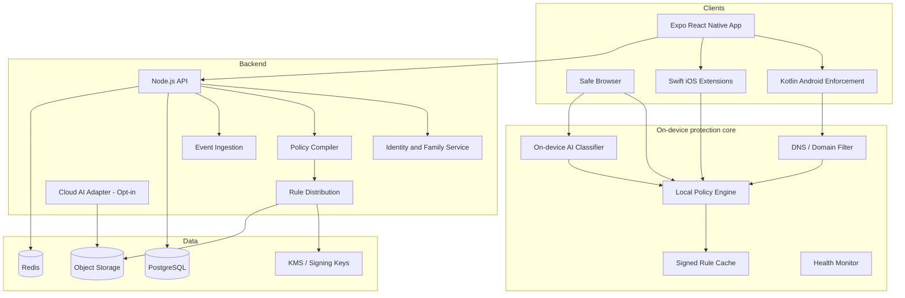
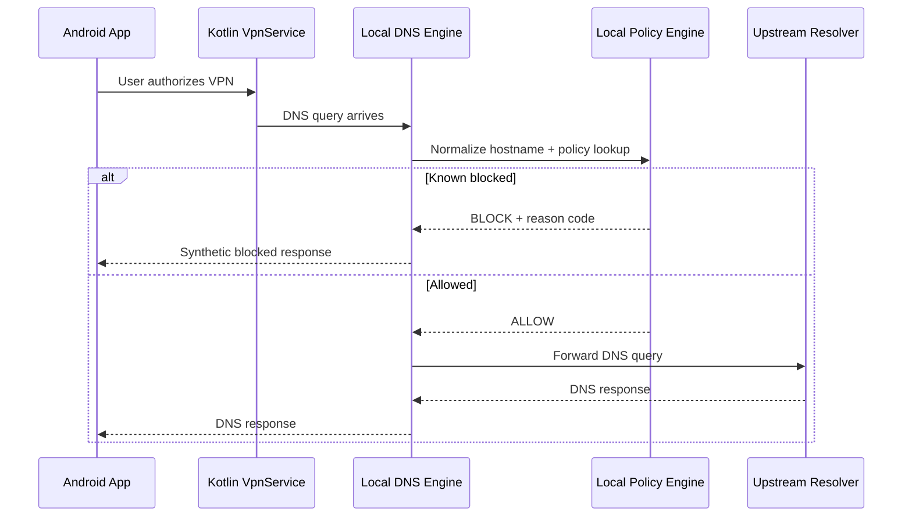
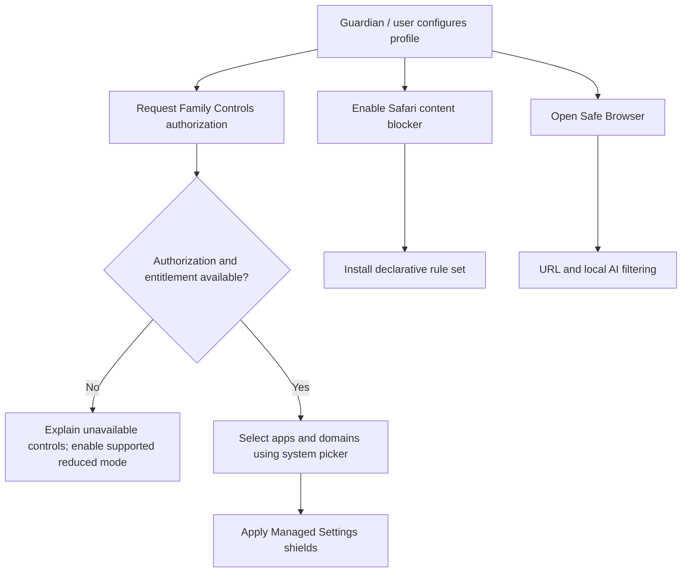
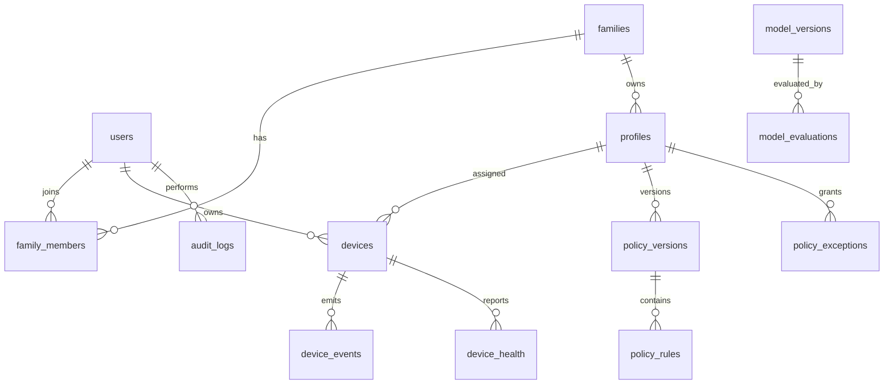

# Safe Internet Guardian — Complete Documentation Pack


---

# Safe Internet Guardian — Documentation Pack

**Version:** 1.0  
**Date:** 20 November 2026  
**Product:** Safe Internet Guardian (working name)  
**Platforms:** Android + iOS  
**Positioning:** AI-assisted internet safety, content filtering, and family protection.

## Pack contents

1. `01_PRODUCT_STRATEGY.md` — positioning, market, differentiation, business model, KPIs and go-to-market.
2. `02_PRD.md` — personas, requirements, journeys, acceptance criteria, scope and non-functional requirements.
3. `03_TRD.md` — implementation technology, APIs, filtering logic, AI pipeline, security, deployment and testing.
4. `04_SYSTEM_ARCHITECTURE.md` — components, data flows, platform-specific architecture and failure handling.
5. `05_DATABASE_DESIGN.md` — PostgreSQL schema, Redis/cache, event model, indexes, retention and migrations.
6. `06_IMPLEMENTATION_ROADMAP.md` — phased execution, epics, staffing, release gates, risks and definition of done.

## Finalized product decisions

| Decision | Final value |
|---|---|
| Platforms | Android + iOS |
| Enforcement | Strict, with safety-preserving exceptions and explicit guardian/user controls |
| Audience | Individuals, parents, children, families and students |
| Ad blocking | Maximum technically and policy-permitted blocking |
| AI | Hybrid on-device + cloud AI |
| Primary client | React Native + Expo |
| Native layer | Kotlin Android modules; Swift iOS extensions |
| Backend | TypeScript/Node.js modular monolith initially |
| Primary database | PostgreSQL |
| Cache / queue | Redis + managed queue |
| Hosting | Cloud-agnostic container platform |

## Important product truth: capability boundaries

This product must not be marketed as an invisible, universal filter that can inspect and block every item inside every third-party application. Mobile operating systems deliberately restrict that capability.

- **Android:** a user-approved `VpnService` can apply DNS/domain policy to network traffic and can support always-on VPN configuration. It does not automatically decrypt HTTPS, inspect every video frame, or reliably identify a specific video inside YouTube or a social app. Accessibility APIs must not be used as a covert general-purpose content interception mechanism.
- **iOS:** Family Controls / Managed Settings can shield selected apps and websites with the required entitlement and authorization. Safari extensions can block browser resources. Network Extension content filters are subject to capability, entitlement, deployment and review restrictions. These are not equivalent to unrestricted packet or screen inspection on every consumer device.
- **YouTube:** use official parental settings, Restricted Mode guidance, allowed-app policies, and a filtered browser experience where appropriate. Do not modify YouTube playback, suppress YouTube ads, or promise comprehensive filtering inside the official YouTube app.
- **Ads:** block known ad/tracker domains and browser page elements where supported. Some ads are first-party, server-side, or share domains with core content and cannot be reliably removed without breaking services. No guarantee of ad-free YouTube.
- **Strict mode:** strict means block known unsafe categories and apply configured app/site restrictions. Unknown or ambiguous items should use a conservative policy in managed child profiles, but never claim perfect classification. Provide a clear emergency recovery and guardian-controlled override.

## Suggested repository structure

```text
safe-internet-guardian/
  apps/
    mobile/                 # Expo React Native app
    guardian-web/           # Parent web console (later phase)
    safe-browser/           # Optional in-app browser shell
  native/
    android/                # Kotlin VpnService, boot, policy, usage modules
    ios/                    # Swift FamilyControls, ManagedSettings, extensions
  services/
    api/                    # Node.js/TypeScript API
    policy-engine/          # Deterministic policy evaluation
    classification/         # AI model adapters and moderation orchestration
    sync-worker/            # Rules, lists, device policy sync
  packages/
    contracts/              # Shared Zod/OpenAPI schemas
    policy-sdk/             # Shared policy types and test fixtures
    ui/                     # Shared design system
  infra/
    docker/
    terraform/
    observability/
  docs/
```

## External platform references

- Android VPN guide: https://developer.android.com/develop/connectivity/vpn
- Android `VpnService`: https://developer.android.com/reference/android/net/VpnService
- Google Play Accessibility API policy: https://support.google.com/googleplay/android-developer/answer/18265346
- Apple Family Controls: https://developer.apple.com/documentation/familycontrols
- Apple Network Extension: https://developer.apple.com/documentation/networkextension
- Apple content filter providers: https://developer.apple.com/documentation/networkextension/content-filter-providers
- Apple Safari web extensions: https://developer.apple.com/documentation/safariservices/safari-web-extensions
- Apple Safari content blocking: https://developer.apple.com/documentation/safariservices/creating-a-content-blocker
- Apple App Review Guidelines: https://developer.apple.com/app-store/review/guidelines/
- YouTube developer policies: https://developers.google.com/youtube/terms/developer-policies

This pack is an engineering/product specification, not legal advice. Obtain platform entitlement approval and jurisdiction-specific privacy/legal review before public launch.


---

# 01 — Product Strategy

## 1. Executive summary

Safe Internet Guardian is a cross-platform safety product that helps individuals and families reduce exposure to adult material, graphic violence, disturbing imagery, harmful search results, malicious sites, trackers and intrusive advertising.

The product combines:
1. Deterministic domain, DNS, URL and browser rules.
2. Search-safety configuration and supported browser filtering.
3. AI-assisted classification for content the product is technically allowed to inspect, especially content rendered in its own Safe Browser or explicitly submitted for analysis.
4. Family policy management, device status, reports and transparent overrides.
5. Platform-native controls rather than relying on unsupported screen scraping.

**Promise:** “A safer internet experience across supported browsers, networks and device controls.”  
**Do not promise:** “Every unsafe image or video is blocked in every app, 100% of the time.”

## 2. Vision and mission

**Vision:** Make safer digital experiences accessible to every family and individual without requiring them to become cybersecurity experts.

**Mission:** Provide understandable, privacy-first controls that reduce exposure to adult content, graphic violence, scams, trackers and unwanted ads across supported device surfaces.

## 3. Problem statement

People encounter unsafe material through more than intentionally visited websites:
- Search results, image search, thumbnails and recommendations.
- Social feeds, short-form video and shared links.
- Redirects, pop-ups, malvertising and notification spam.
- New domains that are not yet present in blocklists.
- Multiple devices and inconsistent parental settings.

Traditional domain blockers are useful but cannot inspect encrypted page content. App-specific parental controls are fragmented. AI classifiers can help but may be wrong, expensive or privacy-invasive if all content is uploaded to cloud services.

## 4. Target segments

### A. Parents / guardians
Need age-appropriate profiles, child-device enrollment, tamper-resistant configuration within platform rules, alerts, schedules, allowlists, and simple explanations.

### B. Individuals
Want to avoid adult content, graphic imagery, gambling/drug-related content, distracting sites or ads for personal values, focus or wellbeing reasons.

### C. Students / schools (future B2B)
Need managed policies, fleet status, category controls, audit trails, administrator roles and deployment support. School/enterprise deployments require separate legal, procurement and device-management design.

### D. Families
Need several profiles, multiple devices, shared rules, guardian approvals and consistent settings.

## 5. Jobs to be done

- “When a child opens an adult website, block it before the page loads and explain why.”
- “When a user searches for explicit terms, enable safe search and block known unsafe destinations.”
- “When a website displays known trackers or ad resources, block them where technically supported.”
- “When a family member opens a supported Safe Browser page with unsafe images or text, classify it and hide/block it according to policy.”
- “When protection is disabled, interrupted or outdated, tell the guardian clearly.”
- “When a legitimate educational or medical page is blocked, let the user request a review without exposing the child to the content.”

## 6. Product principles

1. **Honest coverage:** show which surfaces are protected and which are not.
2. **Privacy by default:** local decisions where possible; no routine upload of browsing history or images.
3. **Strict but recoverable:** enforce known unsafe rules, while providing guardian-controlled recovery for false positives and connectivity failures.
4. **Least privilege:** request only permissions necessary for a visible feature.
5. **No covert surveillance:** no hidden camera/microphone capture, keylogging, stealth screenshotting or secret message reading.
6. **Explainability:** every block has a category, source, timestamp and appeal route.
7. **Accessibility:** warnings should be understandable, multilingual-ready and screen-reader friendly.
8. **Platform-native:** use supported OS APIs and comply with store rules.

## 7. Differentiation

### Core differentiators
- Unified adult + graphic violence + disturbing-content policies.
- Family and personal modes within one product.
- Hybrid local/cloud AI with local-first privacy.
- One policy model mapped to different Android/iOS capabilities.
- Clear protection coverage dashboard and confidence indicators.
- False-positive review workflow and versioned policy rules.
- Ad/tracker protection integrated with content safety rather than marketed as an impossible universal ad remover.

### Defensible assets over time
- Curated, versioned domain/category intelligence.
- Evaluation datasets and model-quality metrics for permitted content.
- Low-latency local policy engine.
- Platform-specific enforcement reliability data.
- Trust, transparency and family workflow quality.

## 8. Product modes

| Mode | Default policy |
|---|---|
| Child — Strict | Adult, explicit sexual, graphic violence, gore, self-harm imagery, malicious domains blocked; unknown domains handled conservatively |
| Teen — Balanced | Adult and graphic content blocked; educational, news and health content allowed with category nuance |
| Personal Clean Internet | User-selected adult, violence, gambling, drugs, trackers and ad categories |
| Student / Focus | Safety categories plus optional distraction lists and schedules |
| Custom | Guardian/user configures categories, allowlists and schedules |

Modes are templates. The user/guardian must see and approve the exact policy before activation.

## 9. Scope and capability tiers

### Tier 1 — MVP, reliable and feasible
- Account and device enrollment.
- DNS/domain category filtering.
- Local allow/block lists.
- Protection status and VPN status.
- Safe Browser with URL filtering, SafeSearch guidance/enforcement where available, and page-level content checks within the browser.
- Adult, malware, phishing, trackers and known ad-domain categories.
- Android native VPN module.
- iOS Family Controls app/site shielding (entitlement dependent) and Safari content blocker.
- Family profiles and guardian PIN/approval.
- Block log with minimal metadata.
- Rule updates and offline cache.

### Tier 2 — AI and family depth
- On-device image/text classification in Safe Browser.
- OCR for visible page text within Safe Browser.
- User-initiated “check this image/page” analysis.
- More granular graphic-violence classifiers.
- Schedules, app category restrictions and device activity summaries using approved APIs.
- Cloud model fallback only with clear disclosure/consent and data minimization.

### Tier 3 — scale and organization
- Guardian web console.
- Multi-family subscriptions.
- School/organization console and managed deployment.
- Advanced policy groups, reporting, audit exports.
- Additional browser extensions where supported.
- Regional threat intelligence feeds.

### Explicit non-goals
- Inspecting or decrypting all HTTPS traffic.
- Guaranteeing full filtering inside every third-party app.
- Removing YouTube or other platform first-party/server-side ads.
- Circumventing app-store policies, OS restrictions, encryption or app security.
- Secretly monitoring private messages, calls, keystrokes or screenshots.
- Replacing emergency, medical, mental-health or law-enforcement services.

## 10. Competitive landscape

Study, benchmark and validate current capabilities/pricing rather than copying claims:
- Canopy — image/content filtering and parental controls.
- Qustodio — family controls, web filtering and activity management.
- Bark — online safety monitoring and alerts.
- NextDNS — DNS-level filtering and privacy controls.
- AdGuard — browser/network ad and tracker blocking.

Position against them on transparent cross-platform coverage, adult + graphic-violence focus, local-first AI and usability. Do not claim a feature is unique until a documented competitor audit confirms it.

## 11. Business model

Suggested initial consumer plans (validate with India and international willingness-to-pay research; prices are hypotheses, not market facts):

| Plan | Indicative price | Limits / value |
|---|---:|---|
| Free | ₹0 | 1 device, core DNS categories, basic Safe Browser |
| Personal | ₹99–149/month | 3 devices, custom categories, ad/tracker lists, reports |
| Family | ₹199–299/month | 5–10 devices, child profiles, guardian controls, schedules |
| Family Plus | ₹399–599/month | 10–15 devices, advanced AI quotas, extended history controls |
| School / Organization | Quote | Admin console, managed deployment, policy groups, support |

Annual plans may offer a discount. Never monetize by selling browsing histories, ad targeting based on sensitive categories, or child data.

### Cost controls
- DNS decisions should be local/cache-first.
- Cloud AI must have quotas, confidence thresholds and batch processing where appropriate.
- Keep image analysis local by default.
- Separate subscription entitlements from safety policy; core safety should not silently fail when billing expires.
- Use metered cloud inference only for explicitly eligible features.

## 12. Go-to-market

1. Start with Android beta in India; validate OEM behavior, VPN reliability and family onboarding.
2. Launch iOS with clearly scoped capabilities after entitlement approvals.
3. Publish an honest coverage matrix and privacy explainer.
4. Partner with parenting educators, schools and digital-wellbeing communities.
5. Offer family trial and transparent refund/support workflows.
6. Expand to organization/school offering only after consent, admin and compliance design is mature.

## 13. North-star metric and KPIs

**North-star:** Weekly Protected Device Days (WPDD): number of device-days where protection is active, policy is current, and enforcement health checks pass.

Supporting metrics:
- Activation: setup completion, VPN/Family Controls authorization, first successful block.
- Reliability: protection uptime, rule freshness, crash-free sessions, DNS decision latency.
- Quality: unsafe-domain block precision/recall, false-positive rate, appeal reversal rate.
- AI: per-category precision/recall, calibration, on-device inference latency, battery impact.
- Trust: privacy consent completion, data deletion completion, support response time.
- Business: free-to-paid conversion, churn, CAC, LTV, subscription renewal.
- Safety: percentage of child profiles with guardian ownership and recovery method configured.

Do not optimize for raw number of blocks; it can reward overblocking.

## 14. Key product risks

| Risk | Mitigation |
|---|---|
| False negatives | Layered lists, SafeSearch, browser AI, user reports, continuous evaluations |
| False positives | Educational/health allowlist, appeal/review, category-specific thresholds |
| OS restrictions | Native proof-of-capability spikes before feature commitments |
| VPN conflict | Detect existing VPN, explain one-VPN limitation, offer DNS profile alternatives where supported |
| Battery/network impact | Local cache, efficient DNS, no continuous screen capture |
| Privacy concerns | Data minimization, local processing, short retention, clear disclosures |
| Store rejection | Pre-review legal/policy checklist, only necessary permissions, entitlement approvals |
| Ad-block expectations | Clearly distinguish domain-level blocking from first-party/server-side ads |
| Child safety misuse | Guardian consent, transparent indicators, no stealth surveillance |

## 15. Strategic recommendation

Ship a credible **Safe Internet Protection Core** first: DNS/domain policy, Safe Browser, family setup, transparent status and block explanations. Add AI where the app can legitimately access content. This is a more trustworthy and technically defensible product than attempting universal content interception.


---

# 02 — Product Requirements Document (PRD)

## 1. Document control

- Product: Safe Internet Guardian
- Version: 1.0
- Platforms: Android and iOS
- Enforcement: Strict profile, configurable by guardian/user
- AI: Hybrid local + cloud
- Audience: Individuals and families

## 2. Product objective

Deliver a mobile application that helps users prevent access to known adult, explicit, graphic-violence, malicious and unwanted advertising/tracking destinations, with additional AI classification inside supported product-controlled surfaces.

### Success criteria for public beta
- User can complete onboarding and activate protection without support.
- A known blocked test domain is blocked consistently on supported network configurations.
- User can see protection health and the reason for a block.
- Guardian can create a child profile and apply a strict policy.
- Safe Browser can filter unsafe URLs and evaluate permitted page content.
- App clearly explains coverage limitations on each OS.
- No browsing content is uploaded by default for AI processing.

## 3. Personas

### Parent / Guardian
Needs to protect a child's device, control settings, review block events, approve exceptions and recover access.

### Child / Managed user
Needs a clear, non-shaming block page and a simple way to request access to a legitimate educational resource.

### Individual user
Needs personal content preferences, strict self-control settings and privacy.

### Organization administrator (future)
Needs managed policies, fleet status and auditability.

## 4. Core user journeys

### Journey A — Personal onboarding
1. Install app.
2. Review plain-language capability and privacy summary.
3. Create account or continue in local-only mode if MVP supports it.
4. Select Personal Clean Internet.
5. Select categories: adult, graphic violence, trackers, ads, malware, etc.
6. Review network filtering disclosure.
7. Grant OS permissions and VPN/extension authorization.
8. Run protection test.
9. See active/inactive status and limitations.

**Acceptance:** no permission is requested before its purpose is explained; user can decline optional AI/cloud processing.

### Journey B — Parent enrolls child
1. Parent creates family.
2. Parent selects Child Strict profile.
3. Parent invites/enrolls child device using one-time pairing code or QR.
4. Child/guardian completes platform authorization.
5. Guardian sets recovery PIN and trusted contacts.
6. App applies policy and confirms which controls are active.
7. Parent sees device health, policy version and minimal block summary.

**Acceptance:** guardian consent and OS authorization are recorded; no hidden installation or stealth mode.

### Journey C — Unsafe website blocked
1. User requests a URL.
2. DNS/domain engine checks local cache and policy.
3. If blocked, request is denied or browser navigation is stopped.
4. A block reason is shown where the product controls the browser.
5. Event is recorded with minimal data.
6. User can request review if allowed by profile.

**Acceptance:** known blocked test domains are blocked on supported network routes; no claim that DNS can inspect encrypted page content.

### Journey D — Unsafe page in Safe Browser
1. User opens a URL in Safe Browser.
2. URL/domain policy runs before navigation.
3. Page is loaded only if allowed by URL policy.
4. Browser extracts permitted text/image metadata from its own rendered page.
5. Local classifier evaluates content.
6. Strict policy blocks or masks the page if score exceeds category threshold.
7. User sees a generic category reason, not a graphic preview.

**Acceptance:** AI processing is confined to Safe Browser content or user-submitted content; remote upload requires explicit consent and a disclosed purpose.

### Journey E — Ad/tracker blocking
1. Browser or DNS layer sees a request to a known advertising/tracking domain.
2. Rule engine checks category and allowlist.
3. Request is blocked where the platform supports it.
4. If a required site resource is blocked accidentally, user can report a broken site.

**Acceptance:** never claim that all ads, especially first-party or server-side ads, are removable.

### Journey F — False-positive appeal
1. User taps “This site should be allowed” or guardian submits request.
2. App submits domain, category and optional reason; no page content by default.
3. Guardian approves, denies or adds temporary exception.
4. Exception is time-bound, scoped and audited.
5. Policy syncs to enrolled devices.

## 5. Functional requirements

Priority definitions: P0 = launch blocker; P1 = next release; P2 = later.

### Identity and family
- FR-001 (P0): support account creation, sign-in, sign-out and account deletion.
- FR-002 (P0): support local device profile before cloud account, if technically feasible.
- FR-003 (P0): create family and guardian role.
- FR-004 (P0): enroll device with short-lived pairing token.
- FR-005 (P0): support device rename, revoke and lost-device removal.
- FR-006 (P1): support multiple guardians and role permissions.
- FR-007 (P1): child profile and age band without collecting exact birth date unless required.

### Policy configuration
- FR-010 (P0): provide Child Strict, Teen Balanced and Personal Clean presets.
- FR-011 (P0): categories include adult/explicit, graphic violence/gore, self-harm imagery, malware/phishing, trackers, ad domains and user-selected categories.
- FR-012 (P0): support allowlist and blocklist with explicit precedence.
- FR-013 (P0): support policy versioning and rollback.
- FR-014 (P0): display enforcement coverage per platform.
- FR-015 (P1): schedule policies by day/time.
- FR-016 (P1): support temporary guardian-approved exceptions with expiry.

### Filtering
- FR-020 (P0): DNS/domain category filtering on Android through approved VPN service.
- FR-021 (P0): iOS-supported domain/app/site controls using approved Family Controls / Managed Settings and permitted network/content-blocking APIs.
- FR-022 (P0): Safe Browser URL and domain filtering.
- FR-023 (P0): enforce or guide SafeSearch settings on supported search engines/browser surfaces.
- FR-024 (P0): block known malware, phishing and adult domains.
- FR-025 (P0): cache rules for offline operation.
- FR-026 (P1): on-device text/image classification in Safe Browser.
- FR-027 (P1): user-initiated content check for supported images/pages.
- FR-028 (P1): category-specific confidence thresholds.
- FR-029 (P2): additional browser extensions and organization-level policies.

### Ads and privacy
- FR-030 (P0): block known ad/tracker domains where DNS/browser support permits.
- FR-031 (P0): explain first-party/server-side ad limitations.
- FR-032 (P0): no sale of browsing or sensitive-category data.
- FR-033 (P0): local-only AI default.
- FR-034 (P0): explicit opt-in before cloud content analysis.
- FR-035 (P0): user can disable optional diagnostic telemetry.
- FR-036 (P1): configurable retention and automatic deletion.

### Reporting and support
- FR-040 (P0): show current protection state: active, degraded, paused, permission required or unsupported.
- FR-041 (P0): show last policy sync and version.
- FR-042 (P0): show minimal block history (category, timestamp, surface, domain only where justified).
- FR-043 (P0): offer false-positive report.
- FR-044 (P1): show weekly safety summary.
- FR-045 (P1): guardian alerts for protection interruption, with opt-in.
- FR-046 (P1): support diagnostics export with sensitive data redacted.

## 6. Content taxonomy

| Category key | Meaning | Default Child Strict |
|---|---|---|
| `adult_explicit` | Pornography and explicit sexual content | Block |
| `adult_suggestive` | Strongly sexualized content | Block |
| `violence_graphic` | Gore, graphic injury, violent imagery | Block |
| `violence_non_graphic` | Non-graphic violence | Configurable |
| `self_harm_graphic` | Graphic self-harm depiction | Block |
| `self_harm_discussion` | Support, education, prevention discussion | Allow / contextual |
| `crime_graphic` | Graphic crime scene material | Block |
| `drugs_illicit` | Drug sale/use content | Configurable |
| `gambling` | Gambling destinations | Configurable |
| `malware_phishing` | Known malicious destinations | Block |
| `ads_trackers` | Known ad and tracking domains | Block |
| `unknown` | No reliable classification | Conservative by profile |

Taxonomy must distinguish graphic depictions from legitimate news, health, safety, education and prevention information.

## 7. Enforcement semantics

### Strict profile
- Known blocked domain/category: block.
- Known malware/phishing: block.
- Known adult and graphic-violence destination: block.
- Unknown domain: default policy configurable; child strict may block or show interstitial until guardian approval.
- AI confidence: use per-category threshold and calibrated model; uncertain classification should not automatically be treated as certainty.
- Safety/health/education allowlist: guardian-managed, auditable.
- Network service unavailable: display degraded state; do not falsely report protection active.

### Policy precedence
1. Platform/system safety restrictions and legal requirements.
2. Explicit guardian deny.
3. Explicit guardian allow (only if guardian role is authorized and category permits override).
4. Organization policy (if applicable).
5. Profile category rules.
6. Global threat-intelligence block.
7. Default allow/unknown handling.

A guardian allowlist must not override malware/phishing protection by default.

## 8. UX requirements

### Main dashboard
- Protection status and last health check.
- Active profile.
- Protected surfaces and limitations.
- Blocked today (count only; avoid sensational detail).
- Policy sync status.
- Quick actions: pause (guardian authenticated), test protection, manage categories.

### Block screen
- Calm, neutral language: “This page was blocked by your safety settings.”
- Category and brief explanation.
- “Ask parent/guardian” option for child profile.
- “Report a mistake” option for personal profile.
- No thumbnail, screenshot or explicit description of blocked content.

### Setup education
- Explain VPN indicator and one-VPN conflict.
- Explain which apps/sites are protected.
- Explain that YouTube official app filtering is limited.
- Explain that ad blocking is best-effort and not universal.
- Explain data processing before enabling cloud AI.

## 9. Non-functional requirements

| Area | Target |
|---|---|
| DNS policy lookup | p95 under 20 ms on-device cache hit |
| Remote rule sync | incremental, compressed, retry-safe |
| Availability | API target 99.9% monthly after GA |
| Mobile crash-free sessions | 99.5% beta target, 99.8% GA target |
| Battery | target under 3% incremental daily drain on reference devices; validate empirically |
| Offline | last-known rules continue to work |
| Security | TLS, encrypted secrets, signed policy bundles |
| Accessibility | WCAG-aligned web console; native screen-reader support |
| Localization | English first; architecture supports Indian languages |
| Privacy | data minimization, export/deletion, retention controls |
| Observability | no raw URLs or content in general application logs |

## 10. Analytics events

Permitted, minimized events:
- `onboarding_completed`
- `protection_enabled`
- `protection_degraded`
- `policy_sync_succeeded`
- `policy_sync_failed`
- `domain_blocked` (category and surface; domain only if required and disclosed)
- `false_positive_submitted`
- `guardian_approval_completed`
- `ai_local_classification_completed` (category/confidence band, not content)
- `cloud_ai_opt_in_used`

Do not record search terms, page text, screenshots, message contents or full browsing history as product analytics.

## 11. MVP release acceptance checklist

- [ ] Android VPN permission and lifecycle work across supported OS versions.
- [ ] iOS entitlements/capabilities approved for the selected release scope.
- [ ] Policy bundle signatures verified.
- [ ] Domain rules work over IPv4 and IPv6.
- [ ] DNS-over-HTTPS / private DNS limitations are explained and tested.
- [ ] Existing VPN conflict is detected and explained.
- [ ] Safe Browser blocks known adult and malware test domains.
- [ ] iOS Safari content blocker works after user enables extension.
- [ ] Family pairing and guardian recovery are tested.
- [ ] No content uploaded without explicit opt-in.
- [ ] Account deletion and retention deletion are tested.
- [ ] False-positive workflow works end-to-end.
- [ ] Store disclosures, privacy labels and policy declarations are reviewed.


---

# 03 — Technical Requirements Document (TRD)

## 1. Recommended technology stack

### Mobile
- React Native + Expo (development build / prebuild; not Expo Go for native enforcement).
- TypeScript for shared UI and domain logic.
- Expo Router for navigation.
- TanStack Query for server state.
- Zustand or Redux Toolkit for local UI state (choose one).
- Zod for runtime validation.
- Kotlin modules for Android enforcement.
- Swift modules/extensions for iOS enforcement.
- Native persistence: Room/SQLite on Android; SQLite/Core Data or App Group shared storage on iOS as appropriate.
- Secure storage: Android Keystore-backed storage; iOS Keychain.

### Backend
- Node.js LTS + TypeScript.
- NestJS or Fastify (choose one; recommended NestJS for modular domain boundaries).
- PostgreSQL as source of truth.
- Redis for cache, rate limits and short-lived jobs.
- Queue: managed SQS/PubSub/Cloud Tasks or BullMQ for early-stage deployments.
- Object storage for signed policy bundles/model artifacts only; do not store user browsing content.
- OpenAPI contract; generated client types.
- Terraform for infrastructure.
- OpenTelemetry + Sentry/Crashlytics for observability.

### AI
- On-device model runtime: TensorFlow Lite / LiteRT on Android; Core ML on iOS.
- Shared model export pipeline where feasible; platform-specific optimized models may differ.
- Cloud inference adapter: containerized model service or managed inference endpoint.
- Model registry with version, taxonomy, thresholds, evaluation metrics and rollback.
- OCR only inside Safe Browser or on user-submitted content with permission.

## 2. Architecture decisions

| Concern | Decision | Rationale |
|---|---|---|
| App architecture | Modular monorepo | Shared UI/contracts, native modules isolated |
| Backend style | Modular monolith first | Avoid premature microservices |
| Policy source | PostgreSQL + signed snapshots | Auditable and efficient sync |
| Local enforcement | Native modules | OS APIs require native integration |
| DNS filtering | Local policy cache + DNS proxy/resolver | Low latency and offline resilience |
| AI decisions | Local first, cloud opt-in fallback | Privacy and cost |
| Transport | HTTPS/TLS 1.2+; TLS 1.3 preferred | Secure APIs |
| Auth | OAuth/OIDC compatible, short-lived access tokens | Standard identity |
| Admin auth | MFA for guardian/admin | Protects family policies |

## 3. Android implementation

### 3.1 VPN service
Implement Kotlin `VpnService` with:
- `VpnService.prepare()` user authorization.
- Foreground service notification and clear service identity.
- IPv4 and IPv6 routes.
- DNS resolver/proxy path.
- Local domain policy cache.
- Per-app include/exclude lists only where supported and explicitly selected.
- Lifecycle recovery and `onRevoke()` cleanup.
- Network change handling.
- Battery and connectivity diagnostics.
- Optional always-on guidance through Android Settings.

Android's always-on/lockdown behavior is controlled by the OS and user/device-owner configuration. Do not claim the ordinary consumer app can silently force lockdown. Users may have only one active VPN service at a time.

### 3.2 DNS pipeline
1. Receive DNS request through configured VPN interface.
2. Parse DNS safely; reject malformed packets.
3. Normalize queried hostname (IDNA, lowercase, trailing dot handling).
4. Check local allow/deny override and threat lists.
5. Check cache.
6. Resolve category from signed local dataset.
7. Apply profile policy.
8. Return synthetic blocked response or forward to configured upstream resolver.
9. Record minimized event asynchronously.
10. Update counters without blocking packet processing.

Support UDP/TCP DNS. Test IPv6, fragmented packets, DNS retries, captive portals and network handoffs. Encrypted DNS may bypass the local DNS path unless the user/device has configured controls that prevent it; explain the limitation rather than covertly intercepting encrypted traffic.

### 3.3 Accessibility and usage APIs
Do not make AccessibilityService the primary content-filtering engine. If a future feature uses it, it must be narrowly scoped, user-visible, policy-compliant, disclosed in the Play listing and consented to. Never use it for covert screen scraping, credential capture, message reading or autonomous UI manipulation.

UsageStatsManager may support user-visible app usage summaries after the required user-granted access. Do not infer page content from app foreground state.

### 3.4 Safe Browser
Use Android WebView or a maintained browser engine strategy with:
- URL allow/block checks before navigation.
- SafeSearch settings and search URL handling.
- Resource request filtering where supported.
- Page text extraction within own browser only.
- Image URL/bitmap processing only for rendered page content and within privacy policy.
- On-device OCR/classifier.
- Interstitial block page.
- Safe download handling.
- Clear browsing data and private session option.

Do not build a browser that circumvents platform security or site access controls.

## 4. iOS implementation

### 4.1 Family Controls / Managed Settings
- Request Family Controls authorization in context.
- Obtain required entitlement and App Store approval before promising availability.
- Use FamilyActivityPicker and opaque application/domain tokens where appropriate.
- Apply ManagedSettings shields to selected apps/categories/domains.
- Use DeviceActivity for supported schedules/thresholds.
- Store policy state in shared App Group only when required by extensions.
- Provide guardian authorization flow for child devices and explain system prompts.

### 4.2 Safari content blocking
- Build Safari content blocker or Safari Web Extension.
- Ship precompiled declarative rules for known ad/tracker and unsafe resources.
- Update rule sets through app/extension-supported mechanisms.
- Do not expect the extension to inspect every full page dynamically; declarative blocking is designed around rules provided to Safari.
- User must enable the extension/content blocker in iOS settings.

### 4.3 Network Extension
Investigate the exact Network Extension capability and entitlement needed for the intended iOS content-filter configuration. Apple's content filter provider architecture separates a restricted data provider from a control provider. Approval and deployment conditions vary; perform an entitlement feasibility spike before implementation commitment.

Do not assume iOS exposes Android-equivalent packet-level DNS control for every consumer use case. If entitlement is unavailable, ship a reduced but useful feature set: Family Controls shields, Safari blocker, Safe Browser and supported DNS configuration options.

## 5. Policy engine

### Input
- Domain/URL or browser page classification result.
- Device platform and capability flags.
- Profile policy version.
- Category, confidence and source.
- Guardian overrides and expiry.
- Threat-intelligence severity.

### Output
`ALLOW | BLOCK | WARN | SHIELD_APP | REQUIRE_GUARDIAN | UNSUPPORTED`

### Deterministic evaluation
1. Validate input and normalize hostname.
2. Apply hard security deny (malware/phishing).
3. Apply explicit guardian deny.
4. Apply non-overridable safety policy.
5. Apply explicit guardian allow if category permits.
6. Apply category policy.
7. Apply confidence threshold and unknown handling.
8. Emit decision reason and policy version.

Every decision should have a stable `reason_code` and `policy_version`.

## 6. AI classification pipeline

### On-device
- Models downloaded as signed, versioned artifacts.
- Model metadata includes supported labels, input dimensions, calibration, minimum OS and checksum.
- Text/image preprocessing occurs locally.
- Inference returns category probabilities and model version.
- Apply policy thresholds locally.
- Do not persist raw image/text unless user explicitly saves a diagnostic sample.

### Cloud fallback
Allowed only when:
- User/guardian has explicitly opted in to the feature.
- The exact purpose and data type are disclosed.
- Content is minimized (crop/resize/metadata removal where appropriate).
- Transport is encrypted.
- Retention is zero or short and documented.
- Cloud provider contract prohibits training/secondary use.
- Child profile rules and applicable law permit the processing.

### Model taxonomy
- Adult explicit / suggestive.
- Graphic violence / gore.
- Self-harm graphic depiction.
- Non-graphic violence.
- Medical/educational context classifier.
- General unsafe image/text.
Use separate thresholds per category; do not collapse all into one “unsafe” probability.

### Model quality
- Maintain representative, legally sourced, appropriately licensed evaluation data.
- Measure precision, recall, F1, false-positive rate, false-negative rate and calibration per category.
- Evaluate across skin tones, image quality, language, age-appropriate medical material and news/education contexts.
- Human review process must be privacy-controlled and opt-in; do not collect children's content for training by default.
- Roll out via canary cohorts and rollback on regression.

## 7. Rule distribution

- Rules are authored/administered server-side.
- Compile into compact normalized domain/category records.
- Create immutable policy snapshot with `version`, `created_at`, `expires_at`, `checksum`.
- Sign snapshot using asymmetric signing key (private key in KMS/HSM).
- Client verifies signature and expiry before activation.
- Incremental updates are optional optimization; full snapshot remains recovery path.
- Cache last-known-good snapshot.
- Reject rollback to older version unless signed rollback authorization is present.
- Rule updates must be idempotent.

## 8. API design

Base path: `/v1`

### Auth / device
- `POST /auth/register`
- `POST /auth/login`
- `POST /families`
- `POST /families/{familyId}/invitations`
- `POST /devices/enroll`
- `POST /devices/{deviceId}/heartbeat`
- `DELETE /devices/{deviceId}`

### Policies
- `GET /devices/{deviceId}/policy`
- `GET /policy-snapshots/{version}`
- `POST /families/{familyId}/profiles`
- `PATCH /profiles/{profileId}`
- `POST /profiles/{profileId}/exceptions`
- `DELETE /exceptions/{exceptionId}`

### Events / review
- `POST /events/batch`
- `POST /block-reports`
- `GET /families/{familyId}/summary`
- `GET /devices/{deviceId}/health`

### AI
- `POST /ai/classify` — only for consented cloud path; payload limits and data retention controls.
- `GET /ai/models/manifest`
- `GET /ai/models/{modelVersion}` — signed artifact URL, authenticated and expiring.

### API requirements
- OpenAPI schema and generated TypeScript clients.
- Idempotency keys for enrollment, event batch and exception operations.
- Per-device and per-account rate limits.
- Request body size limits.
- Strict input validation.
- No raw URL query strings or page content in general logs.

## 9. Security requirements

- TLS everywhere; HSTS for web endpoints.
- Password hashing with Argon2id or managed identity provider.
- Short-lived access tokens and rotating refresh tokens.
- Device-bound keys stored in OS secure storage.
- Signed policy snapshots and model manifests.
- KMS-managed signing keys and rotation.
- Least-privilege service identities.
- RBAC for guardian/admin/support.
- MFA for guardian/admin where feasible.
- Audit logs for policy changes, guardian overrides and support access.
- Encrypt sensitive data at rest.
- Secrets never shipped in mobile app.
- Dependency scanning, SAST, DAST and mobile binary analysis.
- Rate limiting and abuse detection.
- Secure deep links and pairing tokens.
- No hidden bypass, stealth mode or remote control of device settings.

## 10. Privacy and compliance engineering

For India launch:
- Map personal data flows against the Digital Personal Data Protection Act, 2023 and applicable rules/notifications in force at launch.
- Determine when a child is a “child” under applicable law and implement verifiable parental consent where required.
- Provide clear notices, purpose limitation, data minimization, security safeguards, retention/deletion and grievance contact.
- Avoid behavioral advertising and sale of personal data.
- Conduct a data protection impact assessment before child-profile cloud features.
- Provide deletion/export workflows and vendor data-processing agreements.

For other markets, assess COPPA, GDPR/UK GDPR and local child-safety/privacy rules as applicable. Legal counsel must verify the current requirements.

## 11. Performance and resilience

- DNS hot path must not make cloud API calls.
- Use in-memory + persistent cache.
- Rule update runs in background and atomically swaps snapshot.
- AI inference must be asynchronous relative to DNS path.
- Safe Browser can show a neutral loading/interstitial state while page classification completes.
- On service crash, expose degraded state and attempt OS-compliant recovery.
- Do not silently fail open while claiming strict protection.
- Avoid a total internet lockout by providing a clearly documented guardian recovery route.
- Measure battery, memory, startup and network latency on low/mid-range Android devices and older supported iPhones.

## 12. Testing strategy

### Unit
- Domain normalization and IDNA.
- Policy precedence and exception expiry.
- DNS packet parsing.
- Category threshold logic.
- Signed snapshot verification.
- Data retention/deletion jobs.

### Integration
- Android VPN lifecycle and DNS routing.
- iOS Family Controls authorization/shields.
- Safari extension rule refresh.
- API auth, pairing, policy sync and event batching.
- Offline rule operation.

### Device matrix
- Android API levels supported at release; multiple OEMs and battery-management behaviors.
- iOS versions supported; child and individual authorization scenarios.
- Wi-Fi, cellular, IPv4, IPv6, captive portal, roaming, VPN conflict and Private DNS.
- Browser versions and SafeSearch settings.

### Security
- Threat model, penetration test, API fuzzing, packet parser fuzzing, token replay tests, policy tampering tests, storage inspection, TLS validation.

### AI
- Per-category test suite, adversarial transformations, image compression, multilingual text, benign medical/news/education samples, model drift and calibration.

### Store readiness
- Permission declarations.
- VPN disclosure and foreground notification.
- Accessibility API disclosure if used.
- Apple entitlements and App Review notes.
- Privacy labels / Data safety form.
- Child-directed design and parental consent review.


---

# 04 — System Architecture

## 1. Logical architecture



## 2. Deployment architecture

### Initial deployment: modular monolith
Deploy API, policy compiler and event ingestion as separate processes from one codebase, sharing domain modules and contracts. This preserves independent scaling without early microservice complexity.

Suggested environments:
- `dev`: developer sandbox and mock device clients.
- `staging`: production-like, synthetic test data only.
- `production`: isolated accounts, KMS, databases, object storage and monitoring.

### Components
1. **Mobile app:** onboarding, profile selection, policy UI, health, support.
2. **Native enforcement:** OS-specific VPN/shield/content-blocker integration.
3. **Safe Browser:** controlled browsing surface with page-level filtering.
4. **Local policy engine:** deterministic decisions and cached rules.
5. **API:** auth, families, devices, profiles, policy, exceptions and events.
6. **Policy compiler:** resolves profile + family + global threat rules into device snapshot.
7. **Rule distributor:** signed versioned policy bundles.
8. **AI service:** opt-in cloud classification and model manifest delivery.
9. **Admin console (later):** support, rule authoring, review and audit.

## 3. Android request flow



Notes:
- DNS/domain filtering is not HTTPS decryption.
- A domain allow decision does not mean its page content is safe.
- Safe Browser adds URL/page-level analysis for the browser it controls.
- App-level restrictions must use supported OS controls and user authorization.

## 4. iOS request / policy flow



The iOS feature matrix must be capability-gated at runtime. A feature unavailable due to entitlement, OS version or user choice must be shown as unavailable—not green/active.

## 5. Policy snapshot lifecycle

1. Guardian edits a profile.
2. API validates role and policy constraints.
3. Policy compiler merges family defaults, profile settings, exceptions and global security rules.
4. Snapshot is persisted with monotonically increasing version.
5. Snapshot is serialized and signed.
6. Device fetches snapshot using authenticated request.
7. Device verifies signature, schema version, checksum and expiry.
8. Device writes to staging storage and atomically activates.
9. Device reports version and health state.
10. Old snapshot retained locally for rollback if the new snapshot is invalid.

## 6. AI classification lifecycle

### Safe Browser
1. URL reputation and category check.
2. If allowed, load page in controlled browser.
3. Extract text and image candidates within the browser process.
4. Run on-device classifier.
5. Apply category threshold and context rules.
6. If blocked, replace page with a generic safety interstitial.
7. Store only category, confidence band, model version and policy version.

### Cloud fallback
1. Check explicit consent and eligibility.
2. Minimize content and strip metadata.
3. Send to isolated inference endpoint over TLS.
4. Return structured label/probability only.
5. Delete transient payload according to documented retention.
6. Log a privacy-safe inference event.

## 7. Network and data boundaries

- Mobile app communicates with API over HTTPS.
- Device enforcement must operate from signed local policy and not depend on a live API request for each DNS lookup.
- Policy signing private key stays in KMS/HSM.
- Device has public verification key pinned/rotatable through secure app update strategy.
- Cloud AI cannot access account browsing history unless separately authorized and necessary.
- Support staff cannot browse user history by default.
- Admin rule authoring and customer support are separated by RBAC.

## 8. Failure-state model

| Failure | Required behavior |
|---|---|
| API unavailable | Continue using last-known-good rules; show sync stale |
| Rule bundle invalid | Reject bundle, retain previous signed snapshot |
| VPN revoked | Mark protection inactive immediately; notify user |
| iOS entitlement missing | Offer reduced capability set and explain |
| AI model missing | Continue deterministic domain rules; mark AI layer unavailable |
| AI timeout | Apply profile fallback; do not block DNS path waiting for AI |
| DNS upstream down | Show network degraded; use configured secondary resolver if safe |
| VPN conflict | Explain only one active VPN slot and offer supported alternative |
| False positive | Submit minimal report; apply approved time-limited exception |
| Device offline | Use cached rules and queue minimal events |

## 9. Trust boundaries and threat model

Assets:
- Guardian credentials and family membership.
- Device enrollment keys.
- Policy snapshots and signing keys.
- Sensitive category preferences.
- Minimal safety events.
- Model artifacts and rule datasets.

Threats:
- Attacker enrolls unauthorized device.
- Child obtains guardian credentials.
- Malicious app attempts to spoof local policy state.
- Network attacker modifies policy bundle.
- Compromised admin account changes family rules.
- Malicious rule dataset blocks legitimate sites.
- Cloud AI vendor retains sensitive content.
- DNS parser is exploited with malformed packets.

Controls:
- Short-lived pairing tokens and one-time use.
- MFA / step-up guardian authentication.
- Signed snapshots and model manifests.
- Schema validation and strict parser limits.
- Admin audit trail and dual approval for global rules.
- Data minimization and vendor contract controls.
- Penetration testing and dependency scanning.

## 10. Architecture decisions to validate early

1. Android DNS implementation and OEM battery behavior.
2. Whether a reliable local DNS engine can support required IPv4/IPv6 traffic without routing all packets through a remote VPN.
3. iOS entitlement availability for planned network filtering.
4. Family Controls and Managed Settings behavior for target user/account types.
5. Safari extension distribution and rule-size/update limits.
6. AI model accuracy, runtime, battery and app size on low/mid-range devices.
7. Existing VPN and Private DNS conflict UX.
8. Google Play and App Store review treatment of exact feature disclosures.


---

# 05 — Database Design

## 1. Data principles

- PostgreSQL is the system of record.
- Store account/family/device/policy metadata and minimal safety events.
- Do not store raw page content, screenshots, search terms or full browsing history by default.
- Separate identity data from safety-event data where practical.
- Apply retention and deletion jobs.
- Use UUIDs for externally visible IDs.
- Store timestamps in UTC (`timestamptz`).
- Use soft deletion only where recovery/legal needs justify it; otherwise hard-delete personal data on verified deletion workflow.
- Encrypt sensitive fields and backups.

## 2. Entity relationship overview



## 3. PostgreSQL schema

Use migrations (Prisma, Drizzle or TypeORM; choose one). The following SQL is the canonical logical schema and can be adapted to the selected ORM.

```sql
CREATE EXTENSION IF NOT EXISTS pgcrypto;
CREATE EXTENSION IF NOT EXISTS citext;

CREATE TABLE users (
  id UUID PRIMARY KEY DEFAULT gen_random_uuid(),
  email CITEXT UNIQUE,
  phone_e164 TEXT UNIQUE,
  auth_subject TEXT UNIQUE,
  display_name TEXT,
  status TEXT NOT NULL DEFAULT 'active'
    CHECK (status IN ('active','pending_deletion','deleted','suspended')),
  locale TEXT NOT NULL DEFAULT 'en',
  created_at TIMESTAMPTZ NOT NULL DEFAULT now(),
  updated_at TIMESTAMPTZ NOT NULL DEFAULT now(),
  deleted_at TIMESTAMPTZ
);

CREATE TABLE families (
  id UUID PRIMARY KEY DEFAULT gen_random_uuid(),
  name TEXT NOT NULL,
  owner_user_id UUID NOT NULL REFERENCES users(id),
  region_code TEXT NOT NULL DEFAULT 'IN',
  subscription_status TEXT NOT NULL DEFAULT 'free',
  created_at TIMESTAMPTZ NOT NULL DEFAULT now(),
  updated_at TIMESTAMPTZ NOT NULL DEFAULT now()
);

CREATE TABLE family_members (
  id UUID PRIMARY KEY DEFAULT gen_random_uuid(),
  family_id UUID NOT NULL REFERENCES families(id) ON DELETE CASCADE,
  user_id UUID REFERENCES users(id) ON DELETE CASCADE,
  display_label TEXT,
  role TEXT NOT NULL CHECK (role IN ('guardian','adult_member','child_profile','admin')),
  consent_status TEXT NOT NULL DEFAULT 'pending'
    CHECK (consent_status IN ('pending','granted','denied','not_applicable','revoked')),
  consent_version TEXT,
  consented_at TIMESTAMPTZ,
  created_at TIMESTAMPTZ NOT NULL DEFAULT now(),
  UNIQUE (family_id, user_id)
);

CREATE TABLE profiles (
  id UUID PRIMARY KEY DEFAULT gen_random_uuid(),
  family_id UUID NOT NULL REFERENCES families(id) ON DELETE CASCADE,
  name TEXT NOT NULL,
  profile_type TEXT NOT NULL
    CHECK (profile_type IN ('child_strict','teen_balanced','personal_clean','student_focus','custom')),
  policy_mode TEXT NOT NULL DEFAULT 'strict'
    CHECK (policy_mode IN ('strict','balanced','custom')),
  unknown_domain_action TEXT NOT NULL DEFAULT 'warn'
    CHECK (unknown_domain_action IN ('allow','warn','block','require_guardian')),
  cloud_ai_enabled BOOLEAN NOT NULL DEFAULT false,
  is_active BOOLEAN NOT NULL DEFAULT true,
  created_at TIMESTAMPTZ NOT NULL DEFAULT now(),
  updated_at TIMESTAMPTZ NOT NULL DEFAULT now()
);

CREATE TABLE devices (
  id UUID PRIMARY KEY DEFAULT gen_random_uuid(),
  user_id UUID REFERENCES users(id),
  family_id UUID REFERENCES families(id) ON DELETE SET NULL,
  profile_id UUID REFERENCES profiles(id) ON DELETE SET NULL,
  device_name TEXT NOT NULL,
  platform TEXT NOT NULL CHECK (platform IN ('android','ios')),
  os_version TEXT,
  app_version TEXT,
  device_public_key TEXT,
  capability_flags JSONB NOT NULL DEFAULT '{}'::jsonb,
  protection_state TEXT NOT NULL DEFAULT 'not_configured'
    CHECK (protection_state IN ('active','degraded','paused','permission_required','unsupported','not_configured')),
  last_seen_at TIMESTAMPTZ,
  enrolled_at TIMESTAMPTZ NOT NULL DEFAULT now(),
  revoked_at TIMESTAMPTZ,
  created_at TIMESTAMPTZ NOT NULL DEFAULT now()
);

CREATE TABLE policy_versions (
  id UUID PRIMARY KEY DEFAULT gen_random_uuid(),
  profile_id UUID NOT NULL REFERENCES profiles(id) ON DELETE CASCADE,
  version BIGINT NOT NULL,
  schema_version INTEGER NOT NULL DEFAULT 1,
  snapshot_checksum TEXT NOT NULL,
  signature TEXT NOT NULL,
  object_key TEXT NOT NULL,
  status TEXT NOT NULL DEFAULT 'published'
    CHECK (status IN ('draft','published','revoked')),
  created_by UUID REFERENCES users(id),
  created_at TIMESTAMPTZ NOT NULL DEFAULT now(),
  UNIQUE(profile_id, version)
);

CREATE TABLE policy_rules (
  id UUID PRIMARY KEY DEFAULT gen_random_uuid(),
  policy_version_id UUID NOT NULL REFERENCES policy_versions(id) ON DELETE CASCADE,
  rule_type TEXT NOT NULL
    CHECK (rule_type IN ('domain_allow','domain_block','category','keyword','app_shield','schedule')),
  subject TEXT NOT NULL,
  category_key TEXT,
  action TEXT NOT NULL
    CHECK (action IN ('allow','block','warn','shield','require_guardian')),
  priority INTEGER NOT NULL DEFAULT 100,
  source TEXT NOT NULL DEFAULT 'profile'
    CHECK (source IN ('global_security','guardian','profile','user','threat_feed')),
  expires_at TIMESTAMPTZ,
  metadata JSONB NOT NULL DEFAULT '{}'::jsonb
);

CREATE TABLE policy_exceptions (
  id UUID PRIMARY KEY DEFAULT gen_random_uuid(),
  profile_id UUID NOT NULL REFERENCES profiles(id) ON DELETE CASCADE,
  domain TEXT NOT NULL,
  category_key TEXT,
  requested_by UUID REFERENCES users(id),
  approved_by UUID REFERENCES users(id),
  status TEXT NOT NULL DEFAULT 'pending'
    CHECK (status IN ('pending','approved','denied','expired','revoked')),
  reason TEXT,
  expires_at TIMESTAMPTZ,
  created_at TIMESTAMPTZ NOT NULL DEFAULT now(),
  decided_at TIMESTAMPTZ
);

CREATE TABLE device_health (
  id BIGSERIAL PRIMARY KEY,
  device_id UUID NOT NULL REFERENCES devices(id) ON DELETE CASCADE,
  protection_state TEXT NOT NULL,
  active_policy_version BIGINT,
  rule_sync_at TIMESTAMPTZ,
  vpn_or_filter_state TEXT,
  model_version TEXT,
  battery_impact_estimate NUMERIC(5,2),
  error_code TEXT,
  reported_at TIMESTAMPTZ NOT NULL DEFAULT now()
);

CREATE TABLE device_events (
  id BIGSERIAL PRIMARY KEY,
  event_uuid UUID NOT NULL UNIQUE,
  device_id UUID NOT NULL REFERENCES devices(id) ON DELETE CASCADE,
  event_type TEXT NOT NULL,
  category_key TEXT,
  surface TEXT CHECK (surface IN ('dns','safe_browser','safari_extension','app_shield','system','other')),
  domain_hash TEXT,
  domain_value TEXT,
  reason_code TEXT,
  confidence_band TEXT,
  policy_version BIGINT,
  model_version TEXT,
  occurred_at TIMESTAMPTZ NOT NULL,
  received_at TIMESTAMPTZ NOT NULL DEFAULT now(),
  metadata JSONB NOT NULL DEFAULT '{}'::jsonb
);

CREATE TABLE block_reports (
  id UUID PRIMARY KEY DEFAULT gen_random_uuid(),
  device_id UUID REFERENCES devices(id) ON DELETE SET NULL,
  profile_id UUID REFERENCES profiles(id) ON DELETE SET NULL,
  domain TEXT,
  category_key TEXT,
  reason TEXT,
  status TEXT NOT NULL DEFAULT 'open'
    CHECK (status IN ('open','reviewing','resolved','rejected')),
  resolution TEXT,
  created_at TIMESTAMPTZ NOT NULL DEFAULT now(),
  resolved_at TIMESTAMPTZ
);

CREATE TABLE model_versions (
  id UUID PRIMARY KEY DEFAULT gen_random_uuid(),
  model_key TEXT NOT NULL,
  version TEXT NOT NULL,
  platform TEXT NOT NULL CHECK (platform IN ('android','ios','cloud','shared')),
  artifact_key TEXT NOT NULL,
  checksum TEXT NOT NULL,
  signature TEXT NOT NULL,
  taxonomy_version TEXT NOT NULL,
  status TEXT NOT NULL CHECK (status IN ('draft','canary','active','deprecated','revoked')),
  created_at TIMESTAMPTZ NOT NULL DEFAULT now(),
  UNIQUE(model_key, version, platform)
);

CREATE TABLE model_evaluations (
  id UUID PRIMARY KEY DEFAULT gen_random_uuid(),
  model_version_id UUID NOT NULL REFERENCES model_versions(id) ON DELETE CASCADE,
  category_key TEXT NOT NULL,
  precision_score NUMERIC(6,5),
  recall_score NUMERIC(6,5),
  f1_score NUMERIC(6,5),
  false_positive_rate NUMERIC(6,5),
  false_negative_rate NUMERIC(6,5),
  evaluated_at TIMESTAMPTZ NOT NULL DEFAULT now(),
  dataset_version TEXT NOT NULL
);

CREATE TABLE audit_logs (
  id BIGSERIAL PRIMARY KEY,
  actor_user_id UUID REFERENCES users(id),
  family_id UUID REFERENCES families(id),
  action TEXT NOT NULL,
  target_type TEXT,
  target_id TEXT,
  ip_hash TEXT,
  metadata JSONB NOT NULL DEFAULT '{}'::jsonb,
  created_at TIMESTAMPTZ NOT NULL DEFAULT now()
);
```

## 4. Required indexes

```sql
CREATE INDEX idx_devices_family ON devices(family_id);
CREATE INDEX idx_devices_profile ON devices(profile_id);
CREATE INDEX idx_devices_last_seen ON devices(last_seen_at DESC);
CREATE INDEX idx_policy_versions_profile_version ON policy_versions(profile_id, version DESC);
CREATE INDEX idx_policy_rules_lookup ON policy_rules(policy_version_id, rule_type, subject);
CREATE INDEX idx_exceptions_profile_domain ON policy_exceptions(profile_id, domain, status);
CREATE INDEX idx_device_events_device_time ON device_events(device_id, occurred_at DESC);
CREATE INDEX idx_device_events_category_time ON device_events(category_key, occurred_at DESC);
CREATE INDEX idx_device_health_device_time ON device_health(device_id, reported_at DESC);
CREATE INDEX idx_audit_logs_family_time ON audit_logs(family_id, created_at DESC);
```

For high-volume events, partition `device_events` by month or use a time-series/event store once volume justifies it. Avoid indexing raw domain values if they are not retained.

## 5. Data retention

Suggested defaults, subject to legal review:
- Account/family/policy metadata: while account is active; delete/anonymize after verified deletion request and required legal retention.
- Device heartbeat: retain 30–90 days.
- Block event summaries: 7–30 days by default; guardian-configurable only where lawful.
- Raw cloud AI payload: no persistent storage; transient processing only.
- Support diagnostics: user-submitted, redacted and time-limited.
- Audit logs: risk-based retention, with restricted access.
- Backups: documented expiry and deletion propagation schedule.

## 6. Data not to collect by default

- Full browsing history.
- Search query text.
- Page HTML or screenshots.
- Messages, email, calls or keystrokes.
- Camera/microphone recordings.
- Exact child birth date if age band/guardian attestation is sufficient.
- Raw AI classification input.

## 7. Policy bundle format

Example compact JSON:

```json
{
  "schemaVersion": 1,
  "profileId": "uuid",
  "version": 42,
  "issuedAt": "2026-11-20T00:00:00Z",
  "expiresAt": "2026-12-20T00:00:00Z",
  "defaultAction": "warn",
  "categories": {
    "adult_explicit": "block",
    "violence_graphic": "block",
    "malware_phishing": "block",
    "ads_trackers": "block"
  },
  "domains": [
    {"host": "example.invalid", "action": "block", "category": "adult_explicit"}
  ],
  "overrides": [],
  "signature": "detached-signature"
}
```

Production implementation should use canonical serialization before signing, detached signatures, checksum verification and schema validation. The example domain is reserved and nonfunctional.

## 8. Migration and backup strategy

- Use sequential migration IDs and review SQL in pull requests.
- Back up PostgreSQL daily with point-in-time recovery.
- Encrypt backups and restrict restore permissions.
- Test restore quarterly.
- Use expand/contract migrations for zero-downtime deployment.
- Never put real child data in development/staging.
- Deletion jobs must cover primary DB, caches, object storage, analytics and vendor systems.


---

# 06 — Implementation Roadmap

## 1. Delivery strategy

Build in capability-verified phases. Do not start by building all UI screens and assuming the OS features will work. The first milestone is a native feasibility prototype on real devices.

Suggested timeline: 24–32 weeks for a credible cross-platform public beta with a small experienced team. This is a planning estimate, not a guarantee; entitlement review, AI quality and device fragmentation can extend it.

## 2. Workstreams

1. Product/UX and policy taxonomy.
2. Android native protection.
3. iOS entitlement and native controls.
4. Safe Browser.
5. Backend, identity, family and policy.
6. AI model evaluation and mobile inference.
7. Privacy, security and store readiness.
8. QA, device lab and support operations.

## 3. Phase plan

### Phase 0 — Feasibility and product definition (Weeks 1–3)
Deliverables:
- Final taxonomy and policy precedence.
- Android `VpnService` proof of concept with IPv4/IPv6 DNS handling.
- iOS Family Controls authorization and shield proof of concept.
- iOS Network Extension entitlement assessment.
- Safari content blocker prototype.
- Android OEM battery/background test.
- One-VPN conflict and Private DNS behavior matrix.
- AI model benchmark on representative mobile devices.
- Privacy data map and initial threat model.

Exit gate:
- Demonstrate real blocking on at least two Android devices.
- Demonstrate selected iOS controls using approved capabilities/entitlements available to the team.
- Document reduced-mode fallback for unavailable iOS capabilities.
- No unresolved assumption that depends on hidden screen scraping.

### Phase 1 — Core backend and app shell (Weeks 4–7)
Deliverables:
- Monorepo, CI/CD and environments.
- Expo app navigation and design system.
- Authentication and account deletion.
- Family, guardian and device enrollment.
- Policy editor and presets.
- PostgreSQL schema and migrations.
- Signed policy snapshot compiler.
- Device health and heartbeat.
- Privacy/consent screens.

Exit gate:
- End-to-end enrollment and policy sync works with a mock native enforcement client.
- API authorization and audit logs pass tests.

### Phase 2 — Android MVP enforcement (Weeks 8–12)
Deliverables:
- Kotlin `VpnService` foreground lifecycle.
- DNS parser/resolver and local cache.
- IPv4/IPv6 handling.
- Signed rule bundle verification.
- Domain allow/block/category evaluation.
- Protection state and recovery UX.
- Basic ad/tracker/malware/adult domain lists.
- Device test matrix and diagnostics.

Exit gate:
- Known test domains blocked across Wi-Fi and cellular on target devices.
- Service interruption shown as degraded/inactive.
- No unacceptable battery/network regressions.
- VPN permission and disclosures meet Play policy.

### Phase 3 — Safe Browser and browser safety (Weeks 11–16)
Deliverables:
- Android Safe Browser.
- URL normalization and pre-navigation checks.
- SafeSearch setup/enforcement guidance.
- Browser resource filtering where supported.
- Block page and false-positive request.
- Local text/image model integration prototype.
- Privacy-preserving browser storage controls.

Exit gate:
- Adult/malware test corpus blocked.
- Educational/medical/news false-positive set measured.
- Browser data clear and private session tested.

### Phase 4 — iOS supported protection (Weeks 13–19; parallel)
Deliverables:
- Family Controls authorization flow.
- Managed Settings shields for selected apps/categories/domains.
- DeviceActivity schedules where supported.
- Safari content blocker / extension.
- Shared policy model mapped to iOS capability flags.
- iOS Safe Browser.
- Network Extension integration only if entitlement and review path confirmed.

Exit gate:
- App accurately distinguishes active, partial and unavailable controls.
- Family authorization, revocation and recovery tested.
- Store review risk assessed before feature claims.

### Phase 5 — Hybrid AI and quality controls (Weeks 17–22)
Deliverables:
- On-device text/image classifiers for Safe Browser.
- Model manifest, checksum and signature.
- Per-category thresholds and confidence bands.
- Optional cloud inference with explicit opt-in.
- Model evaluation dashboard.
- Model rollback and staged rollout.
- Content minimization and retention controls.

Exit gate:
- Category-specific precision/recall targets agreed from test corpus.
- Cloud AI disabled by default.
- No raw user content in ordinary analytics/logs.
- Battery and latency measured on reference devices.

### Phase 6 — Family workflows and hardening (Weeks 21–26)
Deliverables:
- Multi-device family dashboard.
- Guardian approval and time-limited exceptions.
- Policy schedules.
- Protection interruption alerts.
- Weekly summary.
- Abuse/security review.
- Penetration test and privacy review.
- Store listings, policy disclosures and support docs.

Exit gate:
- Full onboarding-to-block-to-review journey passes.
- Account/device deletion validated.
- Critical security findings closed.
- Google Play and Apple submission checklist complete.

### Phase 7 — Closed beta, public beta and GA (Weeks 27–32)
Deliverables:
- Closed beta with 50–100 households/individual testers (target sample).
- OEM and network compatibility report.
- False-positive/false-negative review.
- Crash/battery/latency dashboards.
- Public beta release.
- Pricing experiment and support playbooks.
- GA decision report.

Exit gate:
- Reliability, quality, privacy and support metrics meet agreed thresholds.
- No unresolved critical safety or security issue.
- Coverage matrix published.

## 4. Team recommendation

Lean team:
- 1 product manager/founder.
- 1 product designer.
- 2 React Native engineers.
- 1 Android/Kotlin engineer with VPN/networking experience.
- 1 iOS/Swift engineer with Family Controls/Network Extension experience.
- 1 backend engineer (Node.js/PostgreSQL).
- 1 ML engineer (part-time initially, stronger involvement in Phase 5).
- 1 QA automation engineer.
- Privacy/security counsel as external specialist.

A solo founder can validate the concept and build a limited Android prototype, but should not promise a robust cross-platform production filter without specialist native engineering and security review.

## 5. Engineering epics and backlog

### Epic A — Identity and family
- Signup/login.
- Family creation.
- Guardian/member roles.
- Device pairing.
- Revocation and recovery.
- Account deletion.

### Epic B — Policy engine
- Taxonomy.
- Precedence.
- Presets.
- Exceptions and expiry.
- Versioning.
- Snapshot signing/verification.

### Epic C — Android enforcement
- VPN service.
- DNS parser and resolver.
- Cache.
- Rule matcher.
- Network lifecycle.
- Health state.
- Diagnostics.

### Epic D — iOS enforcement
- Family Controls authorization.
- App/domain shields.
- DeviceActivity.
- Safari content blocker.
- Entitlement handling.
- Reduced-mode capability map.

### Epic E — Safe Browser
- URL policy.
- SafeSearch.
- Resource blocking.
- Page text/image extraction.
- Local AI.
- Block interstitial.
- Clear data.

### Epic F — AI
- Dataset governance.
- Model selection/benchmark.
- Mobile conversion.
- Runtime integration.
- Threshold calibration.
- Cloud opt-in path.
- Model registry and rollback.

### Epic G — Ads and threat intelligence
- Curated domain feeds.
- Source attribution and license checks.
- Rule QA and expiry.
- False-positive reporting.
- Ad/tracker category policy.
- Site-breakage exception workflow.

### Epic H — Observability and compliance
- Health telemetry.
- Privacy-safe analytics.
- Audit logs.
- Data retention jobs.
- Consent records.
- Security testing.
- Store disclosures.

## 6. Release gates and target metrics

| Metric | Beta target | GA target |
|---|---:|---:|
| Crash-free sessions | ≥99.5% | ≥99.8% |
| Known blocked-domain test pass rate | ≥99% | ≥99.5% |
| Local policy cache hit latency p95 | ≤20 ms | ≤10 ms |
| Rule snapshot verification | 100% signed | 100% signed |
| False-positive rate | establish baseline; category targets required | category targets agreed and published internally |
| Protection health reporting | all supported states | all supported states |
| Data deletion tests | 100% pass | 100% pass |
| Critical security findings | 0 open | 0 open |

AI performance targets must be set after baseline evaluation. Do not invent an accuracy claim before testing; publish per-category metrics and limitations.

## 7. Key risks and mitigations

| Risk | Impact | Response |
|---|---|---|
| iOS entitlement denied/delayed | High | reduced-mode architecture; no dependency on unapproved entitlement |
| Android OEM kills service | High | foreground lifecycle, user education, OEM test lab, health monitoring |
| DNS bypass via encrypted DNS | Medium/high | document limits, supported configuration guidance, test bypass scenarios |
| VPN conflicts with other VPN apps | Medium | detect and explain; offer alternative mode |
| AI false positives | High | category thresholds, context handling, appeal, model rollback |
| AI misses visual content | High | domain rules + SafeSearch + browser layer; never promise perfection |
| YouTube ad blocking expectations | High | explicitly exclude first-party ad removal |
| Store policy rejection | High | narrow permission use, clear disclosures, early policy review |
| Child data compliance | High | privacy counsel, consent, data minimization and deletion |
| Excessive battery drain | Medium | local cache, profiling, no continuous screen capture |

## 8. Definition of done

A feature is done only when:
- Product acceptance criteria are met.
- Android and iOS capability differences are documented.
- Unit, integration and device tests pass.
- Permission and consent copy is approved.
- Logs do not expose sensitive browsing content.
- Failure and recovery states are implemented.
- Accessibility and localization basics are verified.
- Security review has no open critical/high issue.
- Analytics are privacy-reviewed.
- Support documentation and known limitations are published.

## 9. First 10 tasks to start development

1. Create monorepo and CI pipeline.
2. Build Android `VpnService` DNS-only proof of concept.
3. Build iOS Family Controls authorization + shield proof of concept.
4. Request/validate Apple entitlements early.
5. Create category taxonomy and policy precedence test fixtures.
6. Implement local policy engine as a pure, unit-tested module.
7. Implement signed policy snapshot format and verifier.
8. Build device capability matrix and setup UX.
9. Benchmark on-device image/text models on target phones.
10. Make a go/no-go decision on exact MVP scope before building the full UI.
