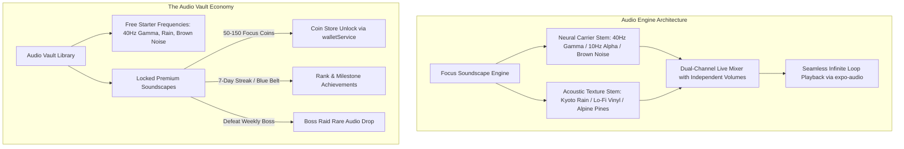
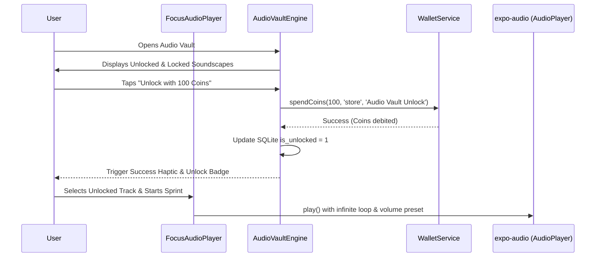

# NeuroNinja Focus Soundscapes & Audio Vault Engine
## Comprehensive Competitive Research & Master Implementation Plan

---

### Executive Vision: Turning Sound into a Dopamine Superconductor

Most Pomodoro and productivity apps include a rudimentary 10-second looping rain sound with harsh audio clipping and zero cognitive science. Meanwhile, market leaders like **Brain.fm** and **Endel** have proven that auditory stimulation directly modulates brainwave frequencies through **neural phase locking** and **binaural resonance**.

In NeuroNinja, we combine:
1. **Brain.fm's Neural Phase Locking**: 40Hz Gamma (Deep Logic / Code), 10Hz Alpha (Creative Ideation), 6Hz Theta (Insight / Rest), and 432Hz Harmonic Resonance.
2. **Endel & Calm's Spatial Soundscapes**: High-fidelity ambisonic field recordings (Kyoto Bamboo Rain, Alpine Pine Wind, Deep Ocean Surf).
3. **Noisli's Multi-Stem Mixer**: Simultaneous dual-channel layering (e.g., $70\%$ 40Hz Gamma Neural Carrier + $30\%$ Kyoto Rain Texture) with independent volume sliders.
4. **The Gamified Audio Vault Economy**: A high-tech audio armory where premium frequencies and secret cyber soundscapes start locked. Users unlock them through **Focus Coins**, **Ninja Belt promotions**, **Focus Streaks**, or **Boss Raid trophy drops**.



---

## 1. Global Competitor Benchmark Matrix

| Capability | Brain.fm | Endel | Calm / Headspace | Portal / Tide | **NeuroNinja Audio Vault** |
| :--- | :---: | :---: | :---: | :---: | :---: |
| **Neural Entrainment (40Hz / 10Hz)** | Yes (Patented) | Proprietary AI | No | Partial (Binaural) | **Yes (40Hz Gamma, 10Hz Alpha, 6Hz Theta, 432Hz)** |
| **Dual-Stem Multi-Track Mixer** | No | Automated only | No | No | **Yes (Independent Neural + Texture volume sliders)** |
| **Noise Colors Spectrum** | Brown only | Pink/White | White only | White/Pink/Brown | **Yes (ADHD Brown, Memory Pink, Masking White)** |
| **Audio Preview Snippets** | Subscription only | Subscription only | Subscription only | Subscription only | **Yes (Free 10-second snippet for all locked tracks)** |
| **Gamified Coin Unlock Economy** | No (Subscription) | No (Subscription) | No (Subscription) | No (Subscription) | **Yes (Earn coins from Pomodoros to unlock tracks)** |
| **Rank & Streak Exclusive Unlocks** | No | No | No | No | **Yes (Belt level & streak milestone soundscapes)** |
| **Boss Raid Loot Drop Tracks** | No | No | No | No | **Yes (Defeat Chronos/Villian to unlock rare tracks)** |
| **Timer Autostop & Break Sync** | Yes | Yes | No | Yes | **Yes (Pauses on break; resumes smoothly on focus)** |

---

## 2. Audio Vault Catalog & Unlock Criteria

The Audio Vault groups soundscapes into four specialized chambers:

### Chamber I: Neural Frequencies & Brainwave Carriers
Designed to synchronize neuronal oscillations (EEG entrainment):
- 🟢 **40Hz Gamma Neural Lock** *(Free / Starter)*: Induces high-frequency synaptic coordination for deep programming, math, and system design.
- 🔒 **10Hz Alpha Creative Resonance** *(Unlock: 100 Focus Coins)*: Stimulates occipital alpha waves for lateral ideation, writing, and flow state.
- 🔒 **6Hz Theta Deep Insight** *(Unlock: 120 Focus Coins)*: Hypnagogic twilight frequency for brainstorming complex problem breakthroughs.
- 🔒 **432Hz Sacred Fibonacci Sine** *(Unlock: 7-Day Focus Streak)*: Harmonic tone scientifically tuned to water resonance to eliminate somatic anxiety.
- 🔒 **Overclocked 40Hz Hyper-Gamma** *(Unlock: Blue Belt Rank - 4,000 XP)*: High-intensity neural phase lock for high-pressure sprint deadlines.

### Chamber II: Acoustic Nature Sanctuaries
High-fidelity ambisonic field recordings:
- 🟢 **Kyoto Cedar Bamboo Rain** *(Free / Starter)*: Binaural rainfall falling over temple cedar shingles.
- 🔒 **Alpine Pine Wind & Distant Birds** *(Unlock: 50 Focus Coins)*: Crisp mountain air rustling through evergreen needles.
- 🔒 **Deep Ocean Abyssal Surf** *(Unlock: 50 Focus Coins)*: Low-frequency rhythmic waves masking office conversational background noise.
- 🔒 **Highland Thunder & Meadow Downpour** *(Unlock: 80 Focus Coins)*: Distant rolling rumbles and heavy deluge.
- 🔒 **Hearthfire & Cedar Crackle** *(Unlock: 60 Focus Coins)*: Warm analog fireside warmth.

### Chamber III: Cyberpunk & Lo-Fi Chillhop
Downtempo rhythms with vinyl warmth:
- 🔒 **Cyber Shinjuku 3AM** *(Unlock: 75 Focus Coins)*: Slow 72 BPM vinyl chillhop with neo-Tokyo subway ambience.
- 🔒 **Neo-Akihabara Neon Rain** *(Unlock: 100 Focus Coins)*: Synthesizer tape loops paired with gentle rain.
- 🔒 **Cyberpunk Data Stream** *(Unlock: Defeat Daily Villain)*: Matrix ambient analog synth drone dropped after slaying a Villain.

### Chamber IV: Pure Acoustic Noise Colors
Full-spectrum sound filters:
- 🟢 **ADHD Brownian Deep Noise** *(Free / Starter)*: Steep 6dB/octave low-frequency roll-off; the #1 proven frequency for ADHD mind wandering.
- 🔒 **Calm Pink Noise** *(Unlock: 40 Focus Coins)*: Balanced 1/f spectral density for memory consolidation and sustained reading.
- 🔒 **Deep Cosmic Zero-G** *(Unlock: 60 Focus Coins)*: Sub-bass interstellar drone.

---

## 3. System Architecture & Technical Flow

### 3.1 Dual-Stem Mixer Engine
Rather than forcing the user to pick either a brainwave or a rain track, NeuroNinja's audio engine allows **simultaneous dual-track layering**:
1. **Stem A (Neural Carrier)**: 40Hz Gamma / 10Hz Alpha / Brown Noise / None.
2. **Stem B (Ambient Texture)**: Kyoto Rain / Lo-Fi Vinyl / Alpine Pines / None.
3. **Mix Ratio Slider**: Adjust the balance between cognitive carrier and atmospheric texture.



---

## 4. Implementation Steps & File Modifications

### Step 1: SQLite V8 Database Migration (`src/services/database/migrations.ts`)
Create table `audio_vault_tracks`:
```sql
CREATE TABLE IF NOT EXISTS audio_vault_tracks (
  track_id TEXT PRIMARY KEY,
  title TEXT NOT NULL,
  category TEXT NOT NULL, -- 'neural', 'nature', 'lofi', 'noise'
  frequency_hz TEXT,
  icon TEXT NOT NULL,
  description TEXT NOT NULL,
  asset_key TEXT NOT NULL,
  price_coins INTEGER NOT NULL DEFAULT 0,
  is_unlocked INTEGER NOT NULL DEFAULT 0,
  unlock_type TEXT NOT NULL DEFAULT 'coins', -- 'free', 'coins', 'streak', 'rank', 'boss'
  unlock_requirement TEXT, -- e.g. '7_day_streak', 'blue_belt', 'boss_chronos'
  unlocked_at TEXT
);
```
Seed all 16 curated soundscape profiles with starter unlocks and clear unlock criteria.

### Step 2: Audio Vault Service (`src/services/audio/audio-vault-engine.ts`)
- `getVaultTracks()`: Fetches all tracks grouped by category with current lock/unlock status.
- `unlockTrackWithCoins(trackId: string)`: Debits coins via `walletService.spendCoins` and sets `is_unlocked = 1`.
- `checkMilestoneUnlocks(userStreak: number, userBelt: string)`: Auto-unlocks milestone tracks when thresholds are met.
- `previewTrack(trackId: string)`: Plays a 10-second preview of locked tracks.

### Step 3: Audio Vault Modal & Collection UI (`src/components/focus/audio-vault-modal.tsx`)
- Cyberpunk dark vault interface (`#070A11`, `#0F1829`, `#00E699`, `#F59E0B`).
- Category tabs: `All`, `Neural 🧠`, `Nature 🌲`, `Lo-Fi 🎧`, `Noise 🌊`.
- Track cards showing:
  - Title, Frequency Badge (e.g., `40Hz Gamma`), Category Icon.
  - Locked Padlock Overlay with Price Chip (e.g., `🪙 100 Coins` or `🔥 7-Day Streak`).
  - Preview Play button with audio waveform indicator.
  - Interactive "Unlock with Coins" button triggering haptic fanfare.
- Header showing live user Focus Coin balance.

### Step 4: Upgraded Multi-Stem Audio Player (`src/components/focus-audio-player.tsx`)
- Integrate with `AudioVaultEngine` so users can choose from their unlocked sound library.
- Add "Audio Vault" button in the header with unlocked tracks count (e.g. `Vault (7/16)`).
- Dual-stem audio mixer with independent sliders for Neural Frequency and Nature Texture.
- Auto-stops audio when Pomodoro ends or is paused; auto-resumes when sprint begins.

### Step 5: Verification & Device Testing
- Run `npx tsc --noEmit` and `npx expo lint`.
- Build native Android bundle with `npx expo export -p android`.
- Compile debug APK with `gradlew assembleDebug`.
- Install onto connected Motorola Moto G62 5G via ADB.
- Test unlocking a track with Focus Coins, verify coin balance updates, and verify audio playback.

---

## 5. Acceptance Criteria & Definition of Done

1. **Audio Vault Persistence**: All tracks and unlock statuses are persisted in SQLite; unlocked tracks remain unlocked permanently.
2. **Coin Economy Transaction**: Unlocking a track deducts the exact coin cost and creates a `wallet_transactions` record.
3. **Milestone Unlocks**: 7-day streak or belt promotions automatically unlock milestone-gated tracks.
4. **Interactive Preview**: Tapping preview on any locked track plays a snippet to let the user sample before buying.
5. **Multi-Stem Mixing**: User can mix a neural carrier (e.g. 40Hz Gamma) with an ambient texture (e.g. Kyoto Rain).
6. **Code Standards**: 0 TypeScript errors (`npx tsc --noEmit`), 0 ESLint warnings (`npx expo lint`).
7. **Live Verification**: Installed and verified on Motorola Moto G62 5G with screenshots.
