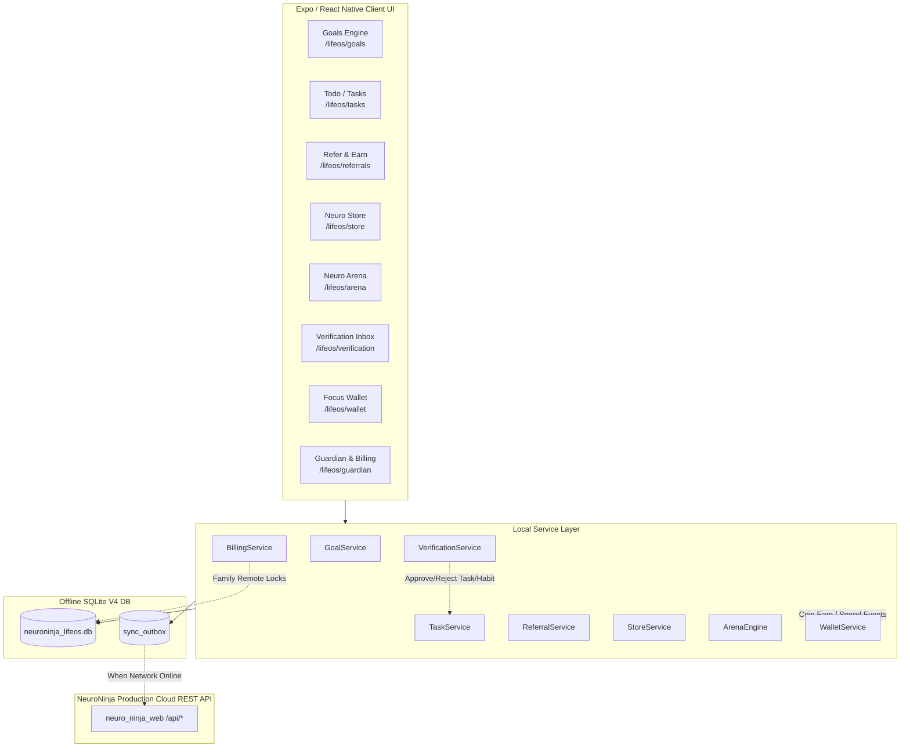
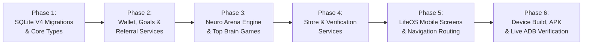

# NeuroNinja Master Implementation Plan: Goals, Todo, Refer & Earn, Neuro Store, Neuro Arena Games, Verification System, Wallet & Guardian Billing

---

## 1. Executive Summary & Competitor Benchmark Matrix

To transform **NeuroNinja** into an undisputed, industry-defining Mobile LifeOS and productivity powerhouse, this master plan architecturally integrates the 8 requested modules with native Android logic, offline-first SQLite synchronization, and high-fidelity Cyberpunk UI components (`#070A11`, `#0F1829`, `#00E699`, `#818CF8`, `#F59E0B`, `#EF4444`).

### Competitor Benchmark Analysis

| Module | Top Competitor Benchmarks | NeuroNinja High-Level Production Solution |
|---|---|---|
| **1. Goals** | **Strides, Notion Projects, Habitica** | Objective-Key-Result (OKR) architecture linking Short-Term & Long-Term goals directly to daily Tasks & Habits. Auto-calculates % completion dynamically from linked items or manual milestones with target date countdowns and coin bounties. |
| **2. Todo / Tasks** | **Things 3, Todoist, TickTick** | Quad-priority matrix (P1 Urgent/Red to P4 Low/Gray), subtask checklists, Pomodoro estimation, recurrence engines, tag filters, and **Social & Guardian Verification** (hold task in escrow until approved). |
| **3. Refer & Earn** | **Duolingo, Revolut, CRED** | Unique Ninja Referral Codes + 1-tap Android Native Share sheet. 4-tier visual milestone unlock ladder (1 friend: 100 coins; 3 friends: Pro Cyberpunk tier; 5 friends: Gold Ninja skin; 10 friends: Lifetime VIP). Anti-fraud qualification rules. |
| **4. Neuro Store** | **Forest, Habitica, Finch** | 3-Pillar Gamified Economy: **Digital Perks** (Themes, Soundscapes, Avatar Visors, Streak Freeze Shields), **Real-World Impact** (Tree planting, education meals, ocean plastic cleanup with live counters), and **Physical Goodies** (Hoodies, bottles, coin discount vouchers). |
| **5. Neuro Arena (Games)** | **Lumosity, Elevate, LinkedIn Games** | Full mobile port of 28 cognitive training games + Chess engine categorized into **Viral Logic** (Queens, Tango), **Speed & Reflex** (Crossclimb, MindSnap, Stroop), **Mental Math** (Math Blitz, Flash Anzan), and **Memory** (Pinpoint, Number Matrix). Real-time timer HUD, combo multipliers, difficulty scaling, and coin payouts. |
| **6. Verification System** | **Beeminder, StickK, StepBet** | Buddy / Parent / Mentor accountability network. Submissions include proof notes and camera photo attachments. Verifier Inbox with 1-tap Approve (releases escrow & awards coins/XP) or Reject (with feedback note). Push notification alert triggers. |
| **7. Wallet** | **CRED Coins, Revolut Vaults, Web3 Wallets** | Multi-asset financial card displaying **Focus Coins**, **Karma XP & Rank** (White Belt to Shadow Master), and **Pledged / Escrow Balance**. Comprehensive transaction ledger (Earned, Spent, Staked, Rewarded) with daily streak claim chest. |
| **8. Guardian & Billing** | **Apple Family Sharing, Qustodio, Opal Family** | 3-Tier Subscription System (Free Ninja, Pro Cyberpunk @ $4.99/mo, Guardian Family @ $9.99/mo). Parent-Child linkage via QR code/invite token, remote app blocker management, emergency unlock override requests, screen-time telemetry digests, and coupon redemption. |

---

## 2. System Architecture & Data Flow



---

## 3. Database Schema Migration (SQLite V4)

We will expand `src/services/database/migrations.ts` to `CURRENT_DB_VERSION = 4` with the following production tables:

```sql
-- 1. Goals Table
CREATE TABLE IF NOT EXISTS goals (
  goal_id TEXT PRIMARY KEY,
  title TEXT NOT NULL,
  description TEXT,
  type TEXT NOT NULL DEFAULT 'short-term', -- 'short-term' | 'long-term'
  category TEXT NOT NULL DEFAULT 'personal', -- 'career' | 'health' | 'relationships' | 'financial' | 'personal' | 'education'
  priority TEXT NOT NULL DEFAULT 'medium', -- 'low' | 'medium' | 'high'
  status TEXT NOT NULL DEFAULT 'in-progress', -- 'not-started' | 'in-progress' | 'completed' | 'paused'
  target_date TEXT,
  progress INTEGER NOT NULL DEFAULT 0, -- 0 - 100
  coin_reward INTEGER NOT NULL DEFAULT 100,
  xp_reward INTEGER NOT NULL DEFAULT 250,
  linked_tasks_json TEXT, -- JSON array of task_ids
  linked_habits_json TEXT, -- JSON array of habit_ids
  created_at TEXT NOT NULL,
  completed_at TEXT,
  sync_status TEXT NOT NULL DEFAULT 'pending'
);

-- 2. Referrals Table
CREATE TABLE IF NOT EXISTS referrals (
  referral_id TEXT PRIMARY KEY,
  referee_name TEXT,
  referee_email TEXT,
  referrer_code TEXT NOT NULL,
  status TEXT NOT NULL DEFAULT 'pending', -- 'pending' | 'qualified' | 'completed'
  coins_awarded INTEGER NOT NULL DEFAULT 0,
  xp_awarded INTEGER NOT NULL DEFAULT 0,
  invited_at TEXT NOT NULL,
  qualified_at TEXT,
  sync_status TEXT NOT NULL DEFAULT 'pending'
);

-- 3. Store Catalog & Orders
CREATE TABLE IF NOT EXISTS store_items (
  item_id TEXT PRIMARY KEY,
  title TEXT NOT NULL,
  subtitle TEXT,
  description TEXT,
  category TEXT NOT NULL, -- 'digital' | 'impact' | 'goodies'
  sub_category TEXT NOT NULL, -- 'themes' | 'soundscapes' | 'environment' | 'apparel' etc.
  coins_price INTEGER NOT NULL,
  xp_required INTEGER NOT NULL DEFAULT 0,
  image_url TEXT,
  badge_text TEXT,
  stock_quantity INTEGER NOT NULL DEFAULT -1, -- -1 = unlimited
  is_purchased INTEGER NOT NULL DEFAULT 0,
  impact_unit TEXT,
  impact_delivered INTEGER DEFAULT 0
);

CREATE TABLE IF NOT EXISTS store_orders (
  order_id TEXT PRIMARY KEY,
  item_id TEXT NOT NULL REFERENCES store_items(item_id),
  coins_spent INTEGER NOT NULL,
  status TEXT NOT NULL DEFAULT 'completed', -- 'completed' | 'processing' | 'shipped'
  shipping_address_json TEXT,
  ordered_at TEXT NOT NULL,
  sync_status TEXT NOT NULL DEFAULT 'pending'
);

-- 4. Focus Wallet & Transactions
CREATE TABLE IF NOT EXISTS wallet_balance (
  id INTEGER PRIMARY KEY CHECK (id = 1),
  coins INTEGER NOT NULL DEFAULT 500,
  karma_xp INTEGER NOT NULL DEFAULT 1200,
  escrow_coins INTEGER NOT NULL DEFAULT 0,
  streak_shields INTEGER NOT NULL DEFAULT 1,
  ninja_rank TEXT NOT NULL DEFAULT 'Green Belt',
  updated_at TEXT NOT NULL
);

CREATE TABLE IF NOT EXISTS wallet_transactions (
  tx_id TEXT PRIMARY KEY,
  type TEXT NOT NULL, -- 'earn' | 'spend' | 'stake' | 'release' | 'forfeit' | 'referral'
  amount INTEGER NOT NULL,
  balance_after INTEGER NOT NULL,
  category TEXT NOT NULL, -- 'habit' | 'task' | 'game' | 'store' | 'referral' | 'login'
  description TEXT NOT NULL,
  reference_id TEXT,
  created_at TEXT NOT NULL,
  sync_status TEXT NOT NULL DEFAULT 'pending'
);

-- 5. Brain Game Scores & Leaderboards
CREATE TABLE IF NOT EXISTS brain_game_scores (
  score_id TEXT PRIMARY KEY,
  game_slug TEXT NOT NULL, -- 'queens', 'tango', 'crossclimb', 'math_blitz', etc.
  score INTEGER NOT NULL,
  stars INTEGER NOT NULL DEFAULT 1,
  difficulty TEXT NOT NULL DEFAULT 'medium',
  duration_seconds INTEGER NOT NULL,
  coins_earned INTEGER NOT NULL,
  xp_earned INTEGER NOT NULL,
  played_at TEXT NOT NULL,
  sync_status TEXT NOT NULL DEFAULT 'pending'
);

-- 6. Guardian Links & Subscriptions
CREATE TABLE IF NOT EXISTS guardian_links (
  link_id TEXT PRIMARY KEY,
  guardian_name TEXT NOT NULL,
  guardian_email TEXT NOT NULL,
  role TEXT NOT NULL DEFAULT 'parent', -- 'parent' | 'child' | 'mentor'
  status TEXT NOT NULL DEFAULT 'active', -- 'pending' | 'active' | 'revoked'
  remote_lock_enabled INTEGER NOT NULL DEFAULT 1,
  daily_allowance_minutes INTEGER NOT NULL DEFAULT 120,
  created_at TEXT NOT NULL,
  sync_status TEXT NOT NULL DEFAULT 'pending'
);

CREATE TABLE IF NOT EXISTS subscriptions (
  id INTEGER PRIMARY KEY CHECK (id = 1),
  tier TEXT NOT NULL DEFAULT 'free', -- 'free' | 'pro' | 'guardian'
  status TEXT NOT NULL DEFAULT 'active',
  expires_at TEXT,
  auto_renew INTEGER NOT NULL DEFAULT 0,
  billing_cycle TEXT NOT NULL DEFAULT 'monthly', -- 'monthly' | 'yearly'
  amount_inr INTEGER NOT NULL DEFAULT 0,
  updated_at TEXT NOT NULL
);
```

---

## 4. Detailed Component & Module Specifications

### Module 1: Goals Engine (`/lifeos/goals`)
- **Visuals:** Radial progress circles, category chip filters, priority tags, countdown badges ("12d remaining").
- **Automatic Linking:** Calculates % progress dynamically based on completed linked tasks (`linked_tasks_json`) and habit checkins (`linked_habits_json`).
- **Milestones Drawer:** Breakdown of milestone steps with toggleable checkboxes.
- **Completion Burst:** Confetti animation + automatic credit of 100 Focus Coins & 250 Karma XP into Wallet.

### Module 2: Enhanced Todo / Tasks (`/lifeos/tasks`)
- **Tri-State / Checkbox Row:** Smooth checkoff animation with haptic pulse.
- **Priority Visuals:** Left color accent bar (P1 Crimson `#EF4444`, P2 Amber `#F59E0B`, P3 Neon Cyan `#38BDF8`, P4 Slate `#64748B`).
- **Subtask Checklist:** Collapsible nested checklist with fractional progress pill (e.g. `3/5 done`).
- **Pomodoro Linking:** 1-tap "Start Focus" opens Pomodoro timer bound to this specific task ID.
- **Accountability Verifier Selection:** Attach a Friend / Parent / Mentor. The task transitions to `pending_verification` upon completion, notifying the verifier.

### Module 3: Refer & Earn (`/lifeos/referrals`)
- **Personal Code Card:** Prominently displays user's unique referral code (`NINJA-9921`) with instant 1-tap Copy and Android Native Share button (`Share.share`).
- **Milestone Ladder:** Interactive visual progress path:
  - 1 Friend: 100 Coins + 200 XP
  - 3 Friends: 350 Coins + 1-Month Pro Cyberpunk Tier Free
  - 5 Friends: 1,000 Coins + Exclusive Neon Gold Ninja Visor Skin
  - 10 Friends: Lifetime Dojo VIP + Merch Voucher
- **Referred Buddies Feed:** Shows each invited friend with status badge (`Invited`, `Signed Up`, `Qualified (First Habit Complete)`).
- **Claim Rewards:** "Claim All" button that sweeps qualified rewards directly into the user's wallet.

### Module 4: Neuro Store (`/lifeos/store`)
- **Balance Header:** Live wallet coin & XP counter with quick top-up/history shortcut.
- **Category Tabs:**
  1. **Digital Perks:** Cyberpunk Themes (Obsidian Crimson, Solar Flare, Neon Matrix), App Visor Icons, Soundscape packs (Tokyo Rain, Deep Space Lo-Fi), Streak Shields.
  2. **Real-World Impact:** Plant a Tree (150 coins), 1 Day Nutrition Meal (300 coins), Ocean Plastic Rescue (200 coins) with live global community counters.
  3. **Goodies & Merch:** NeuroNinja Oversized Hoodie, Thermal Bottle, Sticker Sheet (coin discount codes generated for web store).
- **Purchase Modal:** Clean confirmation modal showing current balance, cost, balance remaining, and 1-tap "Confirm Unlock".

### Module 5: Neuro Arena (28 Brain Games + Chess) (`/lifeos/arena`)
- **Game Hub Grid:** Categorized by LinkedIn Viral, Speed & Reflex, Mental Math, and Memory.
- **Mobile Game Engine:**
  - **Queens:** Touch-friendly grid placement (Queen 👑, Dot ❌) with region color borders and conflict warning flashes.
  - **Tango:** Tap to cycle (Empty -> Sun ☀️ -> Moon 🌙) with real-time 3-in-a-row constraint validation.
  - **MindSnap / Stroop:** Word vs Color discordance speed test with microsecond timer.
  - **Math Blitz:** Rapid-fire arithmetic equations with numpad or multi-choice answers.
  - **Pinpoint:** 5 progressive clue deduction game with guess submission.
  - **Chess Tactics:** Interactive SVG/Canvas chess board with stock puzzles and Elo rating calculator.
- **Game Results Modal:** Victory splash showing Accuracy %, Time, Combo Score, Stars (1-3 ⭐), and Coin/XP reward payout.

### Module 6: Social & Guardian Verification (`/lifeos/verification`)
- **Dual Tab Interface:** `My Requests` (tasks/habits I need verified) and `Review Inbox` (requests sent to me by friends/children).
- **Proof Card:** Displays Habit/Task title, category badge, timestamp, completion note, and attached proof photo.
- **Action Buttons:** Large neon green "Approve & Payout" (`#00E699`) and crimson "Reject with Feedback" (`#EF4444`).
- **Automatic Escrow Payout:** Approving immediately unlocks coins from escrow and updates the sender's streak and stats.

### Module 7: Focus Wallet (`/lifeos/wallet`)
- **Cyberpunk Metallic Card:** Neon glowing card showcasing Total Focus Coins, Karma XP, Current Ninja Rank badge, and Streak Freeze Shields.
- **Daily Login Bonus Chest:** 24-hour claim button with spinning chest animation (+25 to +100 coins based on consecutive days).
- **Transaction Ledger:** Filter by All, Earned (Habits/Tasks/Games), Spent (Store), Staked (Challenges/Escrow).
- **Coin Earning Guide:** Interactive cheat-sheet showing exactly how to earn more coins (e.g. 25m Focus Session = 15 coins, Perfect Habit Day = 50 coins).

### Module 8: Guardian Oversight & Billing (`/lifeos/guardian` & `/lifeos/billing`)
- **Guardian Mode Dashboard:**
  - Active linked family members/children cards.
  - Daily screen time limit bars (e.g. `1h 45m / 2h 00m used`).
  - Remote App Lock toggle: Instantly lock distracting apps on child device.
  - Emergency Unlock requests inbox: 1-tap approve +15m or +30m grace period.
- **Billing & Subscriptions:**
  - 3-tier card carousel: Free Ninja, Pro Cyberpunk ($4.99/mo or ₹499/mo), Guardian Family ($9.99/mo or ₹999/mo).
  - Coupon Code redemption input with instant discount calculation.
  - Invoices & Billing history table with PDF receipt download simulation.

---

## 5. Step-by-Step Implementation Roadmap



### Phase 1: Database V4 Migrations & Core TypeScript Types
- Update `src/services/database/migrations.ts` to `CURRENT_DB_VERSION = 4`.
- Add table definitions for `goals`, `referrals`, `store_items`, `store_orders`, `wallet_balance`, `wallet_transactions`, `brain_game_scores`, `guardian_links`, and `subscriptions`.
- Create domain type files:
  - `src/services/goals/goal-types.ts`
  - `src/services/wallet/wallet-types.ts`
  - `src/services/store/store-types.ts`
  - `src/services/referral/referral-types.ts`
  - `src/services/games/game-types.ts`
  - `src/services/guardian/guardian-types.ts`

### Phase 2: Wallet, Goals, and Referral Services
- Implement `src/services/wallet/wallet-service.ts`:
  - `getBalance()`, `creditCoins(amount, category, description, refId)`, `spendCoins(amount, category, description)`, `pledgeEscrow(amount)`, `releaseEscrow(amount)`, `claimDailyBonus()`, `getTransactionHistory()`.
- Implement `src/services/goals/goal-service.ts`:
  - `createGoal()`, `getGoals()`, `updateGoalProgress()`, `linkTaskToGoal()`, `linkHabitToGoal()`, `completeGoal()`.
- Implement `src/services/referral/referral-service.ts`:
  - `getReferralProfile()`, `generateReferralCode()`, `recordReferralInvite()`, `claimReferralMilestone()`.

### Phase 3: Neuro Arena Engine & Core Brain Games
- Implement `src/services/games/arena-engine.ts`:
  - `getGameRegistry()`, `recordGameScore(slug, score, duration, difficulty)`, `getHighScores()`, `calculateReward(score, difficulty)`.
- Create mobile-optimized touch game components:
  - `QueensGame.tsx` (Region deduction grid)
  - `TangoGame.tsx` (Sun & Moon constraint grid)
  - `MindSnapGame.tsx` (Attention Stroop test)
  - `MathBlitzGame.tsx` (Rapid mental arithmetic)
  - `ChessTacticsGame.tsx` (Tactical puzzle board)
- Build unified `GameHUD.tsx` with timer countdown, combo multiplier, pause button, and score ticker.

### Phase 4: Neuro Store, Verification Engine & Guardian Services
- Implement `src/services/store/store-service.ts`:
  - Default seed catalog for digital perks, real-world impact, and merchandise.
  - `purchaseStoreItem(itemId, shippingAddress?)`, `getPurchasedItems()`, `getStoreOrders()`.
- Implement `src/services/guardian/guardian-service.ts`:
  - `getLinkedGuardians()`, `createInviteCode()`, `acceptGuardianLink()`, `setRemoteLockState()`, `requestEmergencyPass()`.
- Enhance `src/services/verification/verification-service.ts`:
  - Connect task and habit completions to wallet escrow releases upon approval.

### Phase 5: Mobile Screen Overhaul & Expo Router Navigation
- Build screens under `src/app/lifeos/`:
  - `src/app/lifeos/goals/index.tsx` (Goal dashboard with filters and OKR progress)
  - `src/app/lifeos/referrals/index.tsx` (Referral code, milestone ladder, buddies list)
  - `src/app/lifeos/store/index.tsx` (Tri-category store with instant buy modal)
  - `src/app/lifeos/arena/index.tsx` & `[slug].tsx` (Game selection & interactive game player)
  - `src/app/lifeos/wallet/index.tsx` (Cyberpunk balance card, streak chest, transactions)
  - `src/app/lifeos/guardian/index.tsx` (Parent dashboard, child screen time, remote lock)
  - `src/app/lifeos/billing/index.tsx` (Subscription plans carousel, coupon input, receipts)
- Update `src/app/(tabs)/lifeos.tsx` with quick-access cards leading to these new production routes.

### Phase 6: Build, Package & Live ADB Verification on Moto G62 5G
- Run TypeScript static typecheck (`npx tsc --noEmit`).
- Run Expo lint check (`npx expo lint`).
- Bundle JavaScript asset with `expo export:embed`.
- Build debug APK via `./gradlew assembleDebug`.
- Deploy APK to connected Moto G62 5G via `adb install -r`.
- Launch app, verify each new route and feature with real screenshots saved to artifacts.

---

## 6. Key Decisions & Open Questions for User Input

1. **Daily Login Bonus Strategy:**
   - Option A: Flat +50 coins every 24 hours.
   - Option B (Recommended): Escalating 7-day streak chest (+20 on Day 1 up to +150 + 1 Streak Shield on Day 7).
2. **Initial Brain Games Priority:**
   - We will launch with the top 5 flagship games (Queens, Tango, MindSnap, Math Blitz, Chess Tactics) with full 28-game registry architecture in place.
3. **Billing Gateway Integration:**
   - Option A (Recommended for immediate standalone testing): Interactive in-app billing manager with coupon codes, plan switching, and simulated Razorpay/Stripe checkout.
   - Option B: Full live Razorpay SDK keys binding.
