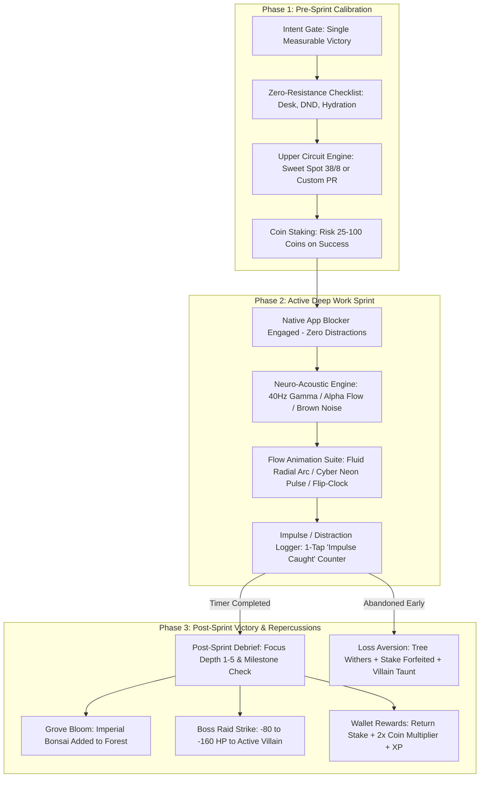

# NeuroNinja: The Undisputed #1 Pomodoro & Deep Work Engine
## Comprehensive Competitive Upgrade & Architectural Implementation Plan

---

### Executive Vision & Market Superiority

Most Pomodoro apps on the market are basic countdown timers with an egg icon. Even premium category leaders only master one dimension:
- **Forest / Flora**: Masters visual metaphor & loss aversion (trees wither), but lacks strict app locking, cognitive audio, and structured intent reflection.
- **Session (Apple Design Award)**: Masters the workflow (Intent setting, distraction tallying, reflection debrief), but lacks gamified RPG stakes, audio synthesizers, and living environments.
- **Endel / Brain.fm**: Masters neuro-acoustic frequencies (40Hz Gamma, binaural beats), but lacks task management and gamified loss stakes.
- **Flow**: Masters minimalist macOS/iOS fluid radial visual design, but lacks psychological friction against app opening.
- **Opal / Freedom**: Masters OS-level application blocking, but feels punitive rather than flow-inducing.

**NeuroNinja's Formula for Global #1**:
By fusing **Session's intentionality workflow**, **Forest's living grove & loss aversion**, **Flow's fluid radial animation & Zen HUD**, **Endel's neural entrainment soundscapes**, **Opal's native Android app shield**, and **NeuroNinja Web's proprietary Upper Circuit Engine (Sweet Spot & Focus Breaker PRs)**, we forge the most lethal productivity engine on any platform.

---

## 1. Competitive Feature Matrix

| Feature | Forest | Session | Flow | Endel | Opal | **NeuroNinja #1** |
| :--- | :---: | :---: | :---: | :---: | :---: | :---: |
| **Living Tree / Bonsai Growth** | Yes | No | No | No | No | **Yes (Focus Grove with Bonsai, Sakura, Cyber Crystal)** |
| **Withered Tree on Abandonment** | Yes | No | No | No | No | **Yes (Live SQLite ledger + Visual Graveyard)** |
| **Pre-Session Intent Gate** | No | Yes | No | No | No | **Yes ("What single milestone will you ship?")** |
| **In-Session Impulse / Distraction Logger** | No | Yes | No | No | No | **Yes (1-Tap "Impulse Caught" Dopamine Shield)** |
| **Post-Session Reflection & Debrief** | No | Yes | No | No | No | **Yes (Focus depth 1-5, reflection notes, tag tracking)** |
| **Fluid Animated Progress & Flip-Clock** | Partial | Partial | Yes | No | No | **Yes (SVG Arc + Haptic Dial + Minimal Zen HUD)** |
| **Real Neuro-Acoustic Binaural Generator** | No | No | No | Yes | No | **Yes (40Hz Gamma, Alpha 10Hz, Brown, Rain, Cyber Lo-Fi)** |
| **Native Android App Blocking** | No | No | No | No | Yes | **Yes (Native Accessibility/UsageStats AppBlockerService)** |
| **Upper Circuit Engine (Sweet Spot & PRs)** | No | No | No | No | No | **Yes (Algorithmically calibrated 75% fatigue ceiling)** |
| **Coin Staking & Loss Risk** | Paid only | No | No | No | No | **Yes (Stake coins; forfeited on quit, doubled on win)** |
| **Villain RPG Combat Integration** | No | No | No | No | No | **Yes (Deals -80 HP to active Daily/Weekly Bosses)** |
| **Chronotype Energy Heatmap** | No | Partial | No | No | No | **Yes (Hourly peak productivity matrix & analytics)** |

---

## 2. Deep Feature Architecture

### Feature 1: Pre-Sprint Intent & Zero-Resistance Launch Gate
- **Intent Input**: A prominent single-line prompt: *"What is the single victory you will ship in this block?"* (e.g., *"Finish SQLite migration script"*, *"Write Chapter 3 outline"*).
- **Subtasks / Micro-Checklist**: Option to add up to 3 quick micro-steps.
- **Zero-Resistance Protocol (from Web)**:
  - Clean & Ready Workspace 🧹
  - Phone on Do Not Disturb 🔕
  - Single Defined Victory 🎯
  - Hydration & Mindset Ready 💧
- **Coin Staking**: Optional wager (0, 10, 25, 50, 100 Focus Coins). Staking coins multiplies XP and rewards by $1.5\times$ to $2\times$, but quitting before $80\%$ completion forfeits the stake into the penalty burn pool.

### Feature 2: Upper Circuit Engine & Biological Sweet Spot
- **Attention Span Ceiling ($C$)**: Calibrated through Focus Breaker tests or user history (default: 50m).
- **Sweet Spot Formula**:
  $$\text{Work Duration} = \text{round}(C \times 0.75)$$
  $$\text{Restorative Break} = \max(5, \text{round}(\text{Work Duration} \times 0.20))$$
  $$\text{Long Break} = \max(10, \text{round}(\text{Work Duration} \times 0.40))$$
- **Preset Options**:
  - `upper_circuit`: Adaptive dynamic sweet spot (e.g. 38m work / 8m break).
  - `pomodoro`: Classic 25m work / 5m break.
  - `extended`: Deep 50m work / 10m break.
  - `sprint`: 15m blast / 3m break.
  - `breaker_pr`: Overdrive mode designed to push the user's ceiling to a new personal record.

### Feature 3: In-Sprint Impulse / Distraction Logger (Dopamine Shield)
- Inspired by Session's celebrated distraction tally, but upgraded with psychological neuro-tagging:
  - Floating pill on active timer: `⚡ Impulse Caught (0)`.
  - Tapping this pill creates an immediate mild haptic vibration and logs an impulse without breaking focus.
  - Quick popup options: *"Social media urge"*, *"Check email/chat"*, *"Random daydream"*, *"Hunger/Snack"*.
  - Stores distractions count per session in SQLite. Lower distraction counts yield a higher "Mindfulness Score" (+20% bonus XP for $\le 1$ distraction).

### Feature 4: Flow Animation Suite & Minimalist Zen HUD
- **3 Visual Clock Faces**:
  1. **Fluid Neon Arc (Flow style)**: React Native SVG circular progress bar with animated gradient stroke (`#00E699` to `#3B82F6`), pulsing ambient glow, and rotating indicator dot.
  2. **Cyber Flip-Clock**: Nostalgic mechanical flip-card digits with smooth split-fold animation.
  3. **Matrix Minimal Zen HUD**: Pitch black OLED mode showing only tabular glowing numerals with gentle breathing opacity, hiding all UI distractions.
- **Dial Scrubbing**: Smooth circular or slider gesture to adjust session minutes with haptic feedback ticks every minute.
- **Animated Bonsai Sprout**: Living SVG/Lottie bonsai in the center that subtly grows branches and leaves as remaining time decreases.

### Feature 5: Neuro-Acoustic Entrainment Audio Suite
- Embedded ambient and binaural frequency generator:
  - **40Hz Gamma Waves**: Scientifically proven for high-frequency cognitive processing and coding.
  - **10Hz Alpha Waves**: Stimulates calm creative flow state and deep reading.
  - **Brownian Noise (Brown Noise)**: ADHD focus mask, dampening internal mental chatter.
  - **Cyberpunk Rain / Lo-Fi Beats**: Curated focus tracks for late-night sessions.
- Auto-fades out smoothly when the sprint ends or is paused.

### Feature 6: Strict Deep Work Shield (Native App Blocker Integration)
- Connects directly to `src/services/native/app-blocker.ts`:
  - When timer starts: `AppBlockerService.startSession(minutes, ['com.instagram.android', 'com.tiktok.android', 'com.google.android.youtube', 'com.twitter.android'])`.
  - When timer ends or breaks: `AppBlockerService.endSession()`.
  - Live Shield badge in HUD showing status: `🛡️ SHIELD ARMED: 14 Distracting Apps Sealed`.

### Feature 7: Post-Sprint Reflection & Boss Raid Combat Strike
- **Debrief Flow**:
  1. **Victory Confirmation**: "Did you ship your intent?" (Yes / Partial / No).
  2. **Focus Depth Rating**: 1 to 5 Stars (🌟 Foggy $\to$ 🌟🌟🌟🌟🌟 God Mode).
  3. **RPG Boss Raid Damage**: Timer completion immediately calls `villainEngine.dealDamage('pomodoro', 80, intentText)` with screen shake animation.
  4. **Focus Grove Planting**: Spawns healthy Bonsai / Sakura in SQLite Grove.
  5. **Coin & XP Distribution**: Credits wallet via `walletService.creditCoins`.

### Feature 8: Chronotype Peak Focus Analytics
- SQLite table `deep_work_sessions` recording:
  - `start_time`, `end_time`, `duration_minutes`, `intent`, `intent_completed`, `focus_depth`, `distractions_count`, `withered`, `coins_earned`, `preset_type`.
- Analytics Dashboard:
  - **Hourly Focus Energy Heatmap**: Highlights peak focus hours (e.g. 9:00 AM - 11:30 AM).
  - **Distraction Reduction Curve**: Tracks impulse resistance over time.
  - **Attention Span Ceiling Growth**: Tracks weekly PR improvements.

---

## 3. Implementation Steps & File Modifications

### Step 1: Database Migration & Deep Work Service
- **Update `src/services/database/migrations.ts` (V7 Migration)**:
  - Create table `deep_work_sessions` and `upper_circuit_profile`.
- **Create `src/services/focus/deep-work-engine.ts`**:
  - Session lifecycle management (start, pause, log impulse, abandon, complete).
  - Sweet spot calculator & PR recorder ported and typed for React Native.
  - Native App Blocker orchestration.
  - Villain damage and Grove coordination.

### Step 2: Flow Animation Components
- **Create `src/components/focus/fluid-radial-timer.tsx`**:
  - `react-native-svg` based animated circular arc with smooth spring interpolation.
  - Cyberpunk gradient stroke (`#00E699` $\to$ `#3B82F6` $\to$ `#8B5CF6`).
  - Central pulsing focus orb / growing bonsai tree.
- **Create `src/components/focus/impulse-logger-modal.tsx`**:
  - Quick distraction capture sheet without interrupting timer countdown.
- **Create `src/components/focus/intent-launch-modal.tsx`**:
  - Pre-sprint setup: Intent prompt, Zero-Resistance checklist, Coin stake selector.
- **Create `src/components/focus/session-debrief-modal.tsx`**:
  - Post-sprint rating: Focus depth (1-5), Intent outcome, Boss damage recap.

### Step 3: Upgrade `src/app/focus/pomodoro.tsx`
- Complete overhaul into the #1 Focus Command Center:
  - Top Bar: Preset Switcher (Upper Circuit 38m, Classic 25m, Deep 50m, PR Test, Stopwatch).
  - Hero Area: Fluid Radial Arc / Flip-Clock / Zen Mode toggle.
  - Active Banner: Current Intent with live countdown & Distraction Counter badge.
  - Floating Action Button: Quick `⚡ Impulse Caught` trigger.
  - Bottom Suite: Neuro-Acoustic binaural sounds, Focus Grove preview, App Shield indicator.

### Step 4: Verification & Device Testing
- Run `npx tsc --noEmit` and `npx expo lint`.
- Build native Android bundle with `npx expo export -p android`.
- Compile debug APK with `gradlew assembleDebug`.
- Install onto connected Motorola Moto G62 5G via ADB.
- Test active timer, impulse logger modal, soundscape selection, completion debrief, and verify live database updates.
