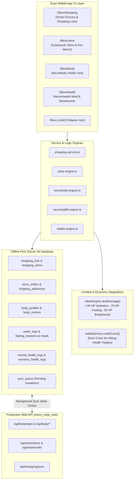

# NeuroNinja: Shopping, NeuroStore, NeuroBody & NeuroHealth Master Implementation Plan

> **Architectural Objective:** Transform the NeuroNinja mobile ecosystem into an industry-leading, unified productivity and somatic-cognitive vitality powerhouse. Bring all core web modules from `neuro_ninja_web` into the mobile app with full offline-first SQLite persistence, competitor parity (Whoop, Oura, MyFitnessPal, Zero Fasting, Flo, AnyList, Gymshark Store), native haptic pacing, gamified boss combat hooks, and seamless background cloud synchronization.

---

## 1. Competitor Analysis & Benchmarking

| Domain | Competitors Analyzed | Top Competitor Capabilities | NeuroNinja Competitive Parity & Differentiators |
| :--- | :--- | :--- | :--- |
| **NeuroHealth (Cognitive & Mental)** | **Whoop 4.0, Oura Ring Gen 3, Headspace, Calm, Huberman Lab** | - Recovery Score (0-100%)<br>- HRV Coherence breathing<br>- Stress (1-10) vs Strain radar<br>- Guided NSDR & sleep routines | - **Mental Wellness Hexagon Radar:** Stress, Anxiety, Energy, Motivation, Focus, Happiness.<br>- **Pacing Breathwork Engine:** Box Breathing (4-4-4-4), 4-7-8 Relaxation, Resonance (5-5 HRV Coherence) with haptic vibrations.<br>- **Binaural Meditation Timer:** Ambient soundscapes (Alpha 10Hz, Theta 6Hz, Gamma 40Hz).<br>- **Combat Hook:** Breathwork strikes `-60 HP` to the Daily Boss. |
| **NeuroBody (Metabolic & Physical)** | **MyFitnessPal, Zero Fasting, MacroFactor, Flo, Waterlogged** | - Circular fasting clock with metabolic bio-zones<br>- Macro targets (Protein, Carbs, Fats, Calories)<br>- Hydration tracker with quick presets<br>- Menstrual cycle, BBT, fertile window prediction | - **Metabolic Fasting Clock:** 6 biological metabolic zones (Digestion 0-4h, Insulin Drop 4-8h, Fat Burning 8-12h, Ketosis 12-16h, Autophagy 16-24h, Deep Cellular Renewal 24h+).<br>- **Macro Nutrient Rings:** Protein, Carbs, Fats with visual SVG progress arcs.<br>- **Consolidated Vitality Score:** 0-100 score composite (Hydration 20 + Fasting 20 + Nutrition 20 + Body Metrics 20 + Mindfulness 20).<br>- **Women's Health:** 4 cycle phases, flow intensity, 12 symptoms, 9 moods, pregnancy profiles. |
| **Smart Shopping & Grocery** | **AnyList, Bring!, Notion Groceries** | - Aisle categorization (Produce, Dairy, Pantry)<br>- Staple quick-add & smart presets<br>- Quantity and unit picker<br>- Cross-device offline list sharing | - **Aisle-Sorted Grocery Engine:** 10 aisle categories with auto-categorization.<br>- **Ninja Dietary Presets:** High-Protein Ninja, Keto Burn, Vegan Vitality, Weekly Essentials.<br>- **1-Tap Quick Staple Bar:** Most common items added instantly with quantity adjustment.<br>- **Full Offline Sync:** All lists and check-offs stored in SQLite with cloud sync. |
| **NeuroStore & Real Merch Marketplace** | **Gymshark, Whoop Store, Patagonia 1% for Planet** | - Real physical merchandise checkout<br>- Verified eco-impact donation causes<br>- Order fulfillment tracking (`pending` -> `delivered`)<br>- Gamified coin redemptions | - **Real Verified Causes:** Plant Living Trees (GPS coordinates + Eden Projects), Elder Care Meals (Akshaya Patra), Child Education Kits, Emergency Relief.<br>- **Physical Cyberpunk Merch:** Hoodies, Stainless Ninja Thermos, Holographic Stickers, Focus Caps with size & shipping address capture.<br>- **Digital Superpowers:** VIP Gold Badge, AI Nutrition Coach, Priority Cloud Vault.<br>- **Digital Impact Certificates:** Downloadable/shareable PDF/image certificates. |

---

## 2. System Architecture & Data Flow



---

## 3. Database Architecture (SQLite Migration V6)

To guarantee 100% offline functionality without network latency, SQLite database migration V6 will define the following production tables in `src/services/database/migrations.ts`:

### A. Shopping & Grocery Tables
```sql
CREATE TABLE IF NOT EXISTS shopping_lists (
  list_id TEXT PRIMARY KEY,
  name TEXT NOT NULL,
  created_at TEXT NOT NULL,
  updated_at TEXT NOT NULL,
  sync_status TEXT NOT NULL DEFAULT 'synced'
);

CREATE TABLE IF NOT EXISTS shopping_items (
  item_id TEXT PRIMARY KEY,
  list_id TEXT NOT NULL REFERENCES shopping_lists(list_id) ON DELETE CASCADE,
  name TEXT NOT NULL,
  category TEXT NOT NULL DEFAULT 'pantry',
  quantity REAL NOT NULL DEFAULT 1,
  unit TEXT NOT NULL DEFAULT 'pcs',
  is_checked INTEGER NOT NULL DEFAULT 0,
  notes TEXT,
  updated_at TEXT NOT NULL
);
CREATE INDEX IF NOT EXISTS idx_shopping_items_list ON shopping_items(list_id);
```

### B. NeuroStore & Merch Orders Tables
```sql
CREATE TABLE IF NOT EXISTS store_orders (
  order_id TEXT PRIMARY KEY,
  item_id TEXT NOT NULL,
  item_title TEXT NOT NULL,
  item_category TEXT NOT NULL, -- 'impact' | 'goodies' | 'digital'
  item_sub_category TEXT NOT NULL,
  item_image TEXT,
  quantity INTEGER NOT NULL DEFAULT 1,
  coins_spent INTEGER NOT NULL,
  status TEXT NOT NULL DEFAULT 'processing', -- 'pending' | 'processing' | 'shipped' | 'delivered'
  full_name TEXT,
  phone TEXT,
  address_line1 TEXT,
  address_line2 TEXT,
  city TEXT,
  state TEXT,
  postal_code TEXT,
  country TEXT DEFAULT 'India',
  selected_size TEXT,
  courier_name TEXT,
  tracking_number TEXT,
  certificate_id TEXT,
  ordered_at TEXT NOT NULL,
  sync_status TEXT NOT NULL DEFAULT 'pending'
);
```

### C. NeuroBody Tables (Hydration, Fasting, Meals, Metrics, Women's Health)
```sql
CREATE TABLE IF NOT EXISTS body_profiles (
  user_id TEXT PRIMARY KEY,
  gender TEXT DEFAULT 'male',
  age INTEGER,
  height_cm REAL,
  target_weight_kg REAL,
  default_water_target_ml INTEGER DEFAULT 3000,
  preferred_fasting_protocol TEXT DEFAULT '16:8',
  calorie_goal INTEGER DEFAULT 2000,
  protein_goal INTEGER DEFAULT 140,
  carbs_goal INTEGER DEFAULT 200,
  fats_goal INTEGER DEFAULT 65,
  activity_level TEXT DEFAULT 'moderately_active',
  updated_at TEXT NOT NULL
);

CREATE TABLE IF NOT EXISTS water_logs (
  log_id TEXT PRIMARY KEY,
  date TEXT NOT NULL UNIQUE, -- YYYY-MM-DD
  target_ml INTEGER NOT NULL,
  total_ml INTEGER NOT NULL DEFAULT 0,
  logs_json TEXT NOT NULL DEFAULT '[]', -- Array of { time, amountMl }
  updated_at TEXT NOT NULL
);

CREATE TABLE IF NOT EXISTS fasting_sessions (
  session_id TEXT PRIMARY KEY,
  protocol TEXT NOT NULL, -- '14:10' | '16:8' | '18:6' | '20:4' | '24:0' | 'custom'
  target_hours REAL NOT NULL,
  start_time TEXT NOT NULL,
  end_time TEXT,
  status TEXT NOT NULL DEFAULT 'active', -- 'active' | 'completed' | 'cancelled'
  mood TEXT,
  notes TEXT,
  created_at TEXT NOT NULL
);

CREATE TABLE IF NOT EXISTS meal_items (
  meal_id TEXT PRIMARY KEY,
  date TEXT NOT NULL, -- YYYY-MM-DD
  meal_type TEXT NOT NULL, -- 'breakfast' | 'lunch' | 'dinner' | 'snack' | 'pre_workout' | 'post_workout'
  name TEXT NOT NULL,
  calories INTEGER NOT NULL DEFAULT 0,
  protein REAL NOT NULL DEFAULT 0,
  carbs REAL NOT NULL DEFAULT 0,
  fats REAL NOT NULL DEFAULT 0,
  ingredients_json TEXT DEFAULT '[]',
  notes TEXT,
  created_at TEXT NOT NULL
);
CREATE INDEX IF NOT EXISTS idx_meal_items_date ON meal_items(date);

CREATE TABLE IF NOT EXISTS body_metrics (
  metric_id TEXT PRIMARY KEY,
  date TEXT NOT NULL UNIQUE, -- YYYY-MM-DD
  weight_kg REAL NOT NULL,
  height_cm REAL,
  waist_cm REAL,
  chest_cm REAL,
  hips_cm REAL,
  body_fat_percentage REAL,
  notes TEXT,
  created_at TEXT NOT NULL
);

CREATE TABLE IF NOT EXISTS womens_health_profiles (
  user_id TEXT PRIMARY KEY,
  mode TEXT NOT NULL DEFAULT 'cycle', -- 'cycle' | 'ttc' | 'pregnancy' | 'postpartum'
  average_cycle_length INTEGER DEFAULT 28,
  average_period_length INTEGER DEFAULT 5,
  last_period_start_date TEXT,
  is_irregular INTEGER DEFAULT 0,
  pregnancy_profile_json TEXT,
  updated_at TEXT NOT NULL
);

CREATE TABLE IF NOT EXISTS womens_health_logs (
  log_id TEXT PRIMARY KEY,
  date TEXT NOT NULL UNIQUE, -- YYYY-MM-DD
  is_period_start INTEGER DEFAULT 0,
  is_period_end INTEGER DEFAULT 0,
  flow_level TEXT, -- 'spotting' | 'light' | 'medium' | 'heavy'
  symptoms_json TEXT DEFAULT '[]',
  moods_json TEXT DEFAULT '[]',
  bbt_celsius REAL,
  cervical_mucus TEXT,
  notes TEXT,
  created_at TEXT NOT NULL
);
```

### D. NeuroHealth Tables (Mental Health & Breathwork)
```sql
CREATE TABLE IF NOT EXISTS mental_health_logs (
  log_id TEXT PRIMARY KEY,
  date TEXT NOT NULL UNIQUE, -- YYYY-MM-DD
  mood TEXT NOT NULL, -- 'great' | 'good' | 'okay' | 'bad' | 'terrible'
  mood_score INTEGER NOT NULL, -- 1 to 5
  stress INTEGER NOT NULL DEFAULT 5, -- 1-10
  anxiety INTEGER NOT NULL DEFAULT 5, -- 1-10
  energy INTEGER NOT NULL DEFAULT 5, -- 1-10
  motivation INTEGER NOT NULL DEFAULT 5, -- 1-10
  focus INTEGER NOT NULL DEFAULT 5, -- 1-10
  happiness INTEGER NOT NULL DEFAULT 5, -- 1-10
  tags_json TEXT DEFAULT '[]',
  journal_text TEXT,
  gratitude_json TEXT DEFAULT '[]',
  created_at TEXT NOT NULL
);
```

---

## 4. Phase-by-Phase Implementation Roadmap

### Phase 1: Database Migration V6 & Domain Models
- Update `src/services/database/migrations.ts` to `CURRENT_DB_VERSION = 6`.
- Add SQL migration script defining the 10 new tables.
- Create TypeScript types matching `neuro_ninja_web/lib/types/body.ts` and `neuro_ninja_web/lib/store.ts`.

### Phase 2: Service Engines
1. **`src/services/shopping/shopping-service.ts`:**
   - Multi-list CRUD, aisle classification (Produce, Protein, Dairy, Pantry, etc.).
   - Preset loader (High-Protein, Keto, Vegan, Weekly Essentials).
   - Quick staple lookup and check-off progress.
2. **`src/services/store/store-engine.ts`:**
   - Unified catalog matching `neuro_ninja_web` (Plant Trees, Elder Meals, Hoodies, Thermos, VIP Perks).
   - Order submission with physical shipping form & size picker.
   - Coin balance check and deduction via `walletService`.
   - Order history and impact certificate retrieval.
3. **`src/services/body/neurobody-engine.ts`:**
   - Hydration: Add water intake (+250ml, +500ml, +750ml, custom), calculate daily streak.
   - Fasting: Start/stop fasts, elapsed timer, 6 metabolic bio-stages (Digestion, Insulin Drop, Fat Burning, Ketosis, Autophagy, Deep Renewal).
   - Nutrition: Meal logging with macros, daily calorie/protein/carb/fat totals.
   - Metrics: Weight and circumference logging, BMI calculation, and trend history.
   - Women's Health: Cycle day calculation, phase prediction (Menstrual, Follicular, Ovulation, Luteal), fertile window, symptom & mood logging.
4. **`src/services/health/neurohealth-engine.ts`:**
   - Daily mental health check-in (mood rating, 6 wellness scores, tags, gratitude, journal).
   - Breathwork pacing timers: Box (4-4-4-4), 4-7-8, Resonance (5-5) with tactile haptics.
   - Binaural meditation timer with background soundscapes.
5. **`src/services/body/vitality-engine.ts`:**
   - Calculates real-time 0-100 Vitality Score:
     $$\text{Vitality Score} = \text{Hydration (20)} + \text{Fasting (20)} + \text{Nutrition (20)} + \text{Bodycare (20)} + \text{Mindfulness (20)}$$

### Phase 3: Gamified Boss Arena Hooks
- Drinking water (reaching target): `villainEngine.dealDamage('habit', 40, 'Hydration Target Achieved')` + 30 Coins.
- Completing 16h fast: `villainEngine.dealDamage('habit', 70, '16h Intermittent Fast')` + 50 Coins.
- Logging daily meals & hitting protein target: `villainEngine.dealDamage('habit', 50, 'Protein Goal Met')` + 40 Coins.
- Completing guided breathwork (10 min session): `villainEngine.dealDamage('habit', 60, 'Navy SEAL Box Breathing')` + 50 Coins.

### Phase 4: UI Screens & Routes (Cyberpunk Theme)
1. **`/lifeos/shopping/index.tsx` (Smart Shopping & Grocery):**
   - Active list header, progress ring (`X/Y Items Checked`).
   - Aisle tabs (`All`, `Produce`, `Protein`, `Dairy`, `Pantry`, `Household`).
   - Quick-add staple bar (`+ Milk`, `+ Eggs`, `+ Oats`, `+ Apples`, `+ Chicken`).
   - Preset importer modal (High-Protein, Keto, Vegan).
   - Multi-list switcher modal (+ Create New List).
2. **`/lifeos/store/index.tsx` (Revamped NeuroStore & Merch):**
   - Category selector (`All`, `Impact Causes 🌱`, `Merch & Gear 🛍️`, `Digital Perks ⚡`, `My Orders 📦`).
   - Item cards with image, badge, coin price, and stock indicator.
   - Multi-step checkout modal: Size selection, Shipping address form (Name, Address, City, Postal Code, Phone).
   - Order history tab with live status badges (`Processing`, `Shipped`, `Delivered`) and impact certificates.
3. **`/lifeos/body/index.tsx` (NeuroBody Hub):**
   - Vitality Score card (0-100 gauge with 5 sub-pillar progress bars).
   - Hydration widget: Circular progress, quick log buttons (+250ml, +500ml, +750ml).
   - Fasting widget: Live ticking clock, metabolic stage pill (`🔥 Ketosis Zone`, `🧬 Autophagy`).
   - Macro summary: Rings for Calories, Protein, Carbs, Fats.
   - Body Metrics & BMI card with weight trend chart.
   - Women's Health card: Cycle day, predicted phase, and symptom quick-picker.
4. **`/lifeos/health/index.tsx` (NeuroHealth Mind Hub):**
   - Daily Check-in card: Mood emoji selector, 6 wellness sliders (1-10).
   - Guided Breathwork player: Animated pulsating circle with breathing phases (`Inhale 4s` -> `Hold 4s` -> `Exhale 4s` -> `Rest 4s`) and synchronized vibration patterns.
   - Meditation Timer: 5m / 10m / 15m / 20m presets with sound toggle.
   - Gratitude & Micro-journaling inputs.
5. **LifeOS Master Hub (`src/app/(tabs)/lifeos.tsx`):**
   - Add direct entry cards for **Smart Shopping**, **NeuroStore**, **NeuroBody Vitality**, and **NeuroHealth Mind**.

### Phase 5: Cloud Synchronization Adapter
- Wire up `src/services/sync/body-sync-adapter.ts` and `store-sync-adapter.ts`.
- When online, sync pending mutations to:
  - `POST /api/body/water`
  - `POST /api/body/fasting`
  - `POST /api/body/meals`
  - `POST /api/body/mental-health`
  - `POST /api/body/metrics`
  - `POST /api/store/order`
- Gracefully handle offline mode: all changes write immediately to SQLite, queue for sync, and update UI without lag.

### Phase 6: Compilation, Verification & Device Testing
- Run `npx tsc --noEmit` and `npx expo lint`.
- Package assets, assemble Android debug APK (`./gradlew assembleDebug`), and deploy to Motorola Moto G62 5G.
- Capture live screenshots of each new screen:
  - `screen_shopping_live.png`
  - `screen_store_upgraded_live.png`
  - `screen_neurobody_live.png`
  - `screen_neurohealth_live.png`
  - `screen_breathwork_pacer_live.png`

---

## 5. Verification Checklist

- [ ] **Zero Placebo Policy:** All metrics, fasting sessions, meals, water entries, and orders persist in local SQLite.
- [ ] **Offline First:** Full capabilities operational without internet connection; automatic sync upon reconnection.
- [ ] **Competitor Parity:** Matches Whoop recovery/strain radar, Zero circular fasting stages, MyFitnessPal macro tracking, Flo cycle tracking, and AnyList grocery categorization.
- [ ] **Theme Cohesion:** Dark cyberpunk palette (`#070A11`, `#0F1829`, `#00E699`, `#818CF8`, `#F59E0B`, `#EF4444`).
- [ ] **Live Device Verification:** Screen captures taken and verified directly on the connected Motorola Moto G62 5G.
