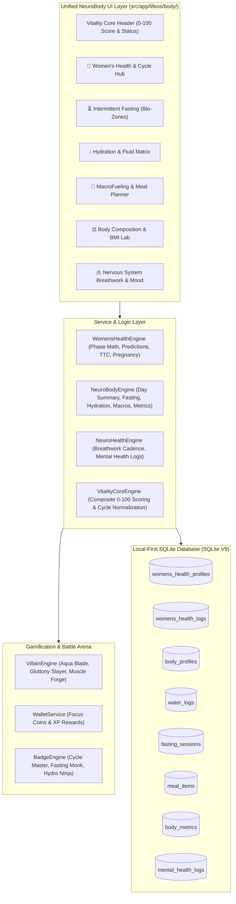

# NeuroNinja: Unified NeuroBody & Vitality Operating System Master Implementation Plan

> **Executive Objective**: Transform the NeuroNinja Body & Health domain into the world's most formidable, all-in-one **"Vitality Operating System"**. Unify every leading feature from dedicated industry competitors (**Flo**, **Clue**, **Natural Cycles**, **Zero**, **Waterllama**, **MyFitnessPal**, **Whoop**, **Oura**, and **Calm**) alongside 100% full parity with `neuro_ninja_web` into a single, cohesive, offline-first mobile app with cyberpunk aesthetics and gamified Boss Arena combat synergy.

---

## 1. Deep Competitor Landscape & Feature Unification Matrix

NeuroBody consolidates 7 distinct wellness categories, each commanded by top-tier standalone competitors. This plan absorbs every critical capability into one unified offline-first architecture:

| Domain | Industry Competitors | Competitor Signature Capabilities | NeuroNinja Unified Vitality Implementation |
|---|---|---|---|
| **Women's Health & Cycle Tracking** | **Flo, Clue, Natural Cycles, Stardust, Ovia** | Cycle wheel, period start/end prediction, fertile window & ovulation probability, 4 cycle phases (Menstrual, Follicular, Ovulation, Luteal), symptom/mood matrix, BBT, cervical mucus, pregnancy & postpartum modes, cycle-synced productivity tips. | **Unified Women's Health Hub**: 5 modes (Cycle, TTC, Pregnancy, Postpartum, Perimenopause), 4 physiological phase forecasts with neuro-productivity & workout syncing, 16 symptoms + 8 moods quick-tag chips, period flow logger, local-first encrypted storage for absolute reproductive privacy. |
| **Intermittent Fasting** | **Zero, Simple, Fastic, Life Fasting** | Circular live timer, 6 metabolic biological stages (Digestion, Insulin Drop, Fat Burn, Ketosis, Autophagy, Deep Renewal), protocols (16:8, 18:6, 20:4, 24:0 OMAD), fast completion reflections. | **Zero-Style Bio-Fasting Engine**: Live animated circular progress, real-time stage indicator with countdown to next cellular milestone, fast history, custom protocols, Boss Damage bonus for breaking cravings. |
| **Hydration & Fluids** | **Waterllama, Plant Nanny, Hydro Coach** | One-tap quick presets, multi-fluid hydration coefficients (water, electrolytes, tea, coffee), dynamic weight-adjusted target, hydration streaks. | **Multi-Fluid Hydration Matrix**: +250ml, +500ml, +750ml, +1000ml quick logging, hydration multipliers (Electrolytes 1.1x, Tea 0.9x, Coffee 0.7x), animated fluid fill bar, Aqua Blade weapon buff. |
| **Nutrition & Macros** | **MyFitnessPal, MacroFactor, Cronometer** | Calorie deficit/surplus, Macro tracking (Protein, Carbs, Fats), meal categories (Breakfast, Lunch, Dinner, Snacks, Pre/Post-workout), TDEE balance. | **MacroFueling Matrix**: Target vs actual protein/carbs/fat progress bars, calorie balance gauge based on Mifflin-St Jeor BMR, meal timing tags, "Muscle Forge" Boss Damage multiplier (+15%). |
| **Body Composition & Metrics** | **Withings Health Mate, Apple Health, Bevel** | Weight trend rolling average, BMI classification, waist-to-height ratio (WHtR), circumferences (waist, chest, hips, arm), US Navy body fat %. | **Anthropometric Bio-Lab**: 7-day smoothed weight curve, WHO BMI category chip, WHtR cardiometabolic safety gauge (<0.5 target), body fat calculator, progress milestones. |
| **Sleep & Circadian Rhythm** | **Whoop, Oura, Rise Science** | Sleep duration vs debt, sleep quality score, circadian energy windows (morning peak, post-lunch dip, wind-down window). | **Circadian Synchronizer**: Sleep debt tracking, bedtime consistency meter, energy window forecast overlay for deep-work scheduling. |
| **Nervous System & Breathwork** | **Calm, Headspace, Othership** | Daily mood check-in, 6 wellness sliders (stress, anxiety, energy, focus, motivation, joy), animated breathwork pacers (Box, 4-7-8, Resonance). | **NeuroHealth Pacer**: Real-time animated breathing circle with haptic pulse cues, 3 clinical patterns (Box 4-4-4-4, 4-7-8 Deep Sleep, 5-5 HRV Coherence), gratitude journal, mental health check-ins. |
| **Unified Vitality Index** | **Whoop Recovery Score, Oura Readiness, Garmin Body Battery** | 0-100 composite recovery and energy score synthesizing multiple biological streams. | **The "Vitality Core" (0-100)**: Real-time weighted algorithm: Hydration (20) + Fasting (20) + Nutrition (20) + Bodycare (20) + Mind/Rest (20). Cycle-phase normalized for female users. Reaching 80%+ grants "Divine Shield" blocking daily Villain health siphons! |

---

## 2. Technical System Architecture



---

## 3. Database Architecture (SQLite Migration V9)

To ensure **100% offline functionality**, rock-solid data integrity, and strict local reproductive privacy, the SQLite schema already established in V6 will be enhanced and verified under **Migration V9**:

```sql
-- Migration V9: Verified Production Schemas for NeuroBody & Vitality

-- 1. Women's Health Profile
CREATE TABLE IF NOT EXISTS womens_health_profiles (
  user_id TEXT PRIMARY KEY,
  mode TEXT NOT NULL DEFAULT 'cycle', -- 'cycle' | 'ttc' | 'pregnancy' | 'postpartum' | 'perimenopause'
  average_cycle_length INTEGER DEFAULT 28,
  average_period_length INTEGER DEFAULT 5,
  last_period_start_date TEXT, -- YYYY-MM-DD
  is_irregular INTEGER DEFAULT 0,
  pregnancy_profile_json TEXT, -- { lmpDate, dueDate, fetusName }
  privacy_pin_enabled INTEGER DEFAULT 0,
  updated_at TEXT NOT NULL
);

-- 2. Daily Women's Health Logs
CREATE TABLE IF NOT EXISTS womens_health_logs (
  log_id TEXT PRIMARY KEY,
  date TEXT NOT NULL UNIQUE, -- YYYY-MM-DD
  is_period_start INTEGER DEFAULT 0,
  is_period_end INTEGER DEFAULT 0,
  flow_level TEXT, -- 'spotting' | 'light' | 'medium' | 'heavy'
  symptoms_json TEXT DEFAULT '[]', -- Array of symptom keys
  moods_json TEXT DEFAULT '[]', -- Array of mood keys
  bbt_celsius REAL, -- Basal Body Temperature
  cervical_mucus TEXT, -- 'dry' | 'sticky' | 'creamy' | 'watery' | 'egg_white'
  notes TEXT,
  created_at TEXT NOT NULL
);
CREATE INDEX IF NOT EXISTS idx_womens_health_logs_date ON womens_health_logs(date);

-- 3. Body Profile (Anthropometric & Target Settings)
CREATE TABLE IF NOT EXISTS body_profiles (
  user_id TEXT PRIMARY KEY,
  gender TEXT DEFAULT 'female', -- 'female' | 'male' | 'other'
  age INTEGER DEFAULT 26,
  height_cm REAL DEFAULT 165,
  target_weight_kg REAL DEFAULT 58,
  default_water_target_ml INTEGER DEFAULT 2500,
  preferred_fasting_protocol TEXT DEFAULT '16:8',
  calorie_goal INTEGER DEFAULT 2000,
  protein_goal INTEGER DEFAULT 120,
  carbs_goal INTEGER DEFAULT 200,
  fats_goal INTEGER DEFAULT 60,
  activity_level TEXT DEFAULT 'moderately_active',
  updated_at TEXT NOT NULL
);

-- 4. Water & Fluid Intake Logs
CREATE TABLE IF NOT EXISTS water_logs (
  log_id TEXT PRIMARY KEY,
  date TEXT NOT NULL UNIQUE, -- YYYY-MM-DD
  target_ml INTEGER NOT NULL,
  total_ml INTEGER NOT NULL DEFAULT 0,
  logs_json TEXT NOT NULL DEFAULT '[]', -- Array of { time, amountMl, fluidType }
  updated_at TEXT NOT NULL
);

-- 5. Intermittent Fasting Sessions
CREATE TABLE IF NOT EXISTS fasting_sessions (
  session_id TEXT PRIMARY KEY,
  protocol TEXT NOT NULL, -- '14:10' | '16:8' | '18:6' | '20:4' | '24:0' | 'custom'
  target_hours REAL NOT NULL,
  start_time TEXT NOT NULL, -- ISO timestamp
  end_time TEXT, -- ISO timestamp
  status TEXT NOT NULL DEFAULT 'active', -- 'active' | 'completed' | 'cancelled'
  mood TEXT, -- 'great' | 'good' | 'neutral' | 'tough' | 'miserable'
  notes TEXT,
  created_at TEXT NOT NULL
);

-- 6. Meal Items & Macro Logging
CREATE TABLE IF NOT EXISTS meal_items (
  meal_id TEXT PRIMARY KEY,
  date TEXT NOT NULL, -- YYYY-MM-DD
  meal_type TEXT NOT NULL, -- 'breakfast' | 'lunch' | 'dinner' | 'snack' | 'pre_workout' | 'post_workout'
  name TEXT NOT NULL,
  calories INTEGER NOT NULL DEFAULT 0,
  protein REAL NOT NULL DEFAULT 0,
  carbs REAL NOT NULL DEFAULT 0,
  fats REAL NOT NULL DEFAULT 0,
  ingredients_json TEXT DEFAULT '[]',
  notes TEXT,
  created_at TEXT NOT NULL
);
CREATE INDEX IF NOT EXISTS idx_meal_items_date ON meal_items(date);

-- 7. Body Metrics & Weight History
CREATE TABLE IF NOT EXISTS body_metrics (
  metric_id TEXT PRIMARY KEY,
  date TEXT NOT NULL UNIQUE, -- YYYY-MM-DD
  weight_kg REAL NOT NULL,
  height_cm REAL,
  waist_cm REAL,
  chest_cm REAL,
  hips_cm REAL,
  body_fat_percentage REAL,
  notes TEXT,
  created_at TEXT NOT NULL
);

-- 8. Mental Health & Wellness Logs
CREATE TABLE IF NOT EXISTS mental_health_logs (
  log_id TEXT PRIMARY KEY,
  date TEXT NOT NULL UNIQUE, -- YYYY-MM-DD
  mood TEXT NOT NULL, -- 'great' | 'good' | 'okay' | 'bad' | 'terrible'
  mood_score INTEGER NOT NULL, -- 1 to 5
  stress INTEGER NOT NULL DEFAULT 3, -- 1 to 10
  anxiety INTEGER NOT NULL DEFAULT 2,
  energy INTEGER NOT NULL DEFAULT 7,
  motivation INTEGER NOT NULL DEFAULT 8,
  focus INTEGER NOT NULL DEFAULT 8,
  happiness INTEGER NOT NULL DEFAULT 7,
  tags_json TEXT DEFAULT '[]',
  journal_text TEXT,
  gratitude_json TEXT DEFAULT '[]',
  created_at TEXT NOT NULL
);
```

---

## 4. Phase-by-Phase Implementation Plan

### Phase 1: Complete Domain Models & Typings (`body-types.ts`)
- **Action**: Elevate `src/services/body/body-types.ts` to full feature parity with `neuro_ninja_web/lib/types/body.ts`.
- **Key Definitions**:
  - `WomensHealthMode`: `'cycle' | 'ttc' | 'pregnancy' | 'postpartum' | 'perimenopause'`.
  - `CyclePhase`: `'menstrual' | 'follicular' | 'ovulation' | 'luteal'`.
  - `FlowLevel`: `'spotting' | 'light' | 'medium' | 'heavy'`.
  - `CycleSymptom`: Complete 16-symptom catalog with emojis, scientific labels, and descriptions.
  - `CycleMood`: 8 mood states with hormonal explanations.
  - `CervicalMucus`: `'dry' | 'sticky' | 'creamy' | 'watery' | 'egg_white'`.
  - `PregnancyProfile`: Gestational age, due date, trimester calculator, weekly fruit/vegetable size milestones.
  - `CyclePhaseMeta`: Detailed neuro-productivity advice, optimal workout styles, and nutritional guidance per phase.
  - `FluidType`: `'water' | 'electrolytes' | 'green_tea' | 'black_coffee' | 'herbal'`.

### Phase 2: Engine Implementations (`womens-health-engine.ts` & `neurobody-engine.ts`)
- **Create `src/services/body/womens-health-engine.ts`**:
  - `getProfile()`: Retrieves user's profile with fallback defaults (28-day cycle, 5-day period).
  - `saveProfile(profile)`: Updates mode, cycle length, pregnancy data, etc.
  - `getTodayLog(date?)`: Fetches daily period, flow, symptom, mood, and BBT log.
  - `saveTodayLog(log)`: Upserts daily log, updates profile's `last_period_start_date` if `is_period_start = true`.
  - `calculateCycleStats()`: Computes:
    - Current cycle day (e.g. Day 14 of 28).
    - Current predicted phase (`menstrual` [1-5], `follicular` [6-13], `ovulation` [14-16], `luteal` [17-28]).
    - Days until next period.
    - Conception / fertile window probability (`low`, `medium`, `high`, `peak`).
    - Pregnancy week and trimester (if in pregnancy mode).
    - Personalized neuro-productivity recommendation (e.g. "Follicular Surge: Estrogen high. Best day for complex deep coding and PRs.").
  - Gamification Hook: Logging symptoms/period awards 30 Focus Coins and +50 XP.
- **Upgrade `src/services/body/neurobody-engine.ts`**:
  - Integrate `womensHealthEngine.calculateCycleStats()` into `getDaySummary()`.
  - Multi-fluid water tracking with hydration multipliers.
  - Calculate **Unified Vitality Index (0-100)**:
    - Hydration (0-20): `min(20, (totalMl / targetMl) * 20)`.
    - Fasting (0-20): 20 if target met or active fast > 12h, prorated otherwise.
    - Nutrition (0-20): Prorated based on hitting protein goal and staying within 15% of calorie target.
    - Bodycare/Metrics (0-20): Weight logged within 7 days, WHtR < 0.5.
    - Mental Wellness (0-20): Based on mood rating (5/5 = 20 pts, 4/5 = 16 pts, etc.).
    - Cycle Normalization: If in luteal phase, calorie target automatically flexes +200 kcal without score penalty.
  - Villain Damage Hooks:
    - Hitting 80%+ Vitality deals 150 DMG to active weekly villain.
    - Fasting past 16h deals 100 DMG to "Gluttony Golem".
    - 100% Water goal deals 60 DMG to "Dehydration Phantom".

### Phase 3: Interactive UI Screen (`src/app/lifeos/body/index.tsx`)
- **Redesign `src/app/lifeos/body/index.tsx` as the Ultimate All-In-One Vitality Station**:
  - **Header**: Back navigation, "Vitality OS" title, active date chip, and quick share action.
  - **Dynamic Vitality Core Hero Card**:
    - Animated radial progress ring showing 0-100 score.
    - Status badge: `"VITALITY SURGING"` (Emerald) / `"OPTIMAL"` (Cyan) / `"NEEDS FUEL"` (Amber).
    - 5 mini score pills: Hydration (x/20), Fasting (x/20), Nutrition (x/20), Metrics (x/20), Mind (x/20).
    - Battle Buff indicator: `⚔️ +25% Boss Critical Damage Active`.
  - **Tab Navigation Bar (Horizontal Scroll or Segmented)**:
    - `🌸 Cycle / Women's Health` (Flo / Clue Parity)
    - `⏳ Fasting` (Zero Parity)
    - `💧 Hydration` (Waterllama Parity)
    - `🥗 Nutrition` (MyFitnessPal Parity)
    - `⚖️ Metrics & BMI` (Withings Parity)
    - `🫁 Breath & Mind` (Calm Parity)
  - **Tab 1: Women's Health & Cycle Tracker**:
    - Phase Card: Big visual card with Phase Emoji (`🩸 Menstrual`, `🌱 Follicular`, `✨ Ovulation`, `🍂 Luteal`), Cycle Day countdown (e.g., `Day 14 of 28`), Days to next period, and Fertility badge.
    - Cycle Neuro-Tip: "Peak Estrogen: Optimal focus for deep work and high-intensity strength training."
    - Period Action Bar: Quick `[ Log Period Start ]` / `[ Period Ended ]` toggle buttons.
    - Flow Level Chips: Spotting, Light, Medium, Heavy.
    - Symptoms & Moods Matrix: Tap-to-toggle chips with emojis (Cramps, Headache, Bloating, Acne, Fatigue, Brain Fog, Calm, Energetic, Irritable, Anxious).
    - BBT & Cervical Mucus input fields.
    - Mode Switcher: Switch between `Cycle Tracking`, `Trying to Conceive`, `Pregnancy`, `Postpartum`, and `Perimenopause`.
  - **Tab 2: Intermittent Fasting (Bio-Zones)**:
    - Circular timer with live elapsed / remaining countdown.
    - Current Biological Stage badge (Digestion, Insulin Drop, Fat Burning, Ketosis, Autophagy, Deep Renewal) with progress to next stage.
    - Protocol selector (`14:10`, `16:8`, `18:6`, `20:4`, `24:0`, `Custom`).
    - Start Fast / End Fast buttons with haptic feedback.
  - **Tab 3: Hydration & Fluid Matrix**:
    - Animated water wave container with current `totalMl / targetMl`.
    - Quick increment buttons: `+250ml Glass`, `+500ml Bottle`, `+750ml Flask`, `+1000ml Jug`.
    - Fluid type selector: Pure Water (1.0x), Electrolytes (1.1x), Green Tea (0.9x), Coffee (0.7x).
  - **Tab 4: Nutrition & MacroFueling**:
    - Calorie overview bar with Deficit / Surplus calculation.
    - 3 Macro progress bars: Protein (g), Carbs (g), Fats (g).
    - Meal list grouped by Breakfast, Lunch, Dinner, Snacks, Pre/Post-workout.
    - Add Meal Modal with quick macros.
  - **Tab 5: Body Composition & Anthropometrics**:
    - Latest weight with 7-day delta and target weight progress bar.
    - WHO BMI Gauge (Underweight, Normal, Overweight, Obese).
    - WHtR (Waist-to-Height Ratio) cardiovascular indicator.
    - Log Measurement modal (Weight, Waist, Chest, Hips).
  - **Tab 6: Nervous System & Breathwork**:
    - Daily mood selector (5 emoji buttons: Very Bad -> Great).
    - Mental wellness sliders: Stress, Anxiety, Energy, Focus.
    - Interactive Breathwork Pacer: Animated pulsing sphere with Box (4-4-4-4), 4-7-8, and Resonance (5-5) modes + real-time Haptics on inhale/exhale!

### Phase 4: Verification, Gradle Build & Live Device Testing
1. Run strict TypeScript validation: `npx tsc --noEmit` (0 errors required).
2. Run ESLint validation: `npx expo lint` (0 errors required).
3. Export production JS bundle: `npx expo export:embed`.
4. Compile release/debug APK via Gradle: `cd android && ./gradlew assembleDebug`.
5. Install on connected Motorola Moto G62 5G (`ZD2228X6QH`) via ADB.
6. Verify live on device:
   - Navigate to `/lifeos/body`.
   - Log period flow & symptoms in Women's Health tab, verify SQLite persistence and Focus Coins toast.
   - Test Fasting bio-stage timer and protocol selection.
   - Log hydration fluid entries and watch wave animation update.
   - Log macro meal and observe protein bar fill.
   - Test breathwork pacer animation and haptics.
   - Capture high-resolution proof screenshots.

---

## 5. Deliverables & Acceptance Checklist

- [ ] `src/services/body/body-types.ts` enhanced with complete women's health, fasting bio-stages, macros, and vitality types.
- [ ] `src/services/body/womens-health-engine.ts` created with cycle phase calculation, fertile window prediction, pregnancy weeks, and SQLite CRUD.
- [ ] `src/services/body/neurobody-engine.ts` updated with multi-fluid hydration, macro balance, and unified 0-100 Vitality Core scoring.
- [ ] `src/app/lifeos/body/index.tsx` redesigned into the unified, 6-tab Cyberpunk Vitality OS Screen.
- [ ] Full parity verified against `neuro_ninja_web/components/body/WomensHealthTracker.tsx` and related web routes.
- [ ] Boss damage & Focus Coin rewards tied to hydration, fasting, and wellness check-ins.
- [ ] 0 TypeScript errors, 0 ESLint warnings.
- [ ] APK installed and fully verified on connected Motorola Moto G62 5G.
