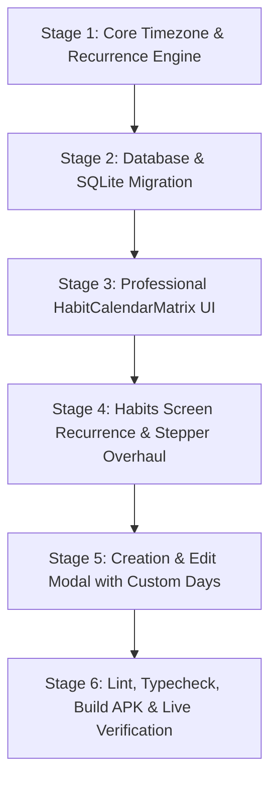

# NeuroNinja Ultimate Habit Tracker & True Calendar Engine: Master Implementation Plan

> **Objective:** Deliver an industry-beating, professional, aesthetically captivating Habit Tracking system for NeuroNinja that completely eliminates the date-day calendar mismatch bug, introduces high-end monthly interactive calendar & contribution heatmaps (Everyday & GitHub parity), and equips users with infinite recurrence flexibility (specific days like Sunday & Monday, intervals, times per week, time-of-day rituals, and numeric targets) infused with NeuroNinja's signature RPG boss damage and focus blocker hooks.

---

## 1. Competitive Analysis & Psychology Architecture (Top 10 Benchmark)

To build a habit system that hooks users and enforces deep productivity without deviation, we synthesized the winning mechanics of the top 10 global habit apps:

| # | Competitor | Core Superpower & User Hook | NeuroNinja Evolution |
|---|---|---|---|
| **1** | **Streaks** (Apple Design Award) | Frictionless 1-tap circular completion rings; zero cognitive overload. | **Tactile Ring Progress HUD**: Glowing circular SVG/Canvas adherence rings + haptic feedback on check-in. |
| **2** | **Loop Habit Tracker** (Open Source King) | Advanced mathematical recurrence (e.g. 3×/week, every 2 days); non-punitive scoring where 1 slip doesn't erase 60 days. | **Flexible Recurrence Engine**: Custom days (e.g. Sun + Mon only), intervals, and rest-day streak immunity. |
| **3** | **Habitica** | RPG game stakes: Unchecked habits damage party HP; completed habits strike the boss. | **Focus RPG Arena Integration**: Every habit completion deals 50 Holy Strike DMG to the Daily Boss & Raid Titan. |
| **4** | **Everyday** | "Don't Break The Chain" visual board with color-intensity heatmaps across days. | **Unified Contribution Heatmap & Chain Line**: Sleek monthly grid with color transitions and continuous streak links. |
| **5** | **Fabulous** (Duke University) | Ritual journeys categorized by time of day (Morning / Afternoon / Evening); habit stacking. | **Time-of-Day Routines**: Morning, Afternoon, Evening, and Night groupings with smart active-slot filtering. |
| **6** | **Productive** | Clean time-anchored dashboard showing only habits relevant to right now. | **Contextual Today Filter**: "Morning Ignition", "Afternoon Flow", "Evening Wind-Down" tabs. |
| **7** | **Done** | Multi-target numeric habits (e.g. 8 glasses of water, 20 pages read) with incrementer buttons. | **Quantity & Unit Counters**: Support for Boolean (Yes/No), Count (e.g. 8 glasses `+`/`-`), and Duration (mins). |
| **8** | **Way of Life** | 4-state tracking (Completed, Missed, Rest Day, Recovered) + micro-journaling excuse logging. | **Tri-State Cycle + Freeze Shields**: Complete, Missed, Honored Rest, or Recovered via Focus Coins/Shields. |
| **9** | **Avocation** | Nurturing visual growth metaphor (plant grows with check-ins) + micro-psychology cards. | **Ninja Discipline Belt Leveling**: Habits feed Kage Sensei's wisdom and advance player ninja belt ranking. |
| **10** | **Atomic Habits (Clear)** | Implementation Intentions formula: *"After [Trigger Habit], I will [New Habit] at [Time] in [Place]"*. | **Habit Stacking Blueprint**: Direct field to anchor new habits to existing identity triggers and alarms. |

---

## 2. Root Cause Analysis: The Date & Day Mismatch Bug

### The Technical Flaw
In JavaScript, parsing date strings via `new Date('YYYY-MM-DD')` treats the timestamp as **UTC Midnight** (`00:00:00.000Z`).
- In timezones west of UTC (e.g., EST UTC-5, PST UTC-8), `2026-11-18` becomes `2026-11-17 19:00:00`.
- Calling `.getDay()` or `.getDate()` returns **yesterday's day of the week and yesterday's date number**!
- Furthermore, in the date strip in `src/app/habits/index.tsx`, dates were generated using `new Date()` without anchoring at local noon, causing day labels to drift out of sync with actual calendar dates.

### The Architectural Fix
1. **Local Noon Anchor (`12:00:00`)**:
   ```typescript
   export function parseLocalDateSafe(dateStr: string): Date {
     const [year, month, day] = dateStr.split('-').map(Number);
     return new Date(year, month - 1, day, 12, 0, 0); // Always local noon, immune to midnight timezone shifts!
   }
   ```
2. **Deterministic Day-of-Week Matching**:
   A deterministic lookup array `['Sun', 'Mon', 'Tue', 'Wed', 'Thu', 'Fri', 'Sat']` based on `date.getDay()` calculated from the safe noon-anchored date.
3. **Week-Start Preference**:
   Support for both Sunday-first and Monday-first calendar grids with guaranteed mathematical cell alignment.

---

## 3. Advanced Flexible Recurrence Engine

Users need habits that run whenever needed—not just rigid daily checkboxes. We will introduce `schedule_json` parsing into SQLite:

```typescript
export type RecurrenceType =
  | 'daily'              // All 7 days
  | 'specific_days'     // e.g. [0, 1] for Sunday & Monday only
  | 'weekdays'          // Mon-Fri [1, 2, 3, 4, 5]
  | 'weekends'          // Sat-Sun [0, 6]
  | 'interval'          // Every N days (e.g. every 2 days, every 3 days)
  | 'times_per_period'; // e.g. 3 times per week, 12 times per month

export type TimeOfDay = 'morning' | 'afternoon' | 'evening' | 'anytime';
export type TargetType = 'boolean' | 'count' | 'duration';

export interface HabitScheduleConfig {
  recurrenceType: RecurrenceType;
  specificDays: number[];         // 0=Sun, 1=Mon, ..., 6=Sat
  intervalDays?: number;          // e.g. 2 for every other day
  timesPerWeek?: number;          // e.g. 3 times a week
  timeOfDay: TimeOfDay;           // 'morning' | 'afternoon' | 'evening' | 'anytime'
  targetType: TargetType;         // 'boolean' | 'count' | 'duration'
  targetValue: number;            // e.g. 8 (glasses) or 25 (minutes)
  targetUnit?: string;            // e.g. 'glasses', 'pages', 'mins'
  habitStackTrigger?: string;     // e.g. "After I pour my morning coffee"
}
```

### Recurrence Rules on Calendar & Check-in:
- **Scheduled Days**: Habit is active. Check-in records `completed` or `not_completed`.
- **Off-Days / Rest Days**: If a habit is only set for Sunday & Monday, Tuesday through Saturday are recognized as **Honored Rest Days**. The streak is **preserved without penalty**, and the card renders a peaceful `"Scheduled Off-Day 🧘"` chip.
- **Interval Tracking**: For "Every 2 days", the engine checks the last completed date to determine if today is due.

---

## 4. Professional & Attractive UI/UX Overhaul

### Screen 1: The Main Habits Hub (`src/app/habits/index.tsx`)
1. **Interactive Calendar Header Bar**:
   - Modern Calendar Pill Switcher: **Week Strip View** (scrollable 14-day strip with day name, date number, and completion dot) vs. **Full Month Matrix View** (expandable collapsible dropdown calendar).
   - Accurate Day + Date Badge (e.g. `Wednesday, Nov 18`).
2. **Time-of-Day Filter Pills**:
   - `All (5)` | `🌅 Morning` | `☀️ Afternoon` | `🌙 Evening` | `Anytime`.
3. **Habit Cards (Done / Loop / Streaks Hybrid)**:
   - Category color accent glow.
   - Title + Habit Stacking Subtitle (*"After waking up → Hydrate"*).
   - Recurrence Badge: `Sun, Mon only` or `Weekdays` or `Daily`.
   - Dynamic Check-in Control:
     - For **Boolean**: Satisfying tri-state ring (Empty → Green Checkmark → Red Cross → Gold Rest).
     - For **Count**: Micro `+` and `-` stepper with progress bar (`4/8 glasses`).
     - For **Duration**: `▶ Start 25m Focus` button linking to deep work timer.
   - Streak flame with current streak number & multiplier.

### Screen 2: World-Class Habit Calendar Matrix (`src/components/habits/HabitCalendarMatrix.tsx`)
1. **Month Navigation**:
   - Month name + year (`November 2026`) with smooth chevron navigation.
   - "Jump to Today" shortcut button.
2. **Weekday Header**:
   - Accurate `S  M  T  W  T  F  S` alignment with custom Sunday/Monday accent colors.
3. **Day Cells**:
   - **Completed**: Rich emerald glow `#00E699` with checkmark icon.
   - **Rest / Off-Day**: Elegant gold dashed ring `#F59E0B` with pause/leaf icon.
   - **Missed**: Muted red tint `#EF4444` with subtle cross.
   - **Recovered**: Cyan frost `#38BDF8` with shield icon.
   - **Future / Unattempted**: Dark clean slate `#1E293B`.
   - **Selected Day**: Highlighted with an animated bright white border.
4. **Contribution Heatmap Strip (Everyday & GitHub Parity)**:
   - 90-day horizontal micro-grid showing frequency intensity at a glance.
5. **Monthly Adherence Stats Strip**:
   - `88% Adherence` · `22 Days Done` · `4 Rest Days` · `0 Broken Streaks`.

### Screen 3: Habit Creation & Recurrence Modal
1. Title, Description, and Icon/Color Picker.
2. **Recurrence Selector**:
   - Chips: `Every Day`, `Specific Days`, `Weekdays`, `Weekends`, `Every N Days`, `Times / Week`.
   - Multi-select weekday circles: `[S] [M] [T] [W] [T] [F] [S]` (Instant toggle for Sunday, Monday, etc.).
   - Interval stepper: `Every [ 2 ] days`.
3. **Time-of-Day Anchor**: `Morning`, `Afternoon`, `Evening`, `Anytime`.
4. **Target Metric**: `Yes/No`, `Numeric Count` (with unit input), `Duration` (with minutes).
5. **Atomic Habits Stacking**: Optional *"After I [Anchor Habit], I will [New Habit]"*.
6. **Accountability Verifier**: Self, Friend, Parent, or Mentor with photo proof requirement.

---

## 5. Implementation Stages & Verification Plan



### Stage 1: Core Timezone & Recurrence Engine
- Overhaul `src/services/habits/streak-calculator.ts`:
  - Replace all bare `new Date(string)` with `parseLocalDateSafe` (noon-anchored).
  - Add `isHabitDueOnDate(habit, date)` helper that evaluates specific days, intervals, and weekly targets.
  - Implement smart streak preservation for non-scheduled days.

### Stage 2: Database & Model Enhancement
- Update `src/services/habits/habit-types.ts` and `src/services/habits/habit-service.ts`:
  - Add `HabitScheduleConfig` to `HabitItemV3`.
  - Store and retrieve `schedule_json` from `habits_v2`.
  - Support incremental count updates for numeric habits in `habit_checkins`.

### Stage 3: Calendar Matrix & Heatmap Overhaul
- Overhaul `src/components/habits/HabitCalendarMatrix.tsx`:
  - Zero date/day mismatch: cell calculation rigorously verified against local month structure.
  - Add Month/Week view toggles and 90-day Everyday-style heatmap chain.
  - Interactive tap to cycle or view any day's check-in notes.

### Stage 4: Main Habits Screen Overhaul
- Overhaul `src/app/habits/index.tsx`:
  - Real Date Strip with accurate Day + Date matching.
  - Time-of-day tabs (Morning, Afternoon, Evening).
  - Numeric stepper controls (`+` / `-` count) alongside boolean check toggles.
  - Scheduled off-day badges for habits not due today.

### Stage 5: Rich Recurrence Creation Modal
- Add day-of-week selection chips (`Sun`, `Mon`, etc.), interval selectors, target type controls, and Atomic Habits cue-trigger fields.

### Stage 6: Build, Verify on Moto G62 5G & Push
- `npx tsc --noEmit` & `npx expo lint` (zero errors).
- Export offline embedded bundle & build Android debug APK via Gradle.
- Live verification on connected Motorola Moto G62 5G via ADB.
- Commit with Conventional Commits and push to GitHub.
