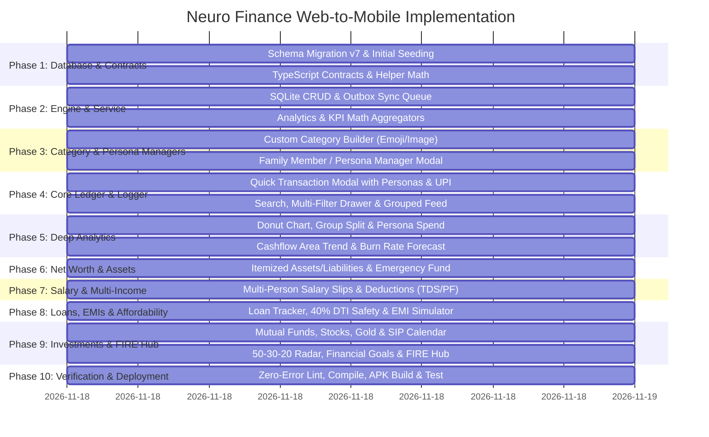

# Master Implementation Plan: Complete Neuro Finance Hub (Web-to-Mobile Parity & Competitor Supremacy)

**Document Version:** 1.0.0  
**Date:** November 18, 2026  
**Source Web Repository:** `C:\Users\acer\Desktop\neuro_ninja_web\neuro_ninja`  
**Target Mobile Repository:** `c:\Users\acer\Desktop\neuro_ninja` (Expo SDK 58 / React Native 0.88 / SQLite)  
**Target Device:** Motorola Moto G62 5G (`ZD2228X6QH`), Android 13/14  
**Status:** Ready for Review & Execution  

---

## 1. Executive Summary & Architecture Vision

The user has instructed:
1. **Thorough Codebase Audit:** Inspect all features, UI, backend flows, categories, analytics, salary manager, loan EMI tracker, investment portfolio, net worth, and family members/personas in `neuro_ninja_web`.
2. **Top Competitor Benchmarking:** Benchmark against the Top 10 Indian and Global Personal Finance applications (Fold Money, Jupiter/Fi, CRED Money, INDmoney, Spendee, Wallet by BudgetBakers, YNAB, Copilot Money, 1Money, Bluecoins), extracting their most addictive, productive, and hook-inducing capabilities.
3. **100% Web-to-Mobile Feature Porting:** Port every single capability from `neuro_ninja_web` into `neuro_ninja` mobile with **zero feature loss**.
4. **Neuro Ninja Dark Neon Aesthetics:** The mobile UI must strictly adhere to the polished Neuro Ninja theme (`#070A11`, `#0F1829`, `#121D33`, Emerald `#00E699`, Cyan `#38BDF8`, Purple `#818CF8`, Gold `#F59E0B`, Rose `#EF4444`, glass cards, smooth haptics, and universal back navigation).
5. **Local-First SQLite & Instant Offline Latency (0ms):** Everything persists immediately in SQLite with offline availability, queued into the offline sync outbox for background syncing with the Next.js API endpoints (`/api/finance/*`, `/api/expenses`, `/api/categories`).

---

## 2. In-Depth Audit of `neuro_ninja_web` Finance Hub

Our audit of `C:\Users\acer\Desktop\neuro_ninja_web\neuro_ninja` uncovered **9 core pillars** and **23 backend/UI files**:

```
C:\Users\acer\Desktop\neuro_ninja_web\neuro_ninja
├── app/
│   ├── finance/page.tsx               # Main 9-tab Finance Hub Dashboard
│   ├── expenses/page.tsx              # Quick expense redirect
│   └── api/
│       ├── expenses/route.ts          # GET/POST expenses & CSV export
│       ├── expenses/[id]/route.ts     # PATCH/DELETE single transaction
│       ├── categories/route.ts        # GET/POST custom categories
│       └── finance/
│           ├── salary/route.ts        # Salary profiles & pay slips
│           ├── emi/route.ts           # Loan obligations & EMI schedules
│           ├── investments/route.ts   # Stocks, MFs, Gold, PPF portfolio
│           ├── members/route.ts       # Family members / personas
│           ├── net-worth-items/route.ts # Custom assets & liabilities
│           └── profile/route.ts       # Financial goals, emergency fund, budget
├── components/
│   ├── ExpenseTracker.tsx             # Daily ledger & transaction logger
│   ├── ExpenseAnalytics.tsx           # Charts, group/persona spend breakdown, cashflow
│   ├── CategoryManagerModal.tsx       # Custom category builder with emoji/images
│   ├── CategoryBudgetsWidget.tsx      # Category-level monthly spending limits
│   ├── ProductivityLink.tsx           # Focus task & coins integration
│   └── finance/
│       ├── NetWorthDashboard.tsx      # Total assets, debts, liquidity & net worth
│       ├── SalaryManager.tsx          # Multi-person salary breakdown & deductions
│       ├── EMITracker.tsx             # Loan schedule & 40% DTI safety alerts
│       ├── EMIAffordabilityCalculator.tsx # Instant loan eligibility simulator
│       ├── InvestmentPortfolio.tsx    # Asset allocation & monthly SIP schedules
│       ├── FinancialPlanningHub.tsx   # 50-30-20 rule, emergency runway & FIRE goals
│       ├── MemberAvatar.tsx           # Multi-entity avatar renderer (emoji/image)
│       └── MemberManagerModal.tsx     # Persona/family member manager
├── hooks/
│   ├── useExpenses.ts                 # Expenses, categories & budget state
│   └── useFinanceData.ts              # Net worth, EMI, salary, investments & KPIs
└── lib/
    ├── types.ts                       # Complete TypeScript finance contracts
    └── financeUtils.ts                # Standard banking EMI & interest formula
```

---

## 3. Top 10 Competitor Benchmark & Strategic Differentiation

| Competitor | Core Strength / Hook | Limitation | **Neuro Finance (Mobile Target)** |
| :--- | :--- | :--- | :--- |
| **Fold Money (India)** | Clean modern UI, account aggregator sync | Cloud-dependent, lacks multi-person entity tracking | **Offline-First (0ms) + Persona Tracking (Self, Parents, Spouse, Kids, Office)** |
| **Jupiter / Fi (Neobanks)** | 50-30-20 rule automatic categorization, salary pots | Locked to bank account, cannot track cash or external loans | **Manual & Fast UPI Logging + 50-30-20 Rule Radar + Emergency Runway** |
| **CRED Money** | Credit card bills, hidden charge alerts, bank balances | Invasive permissions, ad-heavy, no loan affordability simulator | **Zero Ads, Local-First Privacy + Interactive Loan Affordability Calculator** |
| **INDmoney** | Complete Indian net worth (EPF, PPF, NPS, US Stocks, Gold) | Cluttered interface, aggressive upselling of loans/insurance | **Full Indian Asset Ledger (PF, Gold, SGB, Stocks, MFs, Real Estate) + 0 Clutter** |
| **Spendee** | Shared family wallets, multi-currency | Subscription paywall, no salary slip deduction breakdown | **Full Pay Slip Deduction Parser (PF, PT, TDS, HRA) + Multi-Salary Household** |
| **Wallet by BudgetBakers** | Hierarchical categories, debt payoff planner | Clunky mobile UI, steep learning curve | **6 Major Category Groups + 30+ Subcategories + Custom Emoji/Image Builder** |
| **YNAB (You Need A Budget)** | "Give every dollar a job", zero-based budgeting | Expensive (\$100/yr), US-centric, complex envelope system | **Automated Surplus Cash Flow + Indian Rupee Banking EMI Precision** |
| **Copilot Money (iOS)** | Apple-design aesthetics, recurring subscription radar | iOS only, no loan amortization or persona isolation | **Cross-Platform Dark Neon Aesthetic + Full Android Hardware Back Navigation** |
| **1Money / Bluecoins** | Instant offline entry, split transactions | Outdated Android 4/5 visual design, no gamification | **Polished Glassmorphic Neon UI + Haptic Feedback + LifeOS RPG Boss Battle Coins** |
| **Habitica / Gamified Apps** | RPG gamification of habits | Finance is not gamified or linked to discipline | **Financial Shinobi Wealth Zen: Impulse-free streaks earn Focus Pass Coins!** |

---

## 4. Complete Architecture & Data Contracts

### 4.1. SQLite Database Schema Upgrade (Migration Version 7)

```sql
-- Migration v7: Comprehensive Neuro Finance Engine
PRAGMA foreign_keys = ON;

-- 1. Hierarchical & Custom Expense Categories
CREATE TABLE IF NOT EXISTS finance_categories (
  id TEXT PRIMARY KEY,
  name TEXT NOT NULL UNIQUE,
  icon_type TEXT NOT NULL DEFAULT 'emoji', -- 'emoji' | 'image'
  icon_value TEXT NOT NULL DEFAULT '📌',
  color TEXT NOT NULL DEFAULT '#818CF8',
  budget_limit REAL NOT NULL DEFAULT 3000,
  group_id TEXT NOT NULL DEFAULT 'personal', -- 'personal'|'office'|'parents'|'household'|'investments'|'other'
  created_at TEXT NOT NULL,
  updated_at TEXT NOT NULL,
  sync_status TEXT NOT NULL DEFAULT 'synced'
);
CREATE INDEX IF NOT EXISTS idx_finance_cat_group ON finance_categories(group_id);

-- 2. Personas & Family Members (Entities)
CREATE TABLE IF NOT EXISTS finance_members (
  id TEXT PRIMARY KEY,
  name TEXT NOT NULL,
  relationship TEXT NOT NULL DEFAULT 'self', -- 'self'|'spouse'|'father'|'mother'|'child'|'office'|'family'|'friend'|'roommate'|'other'
  avatar_emoji TEXT NOT NULL DEFAULT '👤',
  avatar_type TEXT NOT NULL DEFAULT 'emoji', -- 'emoji'|'image'|'icon'
  avatar_url TEXT,
  icon_name TEXT,
  color TEXT NOT NULL DEFAULT '#38BDF8',
  is_custom INTEGER NOT NULL DEFAULT 0,
  is_default INTEGER NOT NULL DEFAULT 0,
  created_at TEXT NOT NULL,
  updated_at TEXT NOT NULL,
  sync_status TEXT NOT NULL DEFAULT 'synced'
);

-- 3. Enhanced Transactions with Persona, Category Group & Payment Methods
CREATE TABLE IF NOT EXISTS finance_transactions_v2 (
  id TEXT PRIMARY KEY,
  amount REAL NOT NULL,
  type TEXT NOT NULL DEFAULT 'expense', -- 'expense' | 'income' | 'transfer'
  category TEXT NOT NULL DEFAULT 'Food & Dining',
  category_group TEXT NOT NULL DEFAULT 'personal', -- 'personal'|'office'|'parents'|'household'|'investments'|'other'
  spent_on TEXT NOT NULL DEFAULT 'personal', -- member id or 'personal'|'parents'|'spouse'|'child'|'office'
  payment_method TEXT NOT NULL DEFAULT 'upi_gpay', -- 'cash'|'upi_gpay'|'upi_phonepe'|'upi_paytm'|'credit_card'|'debit_card'|'net_banking'|'wallet'|'other'
  date TEXT NOT NULL, -- YYYY-MM-DD
  description TEXT,
  linked_goal_id TEXT,
  tags_json TEXT NOT NULL DEFAULT '[]',
  created_at TEXT NOT NULL,
  updated_at TEXT NOT NULL,
  sync_status TEXT NOT NULL DEFAULT 'synced'
);
CREATE INDEX IF NOT EXISTS idx_tx_date ON finance_transactions_v2(date);
CREATE INDEX IF NOT EXISTS idx_tx_category ON finance_transactions_v2(category);
CREATE INDEX IF NOT EXISTS idx_tx_group ON finance_transactions_v2(category_group);
CREATE INDEX IF NOT EXISTS idx_tx_spent_on ON finance_transactions_v2(spent_on);

-- 4. Multi-Person Salary & Income Stream Profiles
CREATE TABLE IF NOT EXISTS finance_salaries_v2 (
  id TEXT PRIMARY KEY,
  member_id TEXT NOT NULL DEFAULT 'personal',
  member_name TEXT NOT NULL DEFAULT 'Self',
  relationship TEXT NOT NULL DEFAULT 'self',
  income_type TEXT NOT NULL DEFAULT 'salary', -- 'salary'|'freelance'|'rental'|'business'|'dividend'|'pension'|'other'
  monthly_gross REAL NOT NULL DEFAULT 0,
  basic_pay REAL NOT NULL DEFAULT 0,
  hra REAL NOT NULL DEFAULT 0,
  special_allowance REAL NOT NULL DEFAULT 0,
  deductions_json TEXT NOT NULL DEFAULT '{"pf":0,"pt":0,"tds":0,"insurance":0,"other":0}',
  in_hand_salary REAL NOT NULL DEFAULT 0,
  side_income REAL NOT NULL DEFAULT 0,
  pay_date INTEGER NOT NULL DEFAULT 1,
  effective_date TEXT NOT NULL DEFAULT '2026-11', -- YYYY-MM
  company_name TEXT,
  notes TEXT,
  is_active INTEGER NOT NULL DEFAULT 1,
  created_at TEXT NOT NULL,
  updated_at TEXT NOT NULL,
  sync_status TEXT NOT NULL DEFAULT 'synced'
);

-- 5. Loan & EMI Schedules with Affordability & DTI
CREATE TABLE IF NOT EXISTS finance_emis_v2 (
  id TEXT PRIMARY KEY,
  loan_name TEXT NOT NULL,
  loan_type TEXT NOT NULL DEFAULT 'personal', -- 'home'|'car'|'personal'|'education'|'credit_card'|'two_wheeler'|'consumer_durable'|'gold'|'other'
  obligation_type TEXT NOT NULL DEFAULT 'term_loan', -- 'term_loan'|'consumer_emi'|'borrowed_personal'
  borrower_member TEXT NOT NULL DEFAULT 'Self',
  lender_name TEXT,
  principal_amount REAL NOT NULL DEFAULT 0,
  interest_rate REAL NOT NULL DEFAULT 0, -- Annual interest %
  tenure_months INTEGER NOT NULL DEFAULT 12,
  emi_amount REAL NOT NULL DEFAULT 0,
  start_date TEXT NOT NULL DEFAULT '2026-01-01',
  due_day_of_month INTEGER NOT NULL DEFAULT 5,
  months_paid INTEGER NOT NULL DEFAULT 0,
  remaining_months INTEGER NOT NULL DEFAULT 12,
  total_interest_payable REAL NOT NULL DEFAULT 0,
  outstanding_principal REAL NOT NULL DEFAULT 0,
  is_active INTEGER NOT NULL DEFAULT 1,
  notes TEXT,
  created_at TEXT NOT NULL,
  updated_at TEXT NOT NULL,
  sync_status TEXT NOT NULL DEFAULT 'synced'
);

-- 6. Comprehensive Investment Portfolio
CREATE TABLE IF NOT EXISTS finance_investments_v2 (
  id TEXT PRIMARY KEY,
  name TEXT NOT NULL,
  type TEXT NOT NULL DEFAULT 'mutual_funds', -- 'stocks'|'mutual_funds'|'fd'|'ppf'|'nps'|'epf'|'gold'|'real_estate'|'crypto'|'bonds'|'other'
  platform TEXT, -- 'Zerodha'|'Groww'|'Kuvera'|'HDFC'|'Binance'|'Physical'
  invested_amount REAL NOT NULL DEFAULT 0,
  current_value REAL NOT NULL DEFAULT 0,
  units REAL,
  purchase_date TEXT NOT NULL DEFAULT '2026-01-01',
  sip_amount REAL NOT NULL DEFAULT 0,
  sip_frequency TEXT NOT NULL DEFAULT 'monthly',
  sip_day_of_month INTEGER NOT NULL DEFAULT 10,
  maturity_date TEXT,
  interest_rate REAL,
  returns_percent REAL NOT NULL DEFAULT 0,
  notes TEXT,
  created_at TEXT NOT NULL,
  updated_at TEXT NOT NULL,
  sync_status TEXT NOT NULL DEFAULT 'synced'
);

-- 7. Itemized Assets & Liabilities (Net Worth Ledger)
CREATE TABLE IF NOT EXISTS finance_networth_items_v2 (
  id TEXT PRIMARY KEY,
  item_type TEXT NOT NULL DEFAULT 'asset', -- 'asset' | 'liability'
  name TEXT NOT NULL,
  category TEXT NOT NULL, -- Asset: 'bank_cash'|'investments'|'gold_jewellery'|'real_estate'|'vehicles'|'pf_gratuity'|'business'|'other'
                          -- Liability: 'home_loan'|'vehicle_loan'|'personal_loan'|'credit_card'|'borrowed_family'|'consumer_emi'|'other'
  value REAL NOT NULL DEFAULT 0,
  owner TEXT NOT NULL DEFAULT 'Self', -- Family member
  notes TEXT,
  created_at TEXT NOT NULL,
  updated_at TEXT NOT NULL,
  sync_status TEXT NOT NULL DEFAULT 'synced'
);

-- 8. Financial Freedom (FIRE) & Planning Goals
CREATE TABLE IF NOT EXISTS finance_goals_v2 (
  id TEXT PRIMARY KEY,
  name TEXT NOT NULL,
  target_amount REAL NOT NULL DEFAULT 0,
  current_saved REAL NOT NULL DEFAULT 0,
  target_date TEXT NOT NULL, -- YYYY-MM
  priority TEXT NOT NULL DEFAULT 'medium', -- 'high'|'medium'|'low'
  category TEXT NOT NULL DEFAULT 'emergency', -- 'vehicle'|'house'|'education'|'wedding'|'travel'|'emergency'|'retirement'|'gadget'|'other'
  monthly_allocation REAL NOT NULL DEFAULT 0,
  created_at TEXT NOT NULL,
  updated_at TEXT NOT NULL,
  sync_status TEXT NOT NULL DEFAULT 'synced'
);

-- 9. Financial Profile & 50-30-20 Radar
CREATE TABLE IF NOT EXISTS finance_profile_v2 (
  id TEXT PRIMARY KEY,
  currency TEXT NOT NULL DEFAULT '₹',
  monthly_budget REAL NOT NULL DEFAULT 25000,
  savings_goal REAL NOT NULL DEFAULT 100000,
  emergency_fund_current REAL NOT NULL DEFAULT 0,
  emergency_fund_target REAL NOT NULL DEFAULT 150000,
  monthly_expenses REAL NOT NULL DEFAULT 35000,
  fire_target REAL NOT NULL DEFAULT 10000000,
  fire_age_target INTEGER NOT NULL DEFAULT 45,
  category_budgets_json TEXT NOT NULL DEFAULT '{}',
  updated_at TEXT NOT NULL
);
```

---

## 5. Mobile Component Hierarchy & Tab Architecture

The mobile app will implement an ergonomic, high-density top-tab navigation with scrollable pills matching the web app's 9 pillars:

```mermaid
flowchart TD
    A[Neuro Finance Screen - lifeos/finance/index.tsx] --> B[Hero Header: Net Worth & EMI DTI KPI Pills]
    B --> C[Horizontal Pill Switcher]
    
    C --> D[Tab 1: 💳 Ledger & Logger]
    C --> E[Tab 2: 📊 Analytics]
    C --> F[Tab 3: 💎 Net Worth]
    C --> G[Tab 4: 💼 Salary & Income]
    C --> H[Tab 5: 🏛️ Loans & EMIs]
    C --> I[Tab 6: 📈 Investments]
    C --> J[Tab 7: 🧭 Financial Freedom]
    C --> K[Tab 8: 🎚️ Budgets]
    C --> L[Tab 9: ⚔️ Shinobi Wealth]

    D --> D1[Quick Add Transaction Modal with Numpad & Persona Chips]
    D --> D2[Filter & Search Drawer]
    D --> D3[Category Manager Modal with Custom Emoji/Image]
    D --> D4[Member / Persona Manager Modal]
    
    E --> E1[Category Donut / Progress Bar]
    E --> E2[Group Spend: Personal vs Office vs Parents vs Household]
    E --> E3[Persona Spend: Self vs Parents vs Spouse vs Kids vs Office]
    E --> E4[Payment Method Split: UPI vs Cards vs Cash]
    E --> E5[Daily Burn Rate & 30-Day Forecast]

    F --> F1[Assets vs Liabilities Overview]
    F --> F2[Itemized Asset Ledger: Gold, Bank, PF, Real Estate]
    F --> F3[Emergency Runway: X Months Survival]

    G --> G1[Combined Household Monthly Income]
    G --> G2[Multi-Person Salary Slips: Gross, Basic, HRA, PF, PT, TDS]
    G --> G3[Side Incomes: Freelance, Rental, Dividends]

    H --> H1[Total Monthly EMI & 40% DTI Safety Status]
    H --> H2[Active Loans List with Due Day Countdown & Amortization]
    H --> H3[Interactive Loan Affordability Calculator]

    I --> I1[Portfolio Market Value vs Invested Amount + Returns %]
    I --> I2[Holdings by Asset Class: MFs, Stocks, Gold, PPF, Crypto]
    I --> I3[Monthly SIP Calendar & Schedules]

    J --> J1[50-30-20 Rule Radar: Needs, Wants, Savings]
    J --> J2[Emergency Fund Goal Runway: 3, 6, 12 Months]
    J --> J3[FIRE Freedom Calculator & Milestones]

    K --> K1[Category Monthly Spending Limits & Over-budget Warning Meters]

    L --> L1[Shareable Wealth Zen Card with LifeOS Coins & Streaks]
```



---

## 6. Phase-by-Phase Implementation Plan



### Detailed Phase Breakdown

#### Phase 1: Database Migration v7 & Type Contracts
1. **Migration v7 (`src/services/database/migrations.ts`):**
   - Execute table creation for `finance_categories`, `finance_members`, `finance_transactions_v2`, `finance_salaries_v2`, `finance_emis_v2`, `finance_investments_v2`, `finance_networth_items_v2`, `finance_goals_v2`, and `finance_profile_v2`.
   - Seed default hierarchical categories (`Personal`, `Office`, `Parents`, `Household`, `Investments`, `Other` with all 30+ default subcategories).
   - Seed default family members (`Self`, `Parents / Elders`, `Family Combined`, `Child / Kids`, `Spouse / Partner`, `Office / Business`).
2. **Contracts (`src/services/finance/finance-types.ts`):**
   - Exact parity with `C:\Users\acer\Desktop\neuro_ninja_web\neuro_ninja\lib\types.ts`.

#### Phase 2: Engine & Local-First Service Layer (`finance-service.ts`)
1. Implement full local SQLite CRUD for all 8 entities:
   - Transactions, Categories, Members/Personas, Salaries, EMIs, Investments, Net Worth items, and Financial Goals.
2. Implement real-time analytical calculations:
   - `getNetWorthSummary()`: Combined Assets (Bank, Gold, Stocks, Real Estate, PF) minus Total Liabilities.
   - `getEMISafety()`: Debt-to-Income (DTI %) calculation and 40% income safety threshold.
   - `getCombinedHouseholdIncome()`: Aggregated in-hand salaries + side incomes.
   - `getSurplusCashflow()`: Net Income $-$ Total Monthly EMIs $-$ Monthly SIP commitments.
   - `getSpendingByPersona()`: Aggregated expenditures grouped by `spent_on`.
   - `getSpendingByGroup()`: Aggregated expenditures grouped by `category_group`.
   - `getRule50_30_20Breakdown()`: Needs vs Wants vs Savings comparison.
3. Queue every mutation into `sync_outbox` for background sync with Next.js web API endpoints.

#### Phase 3: Category & Persona Managers
1. **Category Manager Modal (`CategoryManagerModal.tsx`):**
   - Modal supporting custom category name, group association (`personal`, `office`, `parents`, etc.), icon picker (emoji grid or URL input), color selection, and monthly budget limit.
2. **Persona / Family Member Manager Modal (`MemberManagerModal.tsx`):**
   - Modal supporting person name, relationship (`self`, `spouse`, `father`, `mother`, `child`, `office`, `friend`, custom), avatar emoji, DiceBear avatar URL presets, color themes, and default badges.
3. **Member Avatar Component (`MemberAvatar.tsx`):**
   - Compact circular avatar displaying emoji or image with role badge.

#### Phase 4: Core Ledger & Transaction Logger
1. **Quick Transaction Logging Modal:**
   - Amount input with instant quick-chip increments (`+100`, `+500`, `+1000`).
   - Transaction Type switcher (`Expense`, `Income`, `Transfer`).
   - Hierarchical category selector (Group tabs: `Personal`, `Office`, `Parents`, `Household`, `Investments`, `Other`).
   - **Persona Selector (`Spent On`):** Quick chips for `Self`, `Parents`, `Family`, `Child`, `Spouse`, `Office` or custom family members.
   - **Payment Method Selector:** `GPay UPI`, `PhonePe`, `Paytm`, `BHIM`, `Cash`, `Credit Card`, `Debit Card`, `Net Banking`.
   - Notes, tags, and goal linking.
2. **Transaction Feed with Filter Drawer:**
   - Search bar (by description or tag).
   - Filter pills by Group, Category, Member/Persona, and Payment Method.
   - Grouped transaction rows by date with delete and edit support.

#### Phase 5: Deep Expense & Wealth Analytics
1. **Time Range Selector:** `7 Days`, `30 Days`, `90 Days`, `1 Year`.
2. **Category Donut / Progress Bar Breakdown:** Top spend categories with percentage of total.
3. **Category Group Breakdown:** Visual comparison of Personal vs Office vs Parents vs Household vs Investments.
4. **"Spent For Whom" / Persona Breakdown:** Clear visualization of how much money is spent on Self vs Parents vs Kids vs Spouse vs Office.
5. **Payment Method Breakdown:** Percentage spent through UPI vs Cards vs Cash.
6. **Daily Cashflow Area Trend & Burn Forecast:** Average daily burn rate, projected 30-day expense, and highest single expense.

#### Phase 6: Net Worth & Itemized Asset Ledger
1. **Net Worth Hero Card:** Total Assets, Total Liabilities, Overall Net Worth, and Liquidity Ratio.
2. **Itemized Assets List:** Grouped by Bank/Cash, Investments, Gold & Jewellery, Real Estate, Vehicles, PF/Gratuity, Business.
3. **Itemized Liabilities List:** Grouped by Home Loan, Car Loan, Personal Loan, Credit Card, Family Hand Loans.
4. **Emergency Fund Runway Meter:** Months of survival based on liquid cash divided by average monthly expense.

#### Phase 7: Salary & Multi-Income Stream Hub
1. **Combined Household Income Hero Card.**
2. **Multi-Person Salary Slips:**
   - Individual salary cards for Self, Spouse, Father, etc.
   - Expandable breakdown: Monthly Gross, Basic Pay, HRA, Special Allowance.
   - Itemized Deductions: PF, Professional Tax (PT), TDS, Health/Life Insurance, Other.
   - Computed In-Hand Salary and Side Income (Freelance, Rental, Dividends).
   - Pay day of month indicator.

#### Phase 8: Loans, EMIs & Affordability Simulator
1. **EMI Burden Hero Card:** Total monthly EMI, total outstanding debt, Debt-to-Income (DTI %).
2. **40% DTI Safety Gate:** Visual color-coded gauge (Green $<35\%$, Yellow $35-50\%$, Red $>50\%$ Critical).
3. **Active Loans List:** Loan type badge, lender name, borrower persona, principal, interest rate, tenure, remaining months progress bar, and monthly due day.
4. **Interactive Loan Affordability Calculator:**
   - Sliders/inputs for proposed loan amount, interest rate, and tenure in months.
   - Standard banking EMI formula: $EMI = P \cdot r \cdot \frac{(1+r)^n}{(1+r)^n - 1}$.
   - Computes total interest, total repayment, new DTI %, and issues a verdict (`Safe to Take` vs `High Risk / Unsafe`).

#### Phase 9: Investment Portfolio, FIRE Hub & Shinobi Zen
1. **Investment Portfolio:**
   - Asset classes: Mutual Funds (SIP / Lumpsum), Stocks, Fixed Deposits, Gold / SGB, PPF, NPS, EPF, Real Estate, Crypto.
   - Invested amount vs Current value, Total profit/loss ₹ and returns %.
   - Monthly SIP schedules with upcoming debit calendar.
2. **Financial Freedom & FIRE Hub:**
   - **50-30-20 Rule Radar:** Real-time percentage comparison of Needs (50%), Wants (30%), Savings (20%) against actual ledger expenses.
   - **Emergency Fund Goal Builder:** Quick selectors for 3, 6, or 12 months runway.
   - **Financial Goals Tracker:** Target amount, saved so far, target date, and monthly SIP allocation.
   - **FIRE Number Calculator:** Computes FIRE wealth threshold ($25\times$ annual expenses) and milestones.
3. **Shinobi Wealth Zen Share Modal:**
   - Renders high-resolution shareable card displaying Shinobi wealth level, budget adherence %, and impulse-free streaks.

#### Phase 10: Verification, Build & Deployment
1. Run `npx tsc --noEmit` $\rightarrow$ 0 errors.
2. Run `npx expo lint` $\rightarrow$ 0 warnings.
3. Export embedded Android bundle (`npx expo export:embed`).
4. Assemble debug APK (`./gradlew assembleDebug`).
5. Install and verify on Motorola Moto G62 5G via ADB.
6. Commit with Conventional Commits and push to GitHub.

---

## 7. Verification Checklist & Success Criteria

- [ ] **Data Parity:** All 9 tabs from `neuro_ninja_web` exist and operate smoothly on mobile.
- [ ] **Offline-First:** All transactions, salaries, EMIs, investments, and personas save locally in SQLite in $<5$ms without internet.
- [ ] **Persona Spending Isolation:** Can filter transactions and view analytics specifically for "Parents", "Child", "Self", or "Office".
- [ ] **Custom Category Management:** Can add new categories with emojis, assign them to major groups, and set budget limits.
- [ ] **EMI Safety Gate:** Correctly calculates DTI % and warns when total EMI exceeds 40% of monthly income.
- [ ] **Loan Calculator:** Accurately calculates monthly EMI and interest using standard banking math.
- [ ] **Net Worth Precision:** Real-time net worth calculation accurately reflects itemized assets minus outstanding debts.
- [ ] **Android Navigation:** Hardware back button and swipe gestures return safely to LifeOS / Ghost Launcher without entrapment.
- [ ] **Clean Build:** 0 TypeScript errors, 0 lint warnings, successful APK compilation.
