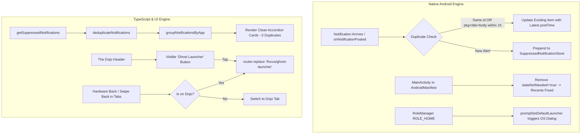

# Master Implementation Plan: Notification Deduplication & Universal Ghost Launcher Home

**Document Version:** 1.0.0  
**Date:** November 18, 2026  
**Target Hardware:** Motorola Moto G62 5G (`ZD2228X6QH`), Android 13/14  
**Status:** Ready for Review & Implementation  

---

## 1. Executive Summary & Root Cause Breakdown

Based on the 3 screenshots and feedback provided:
1. **Screenshot 1 (`media_1794980716327_bf53366f.jpg`): Notification Duplication**
   - In Notification Vault, every single alert has an exact duplicate (e.g. 2 x "Narasimha Naidu Accepted your invite", 2 x "30° in Chennai", 2 x "Weather in Chennai", 2 x "24° in Chennai").
   - **Root Cause:** In native `NinjaNotificationListener.kt`, `suppressExistingNotifications()` runs on listener connect/rebind and re-processes all active notifications. When `onNotificationPosted` executes, `SuppressedNotificationStore.addNotification` blindly prepends the item to the `JSONArray` with zero deduplication or key checking. Additionally, ongoing notifications updated by apps (like Google Weather) trigger repeated callbacks. The TypeScript layer also had no deduplication pass.
2. **Screenshot 2 (`media_1794980743867_87721d1c.jpg`): The Dojo Back Navigation Trap**
   - When inside The Dojo (`src/app/(tabs)/index.tsx`) or tabs, pressing hardware back, swipe back, or looking for a back button fails to return to the Ghost Mode Launcher.
   - **Root Cause:**
     1. In `src/app/(tabs)/_layout.tsx`, the `hardwareBackPress` listener checked `if (settings.ghostLauncherAsHome || isDefaultHome)`—which defaults to `false`! Furthermore, if `router.canGoBack()` was true, it returned `false`, delegating to Android which cannot pop Expo Router tabs.
     2. In `The Dojo` header, there was NO visible back button or Ghost Launcher toggle.
     3. NeuroNinja's mental model treats Ghost Mode Launcher as the true logical home. The app failed to reflect this by dropping to the OEM launcher on back press.
3. **Screenshot 3 (`media_1794980808418_203eafd8.jpg`): Recents Switcher "No recent items" & Launcher Switching Failure**
   - Motorola's Recent Apps switcher shows "No recent items" with a transparent Dojo preview.
   - **Root Cause:**
     1. In `AndroidManifest.xml`, `android:stateNotNeeded="true"` was configured on `MainActivity`. In modern Android, this tells the window manager not to save activity state, causing task snapshots in the Recents overview to glitch or show "No recent items".
     2. In `ghost-launcher.tsx`, toggling "Default to Ghost Launcher" only wrote an AsyncStorage boolean; it did NOT call the Android OS `RoleManager.createRequestRoleIntent(RoleManager.ROLE_HOME)` or `ACTION_HOME_SETTINGS`, so the OS default home was never updated.

---

## 2. Competitor Benchmark & Architecture

| Feature | Before Launcher | Niagara Launcher | Regain / Daywise | **NeuroNinja (Target)** |
| :--- | :--- | :--- | :--- | :--- |
| **Notification Deduplication** | Signature hash `(pkg + title + text)` with 1h replacement window | Replaces ongoing notifications with same `sbn.key` or `sbn.id` | Batched digest groups with duplicate filter by postTime window | **Dual-Layer Engine:** Native key + signature deduplication + TypeScript UI cleansing |
| **Home Mental Model** | Minimal desktop is absolute root. Back from any app/view goes Home | Niagara list is root. Back always returns to list | Dashboard has back to Launcher | **Ghost Launcher is Logical Home:** Back on Dojo/Tabs ALWAYS routes to `/focus/ghost-launcher` |
| **Visible Home Control** | Top header always displays persistent Return button | Swipe or tap header returns to home | Persistent header action | **Sleek Header Pill:** `👻 Ghost Launcher` / `← Launcher` button in The Dojo header |
| **OS Launcher Switching** | Direct button triggers `RoleManager.ROLE_HOME` dialog | Direct button triggers Android Default Apps selector | N/A | **Direct Trigger:** Calling `promptSetDefaultLauncher()` and `openHomeSettings()` from UI |
| **Task Switcher Hygiene** | `launchMode="singleTask"`, `stateNotNeeded` omitted | `launchMode="singleTask"`, standard state saving | Standard activity | **Clean Manifest:** Remove `stateNotNeeded="true"` to restore Recents switching |

---

## 3. Detailed Implementation Architecture



---

## 4. Phase-by-Phase Execution Plan

### Phase 1: Native & JavaScript Dual-Layer Notification Deduplication
1. **Update `SuppressedNotificationStore.kt`**:
   - In `addNotification`:
     - Iterate through existing `stored_suppressed_items`.
     - Check if an item already exists with:
       - matching `id`, OR
       - matching `packageName` AND `title` AND `body` (case-insensitive trim).
     - If match found: Replace the existing entry with the newest `postTime` and `formattedTime` (or skip if identical `postTime`).
     - If no match found: Prepend new item and enforce `MAX_ITEMS = 300`.
   - In `getNotifications`:
     - Deduplicate output list using a LinkedHashMap keyed by `"${item.packageName}:::${item.title.trim()}:::${item.body.trim()}"`.
2. **Update `NinjaNotificationListener.kt`**:
   - In `suppressExistingNotifications()`: Ensure it only processes unique notifications and skips already suppressed items.
3. **Update `src/services/notifications/notification-grouper.ts`**:
   - Add `deduplicateNotifications(notifications: SuppressedNotification[]): SuppressedNotification[]`:
     - Creates a Set/Map of content signatures `"${n.packageName}:::${n.title?.trim()}:::${n.body?.trim()}"`.
     - Keeps only the latest occurrence.
   - Run `deduplicateNotifications` before `groupNotificationsByApp` and inside `paginateList`.

---

### Phase 2: Universal Ghost Launcher Back Navigation & The Dojo Header Button
1. **Update `src/app/(tabs)/_layout.tsx`**:
   - Overhaul `hardwareBackPress` listener:
     - Remove restrictive `if (settings.ghostLauncherAsHome || isDefaultHome)` check. NeuroNinja's logical home is Ghost Launcher!
     - When Back is pressed on the root Dojo tab:
       ```tsx
       router.replace('/focus/ghost-launcher' as any);
       return true;
       ```
     - When Back is pressed on other tabs (Armory, Gates, LifeOS, Analytics, Settings):
       ```tsx
       router.navigate('/(tabs)' as any);
       return true;
       ```
2. **Update `src/app/(tabs)/index.tsx` (The Dojo)**:
   - In the header row (next to the logo or replacing the logo wrap):
     - Add a dedicated `<TouchableOpacity>` with a Ghost icon and label:
       ```tsx
       <TouchableOpacity 
         style={styles.launcherBackPill}
         onPress={() => router.replace('/focus/ghost-launcher' as any)}
         activeOpacity={0.7}
       >
         <MaterialCommunityIcons name="ghost" size={18} color="#00E699" />
         <Text style={styles.launcherBackText}>Launcher</Text>
       </TouchableOpacity>
       ```
     - Gives the user a permanent, 1-tap visible exit back to Ghost Mode Launcher.
3. **Update `src/hooks/use-ninja-back.ts`**:
   - Ensure the universal back hook defaults to `/focus/ghost-launcher` whenever `canGoBack()` is false.

---

### Phase 3: Android Recents Switcher & Launcher Switching Fix
1. **Update `android/app/src/main/AndroidManifest.xml`**:
   - Remove `android:stateNotNeeded="true"` from `MainActivity`.
   - Ensure `launchMode="singleTask"` and `windowSoftInputMode="adjustResize"` remain intact.
2. **Update `src/app/focus/ghost-launcher.tsx` Settings**:
   - In the "HOME BEHAVIOR" section:
     - When the user toggles "Default to Ghost Launcher":
       - If enabled, immediately call `promptSetDefaultLauncher()` to invoke Android's `RoleManager.createRequestRoleIntent(RoleManager.ROLE_HOME)`!
     - Add a direct button:
       `[ ⚙️ Switch Default Launcher (System Settings) ]`
       calling `openNormalLauncherSettings()` (`ACTION_HOME_SETTINGS` or `ACTION_MANAGE_DEFAULT_APPS_SETTINGS`).
     - Add an explicit button:
       `[ 🚪 Exit to System Launcher ]`
       allowing the user to minimize NeuroNinja or open the OEM launcher whenever they want to switch.

---

## 5. Verification & Test Plan on Physical Moto G62 5G

| Step | Action | Expected Result |
| :--- | :--- | :--- |
| **Test 1: Notification Deduplication** | Launch Notification Vault (`neuroninja:///notifications`) | Every notification group (e.g. Google, chat invites) displays **exactly 1 alert per message** with 0 duplicates. Count badges match distinct alerts. |
| **Test 2: Visible Dojo Header Return** | Navigate to The Dojo (`/(tabs)`) | Prominent `👻 Launcher` pill is visible in header. Tapping it returns immediately to Ghost Launcher. |
| **Test 3: Hardware / Swipe Back from Dojo** | While on The Dojo, press Android hardware Back or perform swipe-back gesture | Smoothly navigates to `/focus/ghost-launcher` without closing the app or hanging. |
| **Test 4: Hardware Back from Tabs** | From The Dojo, tap "Armory" or "LifeOS", then press Back | Navigates back to "The Dojo", and a second Back navigates to `/focus/ghost-launcher`. |
| **Test 5: Recent Apps Switcher (Recents)** | Swipe up into Recents overview | Motorola task switcher displays NeuroNinja card snapshot properly (no "No recent items" error). |
| **Test 6: Launcher Switching** | In Ghost Launcher Settings, tap "Switch Default Launcher" | Opens Android's Default Home app chooser dialog or system settings. |

---

## 6. Review & Next Steps
Please review this plan. Upon your confirmation, we will proceed to implement the changes, run TypeScript typecheck and linting, build the debug APK, install to the connected Motorola device, and capture visual proof for all 3 scenarios.
