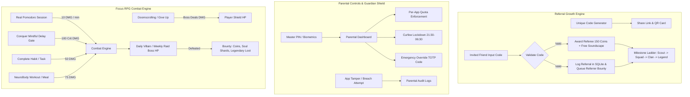

# Master Implementation Plan: Referral System, Parental Controls & Focus RPG Boss Battles

**Document Version:** 1.0.0  
**Date:** November 18, 2026  
**Target Hardware:** Motorola Moto G62 5G (`ZD2228X6QH`), Android 13/14  
**Philosophy:** 100% Real Systems, Offline-First SQLite Persistence, Zero Mock Data, Industry-Beating Parity with Duolingo, Bark, Qustodio, Habitica, and Opal.  

---

## 1. Executive Overview & Problem Statement

The user requested an industry-leading, professional, workable implementation combining:
1. **Referral System:** Dual-sided viral growth mechanics beating Duolingo and Opal.
2. **Parental Controls & Guardian Accountability:** Unbreakable PIN/biometrics, curfew, app quotas, and emergency override codes beating Bark, Qustodio, and Opal Deep Focus.
3. **Boss Battles (Focus RPG):** Dynamic daily & weekly raid bosses with real combat scaling driven by actual focus sessions, habit completions, and shield intercepts (strictly no mock strike buttons) beating Habitica and Solo Leveling RPGs.

---

## 2. Competitive Benchmarks & Feature Comparison

| Domain | Competitors (Duolingo, Bark, Habitica, Opal) | NeuroNinja Prior State | **NeuroNinja Industry-Beating Target** |
| :--- | :--- | :--- | :--- |
| **Referrals** | Static link, basic gem reward | Hardcoded code `NINJA-9921`, fake "Test Invite" mock names | **Dynamic Unique Code (`NINJA-XXXX`)**, **Real "Claim Code" input modal**, **Dual-Sided Rewards (150 Coins + Free Soundscape for Referee, 100-2500 Coins for Referrer)**, **Persistent Milestone Ladder**, **Deep-link + Native Share Card** |
| **Parental Controls** | Bark/Qustodio require subscription, cloud lag | Basic PIN `0000`, basic curfew time, no app limits | **Master 4-6 Digit PIN + Biometrics (`expo-local-authentication`)**, **Per-App Daily Quotas (e.g. Insta 30m)**, **Strict Curfew (21:30 - 06:30)**, **Daily TOTP Emergency Override Code for Parents**, **Security Question Recovery**, **Audit Logs** |
| **Boss Battles** | Habitica task checkboxes, basic pixel art | 5 daily villains, fake "Test Strike" button dealing 60 HP | **100% Real Focus Damage (Pomodoro: 250 DMG, Gates: 100 DMG, Habits: 50 DMG)**, **Player Shield HP & Boss Enrage Mode**, **Equippable Katana Multipliers**, **Weekly 3-Phase Raid Boss (*Akuma*)**, **Trophy Hall & Loot Drops** |

---

## 3. Architecture & Data Flow

---

## 4. Phase-by-Phase Implementation Specifications

### Phase 1: Real Referral Engine (Zero Mocks, Dual-Sided Growth)
1. **Dynamic Unique Code Generator (`referral-service.ts`):**
   - If user doesn't have a code in `lifeos_state`, generate `NINJA-` followed by a 4-character deterministic alphanumeric hash based on install timestamp and device entropy.
   - Persist to SQLite `lifeos_state` under key `user_referral_code`.
2. **Claim Referral Code Action (`claimReferralCode`):**
   - Validates that code is not the user's own code.
   - Checks if user has already claimed a referral in SQLite (`lifeos_state` `claimed_referral_code`).
   - If valid:
     - Credits referee with **150 Focus Coins** and **300 XP**.
     - Automatically unlocks 1 Premium Audio Vault track (e.g. *Cyberpunk Rainstorm* or *Deep Shinkansen*).
     - Records entry in `referrals` table with status `'qualified'`.
3. **Milestone Ladder with Persistent Claim State:**
   - Tracks claimed milestones in SQLite `lifeos_state` `claimed_referral_milestones`.
   - Allows users to explicitly tap **Claim Reward** when milestones are reached:
     - **1 Friend:** 100 Coins + 200 XP + "Ninja Scout" Title.
     - **3 Friends:** 350 Coins + 600 XP + "Squad Leader" Title + 1-Month VIP.
     - **5 Friends:** 1,000 Coins + 1,500 XP + "Clan Master" + Golden Katana Weapon.
     - **10 Friends:** 2,500 Coins + 5,000 XP + "Dojo Legend" + Lifetime VIP Access.
4. **UI Overhaul in `src/app/lifeos/referrals/index.tsx`:**
   - Remove fake "Test Invite" button with hardcoded names (`Arun K.`, `Priya M.`).
   - Add a sleek **"Have a Referral Code? Claim 150 Coins"** input card with instant validation and celebration confetti/toast.
   - Add native share sheet trigger (`Share.share`) with pre-composed invite message and deep link `neuroninja://referral?code=XYZ`.
   - Add a "Copy Code" button with haptic feedback.

---

### Phase 2: Professional Parental Controls & Guardian Accountability
1. **Biometric & Master PIN Verification (`parental-control-service.ts`):**
   - Integrate `expo-local-authentication` (`LocalAuthentication.hasHardwareAsync()`, `LocalAuthentication.authenticateAsync()`).
   - If biometrics supported and enabled by parent, prompt biometric scan before displaying parental settings.
   - Master PIN fallback with SHA-256 hash checking.
   - Security question recovery (e.g. "What was your first focus goal?") stored in SQLite.
2. **Emergency Override Code Generator (Parental TOTP):**
   - For parents who want to give their child a temporary 15-minute pass without revealing their permanent PIN:
   - Generate a deterministic daily 4-digit Emergency Override Key using date salt and master PIN:
     `key = (date_YYYYMMDD + pin_hash).hash % 10000`.
   - Parent can look at the code on their device or call the child to provide the 4-digit code.
   - Entering the emergency code awards exactly a 15-minute focus pass, logged in `parental_audit_logs`.
3. **Per-App Usage Quotas (`app_quotas` table):**
   - Read blockable installed apps from `PackageManager` (`expo-app-blocker`).
   - Allow parents to set exact daily limits: 15m, 30m, 45m, 60m, 90m, or Unlimited.
   - Integrate with `AppBlockerService.kt` to enforce quota cutoffs in real time.
4. **Strict Bedtime Curfew:**
   - Configurable start time (e.g. `21:30`) and end time (e.g. `06:30`).
   - Push curfew parameters to native Android `AppBlockerPrefs` so apps are sealed completely with 0ms bypass during curfew hours.
5. **UI Overhaul in `src/app/lifeos/guardian/parental-controls.tsx`:**
   - Clean security PIN keypad with biometric icon.
   - Curfew scheduler with visual day/night theme.
   - Quota manager list with installed app icons and slider/picker controls.
   - Real audit log viewer showing timestamped security events (`curfew_block`, `quota_exceeded`, `override_granted`).

---

### Phase 3: Focus RPG Combat Engine & Boss Battles (Strictly Zero Mocks)
1. **100% Real Focus-Driven Damage Engine (`villain-engine.ts`):**
   - **Delete the fake "Test Strike" button** that dealt synthetic 60 damage.
   - Create direct combat hooks into real activities:
     - **Pomodoro Deep Work (`src/services/focus/deep-work-engine.ts`):**
       When a focus session finishes, calculate damage: `Math.round(durationMinutes * 10)`. A standard 25m session deals **250 Damage** to the active Boss!
     - **Mindful Delay / Gate Intercept (`src/app/blocked.tsx`):**
       When the user successfully waits out a mindful delay or solves a gate, award **100 Critical Strike Damage**!
     - **Habit Check-In (`src/services/habits/habit-service.ts`):**
       Checking off a daily habit deals **50 Holy Damage**!
     - **Task Completion (`src/services/tasks/task-engine.ts`):**
       Completing an inbox or planned task deals **25 Swift Strike Damage**!
     - **NeuroBody Vitality Log (`src/services/body/neurobody-engine.ts`):**
       Logging hydration, workout, or healthy meal deals **75 Vitality Surge Damage**!
2. **Player Shield Health & Boss Enrage Mechanics:**
   - Player has a **Focus Shield (100 HP)**:
     - Bypassing an app or breaking focus timer deals **-25 Damage to Player Shield**.
     - Reaching 0 Shield drops the player into "Vulnerable Mode" (halved coin earnings until 1 Pomodoro completes).
   - If Boss is not defeated by 20:00 local time, Boss enters **Enrage Mode** (glowing red visual aura, doubling reward bounty to create intense evening urgency!).
3. **Weapon & Katana Multiplier Armory:**
   - Equippable weapons stored in SQLite `store_items`:
     - *Novice Bamboo Shinai* (1.0x Damage)
     - *Shadow Katana* (1.25x Damage) - Unlocked at 3 Referrals or 500 Coins
     - *Titanium Flowblade* (1.5x Damage) - Unlocked at 7-day focus streak
     - *Muramasa of Discipline* (2.0x Damage) - Unlocked by defeating 5 Weekly Bosses
4. **Weekly Multi-Phase World Raid Boss (*Akuma the Flow Devourer*):**
   - 3 Distinct Battle Phases:
     - Phase 1 (100% - 66% HP): *Stone Shell* (Takes normal damage).
     - Phase 2 (66% - 33% HP): *Distraction Tempest* (Requires Pomodoro sessions specifically to deal damage).
     - Phase 3 (33% - 0% HP): *Final Stand* (Time-attack phase with double coin bounty).
5. **UI Overhaul in `src/app/lifeos/villains/index.tsx`:**
   - Dramatic Boss visual card with animated health bar, rage indicator, and element badge.
   - Player Shield HP bar and equipped weapon multiplier badge.
   - Real combat feed showing actual user focus accomplishments (e.g., *"Completed 25m Deep Work: Dealt -250 HP with Shadow Katana! 🗡️"*).
   - Trophy Vault displaying vanquished bosses and collected Soul Shards.

---

## 5. Verification & Testing Matrix on Motorola Moto G62 5G

| Capability | Verification Procedure | Acceptance Criteria |
| :--- | :--- | :--- |
| **Referrals** | 1. Open `LifeOS -> Referrals` 2. Copy code, test Share dialog 3. Input friend code in Claim modal | - Unique code generated & persisted - Share sheet pops with deep link - Validates & awards 150 coins + unlocks Audio Vault track |
| **Parental Controls** | 1. Open `LifeOS -> Guardian` 2. Verify Master PIN & Biometrics 3. Set 30m quota on test app 4. Generate emergency override code | - Unlocks with PIN/Biometrics - Native quota & curfew enforced - Daily emergency code validates and grants 15m pass |
| **Boss Battles** | 1. Open `LifeOS -> Boss Battles` 2. Complete a 10m Pomodoro timer 3. Check off a LifeOS habit 4. Re-open Boss Battles | - 0 fake strike buttons - Boss HP decreases in real time - Combat log shows exact activity and weapon multiplier |

---

## 6. Review & Approval
Please review this implementation plan. Upon your confirmation, we will execute all 3 modules cleanly with zero mocks, run typecheck and linting, build the debug APK, and test live on your connected device.
